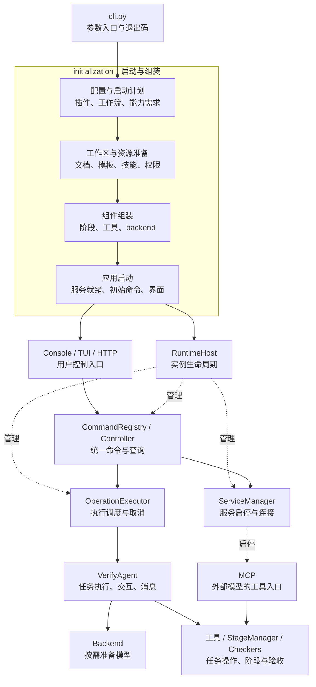

# CLI / VerifyAgent 重构方案

> 状态：待实施；本文只定义方案。范围限定为启动与实例组装，复用此前完成的 `control/` 架构。

## 1. 目标与边界

当前 `cli.py`（约 1700 行）混合参数、配置、插件、工作区、服务和界面启动；`VerifyAgent.__init__`（约 700 行、37 个参数）同时准备文件、组装阶段/工具并初始化后端，导致启动顺序难以验证、失败清理分散，MCP 等入口仍可能被主模型初始化阻塞。

目标：**启动过程分步可测，Agent 聚焦任务执行，RuntimeHost 统一管理实例生命周期，各入口使用同一套运行对象。**

- 保留现有 CLI 参数、平铺调用形式、公开构造接口、配置优先级和插件协议；参数分类只调整组织与帮助展示，不新增子命令；迁移完成后删除原位置的重复实现。
- 保留 Check/Complete、证据检查、历史记录及人工/模型审核门槛，不借重构调整验收规则。
- 不重构整个仓库，不新增守护进程、远程 TUI 或插件框架；禁止 `try import` 与兜底导入。
- R00～R05 调整结构并修正依赖校验、失败清理；R06 单列模型启动行为变化；R07 集成验收。

## 2. 预期目录与职责

```text
ucagent/
├── cli.py                   # 公开入口、错误呈现、退出码
├── verify_agent.py          # 单轮执行、交互策略、消息与统计
├── initialization/          # 新增：从输入到可运行实例的启动流程
│   ├── __init__.py
│   ├── arguments.py         # 参数分组、帮助展示、解析与语法校验
│   ├── actions.py           # 自检、升级、hook、插件列举等管理操作
│   ├── workspace.py         # 工作区来源、压缩包、临时目录
│   ├── configuration.py     # 插件/工作流解析、最终配置、启动计划
│   ├── resources.py         # Guide_Doc、模板、技能、指令文件、权限
│   ├── assembly.py          # 阶段、工具、后端的依赖组装
│   └── application.py       # 连接运行层、启动服务/界面、启动失败清理
├── control/                 # 复用：统一命令、Console 与 runtime/
├── abackend/                # 复用；R06 调整模型准备时机
└── stage/ tools/ plugins/ server/ tui/   # 保留现有职责与目录
```

`assembly.py` 协调上述模块和现有组件，不承接另一份大构造函数。CLI 与直接构造 `VerifyAgent` 共用同一条配置、资源、组件组装路径；公开构造器只作薄入口，禁止两套初始化逻辑或构造器与组装器互相递归。

## 3. 启动契约

1. **先分流**：解析参数后识别管理命令；无需任务的操作直接结束，不构造 Agent。
2. **配置只有一个最终结果**：保留“发现插件/选定工作流 → 合并最终配置”的必要两阶段处理；复用现有加载器，依赖校验依据最终 backend，而非仅看 CLI 参数。
3. **启动计划只存数据**：记录启动用途、backend、Console/TUI/无界面、服务清单、初始命令及模型能力需求；不新增运行状态机。主模型、embedding、审核/失败建议分别判定依赖。
4. **按依赖组装**：准备工作区和资源，组装阶段/工具/后端，绑定 Agent，再接入 RuntimeHost；保持工具绑定、阶段初始化和历史恢复的有效顺序。
5. **服务就绪后执行命令**：保持初始命令顺序；尤其命令行 backend 依赖的 MCP 必须先 ready。`--emulate-config` 仍遍历阶段并执行检查，不改成仅解析 YAML。
6. **清理责任有交接点**：RuntimeHost 接管前由启动流程登记并逆序清理已创建资源；接管后由现有 Host/ServiceManager 清理，避免遗漏或重复关闭。恢复本次临时权限调整，保留任务输出。
7. **退出语义保持**：TUI 的 `q` 脱离界面；Console 退出及 `shutdown` 关闭实例；继续保留取消、完成退出和 Master 生命周期规则。

### R06：明确的行为调整

| 场景 | 预期行为 |
|---|---|
| MCP 服务，未要求内部模型执行 | 启动工具服务并等待；不因无界面而自动提交 `continue`，不创建或探测主模型 |
| MCP + `--loop` 或显式模型执行命令 | 按最终配置准备 backend，依赖不满足时明确报错 |
| Console/TUI 启动后仅查询状态或调用确定性工具 | 不连接主模型；首次模型工作前准备一次，状态查询不能触发初始化 |
| 无服务、无界面的普通任务 | 保留默认自动执行 |
| `--backend blank` | 可以使用其支持的工具/服务，内部模型执行命令明确拒绝 |
| 显式启用 embedding、模型审核或失败建议 | 按各自能力验证依赖；不静默关闭验收门槛，也不自动降级为 blank |

后端对象创建与模型准备分离：沿用命令行 backend 已有的延后准备机制；调整 LangChain 的模型创建/API 探测时机。消息与上下文工具须处理“模型尚未准备”的状态，不能因注册或查询而连接模型。无主模型配置的 MCP 验收使用不依赖模型的工具和检查器，不承诺任意工作流都没有模型依赖。

## 4. 执行批次

按 **R00 → R01 → R02 → R03 → R04 → R05 → R06 → R07** 执行；每批交付可独立评审的修改和测试结果，相关测试通过后进入下一批。

| 批次 | 增 / 移 / 改 / 删 | 可验证的批次结果 |
|---|---|---|
| **R00 基线** | 新增 `tests/test_initialization.py`，覆盖启动组合、配置覆盖、初始命令顺序、退出和异常清理；补充参数主名/别名、默认值、可选值、重复传参顺序及显式指定状态的解析基线；将拟修正行为单独列出。 | 现有合法调用有回归依据；不固定旧 help 的排版，不把已知错误固定为永久契约；后续批次加入修正后的目标断言。 |
| **R01 CLI 拆分与参数分类** | 新增 `initialization/__init__.py`、`arguments.py`、`actions.py`、`workspace.py`；参数在同一文件按下表用 `add_argument_group()` 分组，解析入口支持传入参数列表；精简 help 用法说明并补常见示例；迁移管理操作和工作区处理，删除原实现。 | R00 解析基线通过；公开参数均出现在对应帮助组，隐藏参数继续隐藏；hook、插件列举、压缩包路径保护一致；无需任务的管理命令不构造 Agent。 |
| **R02 配置与计划** | 新增 `configuration.py` 和启动计划数据结构；集中插件发现、工作流选择、最终配置及跨参数/能力校验；`arguments.py` 保留输入语法校验；CLI/Agent 接入共享路径，删除重复解析与分散推断。 | 参数与配置优先级一致；配置文件选出的 backend 同样受依赖校验；保留 TUI、MCP、HTTP 等现有合法组合，不把帮助分组当互斥模式；Master、工作流及资源路径解析正确。 |
| **R03 资源准备** | 新增 `resources.py`；迁移 Guide_Doc、模板、技能、指令文件及权限处理；输出准备结果和清理记录，删除构造器内对应实现。 | 临时工作区的文件内容、覆盖/冲突规则、只读保护和路径限制一致；失败不会遗留本次临时权限修改。 |
| **R04 组件组装** | 新增 `assembly.py`；提取阶段、工具、插件扩展和 backend 的组装；精简 `VerifyAgent.__init__`，运行方法保留；移除被替代的初始化代码。 | CLI 与直接构造得到一致的组件关系；工具注册、Check/Complete、历史恢复、状态查询及 ACT4/RTL2Spec 调用正常；本批保持原模型初始化时机。 |
| **R05 应用生命周期** | 新增 `application.py`；迁移 CLI 中 Host/Session/Console 创建、服务启动、界面选择和初始命令执行；登记启动清理并交接 Host，删除重复清理路径。 | 在资源准备、组装、端口绑定、服务启动、初始命令处注入失败，均无遗留监听/工作线程；服务 ready 顺序、取消、TUI 脱离和实例退出符合契约。 |
| **R06 按需模型** | 修改 `configuration.py` 的执行策略、`assembly.py` 的后端绑定及受影响的 Agent/backend 方法；分离 LangChain 客户端创建与准备；改掉仅凭服务模式自动触发模型工作的规则。 | 假模型调用计数证明：纯 MCP/状态查询零创建、零探测；首次执行只准备一次；错误配置在需要该能力时准确失败；审核门槛和命令行 backend 就绪顺序不退化。 |
| **R07 集成交付** | 补齐跨入口、Master、插件和故障回归；同步 CLI 参数参考的分组、简短说明与示例，并更新受影响的启动/运行控制/backend 专题文档及架构说明；删除失效测试替身、重复帮助函数和旧说明。 | 定向测试及框架/相关插件回归通过；help、参数参考和实际解析一致；人工验证现有命令示例及同一实例的 Console/TUI/HTTP 控制、MCP 工具、停止/退出与无模型 MCP 启动。 |

### R01 参数分组与兼容约束

以下列出当前参数主名；短别名及自动生成的帮助/反向开关继续保留。所有分组在 `arguments.py` 内组织，不按组新建文件或参数框架。

| 帮助分组 | 参数 |
|---|---|
| 任务与工作区 | `workspace`、`dut`、`--workspace-base`、`--output` |
| 配置与工作流 | `--config`、`--override`、`--plugin`、`--plugin-workflow` |
| 执行与模型 | `--backend`、`--loop`、`--loop-msg`、`--interaction-mode`、`--icmd`、`--exit-on-completion`、`--seed`、`--sys-tips` |
| 界面与显示 | `--human`、`--tui`、`--stream-output`、`--web-console`、`--web-terminal` |
| 阶段与历史 | `--force-stage-index`、`--skip`、`--unskip`、`--ref`、`--no-history` |
| 文档、模板与文件保护 | `--template-dir`、`--template-overwrite`、`--template-cfg-override`、`--guid-doc-path`、`--gen-instruct-file`、`--no-write` |
| 工具与技能 | `--ex-tools`、`--no-embed-tools`、`--use-skill`、`--extra-skill-path`、`--use-todo-tools`、`--force-todo`、`--enable-context-manage-tools`、`--append-py-path` |
| MCP 与 HTTP 服务 | `--mcp-server`、`--mcp-server-no-file-tools`、`--mcp-server-host`、`--mcp-server-port`、`--export-cmd-api` |
| Master 管理与连接 | `--as-master`、`--as-master-key`、`--as-master-password`、`--as-master-persist`、`--master`、`--client-id` |
| 日志与记录 | `--log`、`--log-file`、`--msg-file` |
| 检查与管理操作 | `--version`、`--check`、`--upgrade`、`--list-plugins`、`--validate-plugin`、`--emulate-config`、`--hook-message` |

- **内部传参**：`--meta`、`--web-console-session-host`、`--web-console-session-port`、`--web-console-capture-path` 在代码中集中放置，保持 help 隐藏及现有用途。
- **解析契约**：保留类型、默认值、可选值、别名、重复参数顺序与配置覆盖关系；重点验证 `--as-master` 未传/不带地址传入、`--use-skill` 未指定/显式开关的区别；不调整 `--no-embed-tools false` 等现有语法。
- **帮助与行为**：简短说明角色和依赖，例如 `--as-master` 启动 Master、`--master` 连接 Master；较长用法留给专题文档。分组不改变执行策略，`--emulate-config` 仍按启动契约执行检查。

### 测试入口

以下为实施后的命令，在 `UCAgent/` 内使用项目测试环境执行。`tests/test_initialization.py` 自 R00 新增并逐批补充，包含 R00/R01 的解析基线、帮助分组与隐藏参数用例；R02 补充最终配置下的依赖和合法组合测试。新增用例用临时工作区和假模型，服务就绪用本机端口验证，不调用真实外部模型。

```bash
# R00；之后每批先跑该文件，再跑本批的相关回归
python -m pytest -q tests/test_initialization.py
# R01
python -m pytest -q tests/test_cli_argument_dependencies.py tests/test_cli_hook_message.py tests/test_workspace_archive.py tests/test_plugins.py
# R02
python -m pytest -q tests/test_config_loader.py tests/test_cli_argument_dependencies.py tests/test_plugin_runtime_extensions.py tests/test_master_runtime.py
# R03
python -m pytest -q tests/test_verify_agent_instructions.py tests/test_refresh_workspace_assets.py tests/test_plugin_runtime_extensions.py
# R04
python -m pytest -q tests/test_verify_agent_runtime.py tests/test_runtime_stage_control.py ucagent/plugins/ACT4/tests ucagent/plugins/RTL2Spec/tests
# R05
python -m pytest -q tests/test_runtime_cli.py tests/test_runtime_host.py tests/test_runtime_services.py tests/test_runtime_shutdown.py tests/test_runtime_frontends.py
# R06
python -m pytest -q tests/test_cli_argument_dependencies.py tests/test_cmdline_backend.py tests/test_mcps.py tests/test_langchain_openai_api_mode.py tests/test_langchain_message_accounting.py tests/test_langchain_tool_recovery.py
# R07：限定目录，避免收集生成工作区和未渲染模板
python -m pytest -q tests ucagent/plugins/ACT4/tests ucagent/plugins/RTL2Spec/tests ucagent/plugins/UnityTest/tests ucagent/plugins/Formal/tests ucagent/plugins/DesignWithPPA/tests
git diff --check
```

R07 人工验收重点：普通任务默认执行；TUI `q` 后任务/服务仍在；Console `shutdown` 回收实例；HTTP 与 Console/TUI 操作同一状态；MCP 在不配置主模型时可执行确定性工具；显式模型执行缺配置时可定位报错。历史恢复、配置演练及启用审核的工作流也须验证。

## 5. 预期架构

实线表示启动/调用关系，虚线表示运行期管理关系。`initialization` 负责把实例启动起来；运行后的任务、服务和退出仍由既有 `control/runtime` 管理。MCP 通过工具接口接入同一任务，并非 Console 的附属界面。


