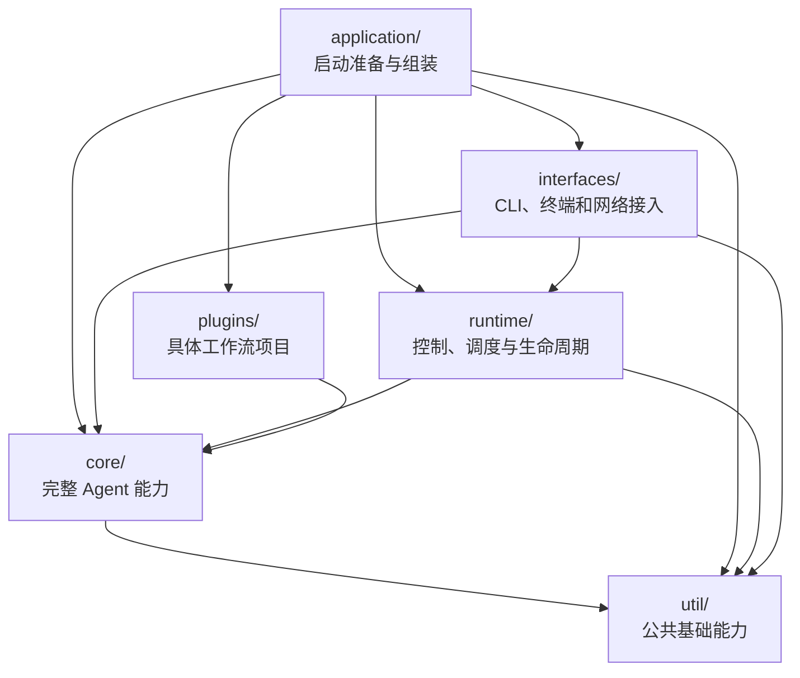

# UCAgent 启动与目录架构

> 状态：启动重构 R00～R07 已完成；本轮 core/application/runtime/interfaces 目录重组已完成；最终 pytest 为 2543 passed、80 skipped、0 failed。范围限定为启动与实例组装，复用此前完成的 `control/` 架构；ACT4、RTL2Spec 仅同步公共导入和启动路径，不做功能调整或回归。

## 1. 目标与边界

启动重构前的 CLI（约 1700 行）混合参数、配置、插件、工作区、服务和界面启动；`VerifyAgent.__init__`（约 700 行、37 个参数）同时准备文件、组装阶段/工具并初始化后端，导致启动顺序难以验证、失败清理分散，MCP 等入口仍可能被主模型初始化阻塞。

目标：**启动过程分步可测，Agent 聚焦任务执行，RuntimeHost 统一管理实例生命周期，各入口使用同一套运行对象。**

- 保留现有 CLI 参数、平铺调用形式、公开构造接口、配置优先级和插件协议；参数分类只调整组织与帮助展示，不新增子命令；迁移完成后删除原位置的重复实现。
- 保留 Check/Complete、证据检查、历史记录及人工/模型审核门槛，不借重构调整验收规则。
- 不重构整个仓库，不新增守护进程、远程 TUI 或插件框架；禁止 `try import` 与兜底导入。
- R00～R05 调整结构并修正依赖校验、失败清理；R06 单列模型启动行为变化；R07 集成验收。

## 2. 当前目录与职责

```text
ucagent/
├── __init__.py                 # from ucagent import VerifyAgent
├── __main__.py                 # python -m ucagent
├── setting.yaml                # 全局默认配置
├── core/                       # 完整 Agent 能力
│   ├── agent/                  # 执行、配置、自有组件构造
│   ├── backends/               # 模型与命令行后端，assets/ 保存配置模板
│   ├── interaction/            # 现有增强交互和工具编排策略
│   ├── stage/                  # 阶段、历史和审核
│   ├── checkers/               # 通用验收与批次引擎
│   ├── tools/                  # 完整通用工具
│   ├── workspace/              # 资源与权限恢复
│   ├── plugins.py              # 插件机制
│   └── locales/zh.yaml         # 中文框架语言配置
├── application/                # entry、preparation、plan、launch、workspace
│   └── presets/zh/master.yaml  # Master 应用预设
├── runtime/                    # Host、操作、服务、会话、输出、启动命令
│   └── control/                # Controller 与命令分派
├── interfaces/
│   ├── cli/                    # 参数、管理操作、启动数据转换
│   ├── terminal/               # Console、展示与 tui/
│   └── server/                 # HTTP、MCP、Master、Web Terminal 及页面资源
├── plugins/                    # 各工作流项目及完整配套资源
├── util/                       # 共享基础能力
└── scripts/                    # 独立辅助脚本
```

应用入口调用 CLI 解析并建立启动请求，连接核心、运行时和接入组件。运行时通过传入的服务构造器和展示回调管理实例，不反向导入接口实现。核心不导入应用、运行时或接入层。工作流及资源仍按同一任务契约解析和准备，所有具体插件项目继续独立保存。

公开 Python 构造保持 `from ucagent import VerifyAgent`；命令行使用 `ucagent`、`python -m ucagent` 或源码根目录 `ucagent.py`。语言配置与后端资源按新位置加载，不保留旧目录查找分支。

## 3. 启动契约

1. **先分流**：解析参数后识别管理命令；无需任务的操作直接结束，不构造 Agent。
2. **工作流与配套资源统一准备**：内部顺序为“确定工作区 → 发现插件并选定工作流及配套资源 → 合并最终配置 → 校验并落地资源”。先确定工作区以读取工作区配置；复用现有加载器，保留发现/选择与最终配置合并的必要处理。已激活插件的共享资源和显式附加资源按现有规则纳入同一解析结果；资源落地只消费该结果及最终配置，不重新选择工作流、加载配置或推断资源来源。输出路径、模板上下文、技能开关、文档覆盖及文件保护规则均在写入前确定；无工作流的启动仍按最终配置准备所需资源，不强制绑定工作流。
3. **启动计划只存数据**：由最终配置和启动参数派生，记录启动用途、backend、Console/TUI/无界面、服务清单、初始命令及模型能力需求；作为任务准备的独立数据结果，不属于工作流资源声明，也不新增运行状态机。依赖校验依据最终 backend 和实际能力需求；主模型、embedding、审核/失败建议分别判定依赖。
4. **按依赖组装**：任务准备统一交付最终配置、选定工作流及插件扩展引用、资源准备结果、启动计划和清理记录；组件组装复用这些结果，组装阶段/工具/后端，绑定 Agent，再接入 RuntimeHost。资源准备失败不得继续组装；保持工具绑定、阶段初始化和历史恢复的有效顺序。
5. **服务就绪后执行命令**：保持初始命令顺序；尤其命令行 backend 依赖的 MCP 必须先 ready。`--emulate-config` 仍遍历阶段并执行检查，不改成仅解析 YAML。
6. **清理责任有交接点**：RuntimeHost 接管前由启动流程登记并逆序清理已创建资源；接管后由现有 Host/ServiceManager 清理，避免遗漏或重复关闭。恢复本次临时权限调整，保留任务输出。
7. **退出语义保持**：TUI 的 `q` 脱离界面；Console 退出及 `shutdown` 关闭实例；继续保留取消、完成退出和 Master 生命周期规则。

### R06：明确的行为调整

| 场景 | 预期行为 |
|---|---|
| MCP 服务，未要求内部模型执行 | 启动工具服务并等待；不因无界面而自动提交 `continue`，不创建或探测主模型 |
| MCP + `--loop` 或显式模型执行命令 | 按最终配置准备 backend，依赖不满足时明确报错 |
| Console/TUI 启动后仅查询状态或调用确定性工具 | 不连接主模型；首次模型工作前准备一次，状态查询不能触发初始化 |
| 无服务、无界面的普通任务 | 保留默认自动执行 |
| `--backend blank` | 可以使用其支持的工具/服务，内部模型执行命令明确拒绝 |
| 显式启用 embedding、模型审核或失败建议 | 按各自能力验证依赖；不静默关闭验收门槛，也不自动降级为 blank |

后端对象创建与模型准备分离：沿用命令行 backend 已有的延后准备机制；调整 LangChain 的模型创建/API 探测时机。消息与上下文工具须处理“模型尚未准备”的状态，不能因注册或查询而连接模型。无主模型配置的 MCP 验收使用不依赖模型的工具和检查器，不承诺任意工作流都没有模型依赖。

## 4. 执行批次

按 **R00 → R01 → R02 → R03 → R04 → R05 → R06 → R07** 执行；每批交付可独立评审的修改和测试结果，相关测试通过后进入下一批。R02/R03 分批实现同一“任务准备”步骤的解析与资源落地；R04 将其与 R01 的工作区准备接入统一入口。ACT4、RTL2Spec 不纳入功能调整和回归，仅同步目录迁移必需的公共引用。

| 批次 | 增 / 移 / 改 / 删 | 可验证的批次结果 |
|---|---|---|
| **R00 基线** | 新增 `tests/test_initialization.py`，覆盖启动组合、配置覆盖、初始命令顺序、退出和异常清理；补充参数主名/别名、默认值、可选值、重复传参顺序及显式指定状态的解析基线；将拟修正行为单独列出。 | 现有合法调用有回归依据；不固定旧 help 的排版，不把已知错误固定为永久契约；后续批次加入修正后的目标断言。 |
| **R01 CLI 拆分与参数分类** | 新增 `application/__init__.py`、`application/cli/arguments.py`、`application/cli/actions.py`、`workspace/source.py`；参数在同一文件按下表用 `add_argument_group()` 分组，解析入口支持传入参数列表；精简 help 用法说明并补常见示例；迁移管理操作和工作区处理，删除原实现。 | R00 解析基线通过；公开参数均出现在对应帮助组，隐藏参数继续隐藏；hook、插件列举、压缩包路径保护一致；无需任务的管理命令不构造 Agent。 |
| **R02 任务准备：解析与计划** | 新增 `application/preparation.py`、`application/plan.py` 及启动计划数据结构；集中插件发现、工作流及配套资源解析、最终配置及跨参数/能力校验，整体传递工作流、配置与资源清单；`application/cli/arguments.py` 保留输入语法校验；CLI/Agent 接入共享解析路径，删除重复解析与分散推断。 | 参数与配置优先级一致；选定工作流与配套资源对应，切换工作流不会混入未选工作流的资源；配置文件选出的 backend 同样受依赖校验；保留 TUI、MCP、HTTP 等现有合法组合，不把帮助分组当互斥模式；Master、工作流及资源路径解析正确。 |
| **R03 任务准备：资源落地** | 新增 `workspace/assets.py` 和 `workspace/permissions.py`，只消费 R02 的解析结果和最终配置；迁移 Guide_Doc、模板、技能、指令文件及权限处理，不重复选择工作流或加载配置；输出资源准备结果和清理记录，删除构造器内对应实现。 | 资源落地使用同一份最终配置，输出路径、技能开关及覆盖规则生效；临时工作区的文件内容、覆盖/冲突规则、只读保护和路径限制一致；失败不会遗留本次临时权限修改。 |
| **R04 组件组装** | 新增 `agent/construction.py`，建立共用的任务准备入口并将准备结果传给组件组装；提取阶段、工具、插件扩展和 backend 的组装；精简 `VerifyAgent.__init__`，运行方法保留；移除被替代的初始化代码。 | CLI 与直接构造复用同一任务准备路径及结果，得到一致的组件关系；工具注册、Check/Complete、历史恢复和状态查询正常；本批保持原模型初始化时机。 |
| **R05 应用生命周期** | 新增 `application/launch.py`；迁移 CLI 中 Host/Session/Console 创建、服务启动、界面选择和初始命令执行；登记启动清理并交接 Host，删除重复清理路径。 | 在资源准备、组装、端口绑定、服务启动、初始命令处注入失败，均无遗留监听/工作线程；服务 ready 顺序、取消、TUI 脱离和实例退出符合契约。 |
| **R06 按需模型** | 修改 `application/preparation.py` 和 `application/plan.py` 的执行策略、`agent/construction.py` 的后端绑定及受影响的 Agent/backend 方法；分离 LangChain 客户端创建与准备；改掉仅凭服务模式自动触发模型工作的规则。 | 假模型调用计数证明：纯 MCP/状态查询零创建、零探测；首次执行只准备一次；错误配置在需要该能力时准确失败；审核门槛和命令行 backend 就绪顺序不退化。 |
| **R07 集成交付** | 补齐跨入口、Master、插件和故障回归；同步 CLI 参数参考的分组、简短说明与示例，并更新受影响的启动/运行控制/backend 专题文档及架构说明；删除失效测试替身、重复帮助函数和旧说明。 | 定向测试及框架/相关插件回归通过；help、参数参考和实际解析一致；人工验证现有命令示例及同一实例的 Console/TUI/HTTP 控制、MCP 工具、停止/退出与无模型 MCP 启动。 |

### R01 参数分组与兼容约束

以下列出当前参数主名；短别名及自动生成的帮助/反向开关继续保留。所有分组在 `application/cli/arguments.py` 内组织，不按组新建文件或参数框架。

| 帮助分组 | 参数 |
|---|---|
| 任务与工作区 | `workspace`、`dut`、`--workspace-base`、`--output` |
| 配置与工作流 | `--config`、`--override`、`--plugin`、`--plugin-workflow` |
| 执行与模型 | `--backend`、`--loop`、`--loop-msg`、`--interaction-mode`、`--icmd`、`--exit-on-completion`、`--seed`、`--sys-tips` |
| 界面与显示 | `--human`、`--tui`、`--stream-output`、`--web-console`、`--web-terminal` |
| 阶段与历史 | `--force-stage-index`、`--skip`、`--unskip`、`--ref`、`--no-history` |
| 文档、模板与文件保护 | `--template-dir`、`--template-overwrite`、`--template-cfg-override`、`--guid-doc-path`、`--gen-instruct-file`、`--no-write` |
| 工具与技能 | `--ex-tools`、`--no-embed-tools`、`--use-skill`、`--extra-skill-path`、`--use-todo-tools`、`--force-todo`、`--enable-context-manage-tools`、`--append-py-path` |
| MCP 与 HTTP 服务 | `--mcp-server`、`--mcp-server-no-file-tools`、`--mcp-server-host`、`--mcp-server-port`、`--export-cmd-api` |
| Master 管理与连接 | `--as-master`、`--as-master-key`、`--as-master-password`、`--as-master-persist`、`--master`、`--client-id` |
| 日志与记录 | `--log`、`--log-file`、`--msg-file` |
| 检查与管理操作 | `--version`、`--check`、`--upgrade`、`--list-plugins`、`--validate-plugin`、`--emulate-config`、`--hook-message` |

- **内部传参**：`--meta`、`--web-console-session-host`、`--web-console-session-port`、`--web-console-capture-path` 在代码中集中放置，保持 help 隐藏及现有用途。
- **解析契约**：保留类型、默认值、可选值、别名、重复参数顺序与配置覆盖关系；重点验证 `--as-master` 未传/不带地址传入、`--use-skill` 未指定/显式开关的区别；不调整 `--no-embed-tools false` 等现有语法。
- **帮助与行为**：简短说明角色和依赖，例如 `--as-master` 启动 Master、`--master` 连接 Master；较长用法留给专题文档。分组不改变执行策略，`--emulate-config` 仍按启动契约执行检查。

### 测试入口

以下为实施后的命令，在 `UCAgent/` 内使用项目测试环境执行。`tests/test_initialization.py` 自 R00 新增并逐批补充，包含 R00/R01 的解析基线、帮助分组与隐藏参数用例；R02 补充工作流与配套资源对应关系、最终配置下的依赖和合法组合测试；R03 验证资源落地复用解析结果及配置覆盖效果。新增用例用临时工作区和假模型，服务就绪用本机端口验证，不调用真实外部模型。

```bash
# R00；之后每批先跑该文件，再跑本批的相关回归
python -m pytest -q tests/test_initialization.py
# R01
python -m pytest -q tests/test_cli_argument_dependencies.py tests/test_cli_hook_message.py tests/test_workspace_archive.py tests/test_plugins.py
# R02
python -m pytest -q tests/test_config_loader.py tests/test_cli_argument_dependencies.py tests/test_plugin_runtime_extensions.py tests/test_master_runtime.py
# R03
python -m pytest -q tests/test_verify_agent_instructions.py tests/test_refresh_workspace_assets.py tests/test_plugin_runtime_extensions.py
# R04
python -m pytest -q tests/test_verify_agent_runtime.py tests/test_runtime_stage_control.py
# R05
python -m pytest -q tests/test_runtime_cli.py tests/test_runtime_host.py tests/test_runtime_services.py tests/test_runtime_shutdown.py tests/test_runtime_frontends.py
# R06
python -m pytest -q tests/test_cli_argument_dependencies.py tests/test_cmdline_backend.py tests/test_mcps.py tests/test_langchain_openai_api_mode.py tests/test_langchain_message_accounting.py tests/test_langchain_tool_recovery.py
# R07：限定目录，避免收集生成工作区和未渲染模板
python -m pytest -q tests ucagent/plugins/UnityTest/tests ucagent/plugins/Formal/tests ucagent/plugins/DesignWithPPA/tests
git diff --check
```

R07 人工验收重点：普通任务默认执行；TUI `q` 后任务/服务仍在；Console `shutdown` 回收实例；HTTP 与 Console/TUI 操作同一状态；MCP 在不配置主模型时可执行确定性工具；显式模型执行缺配置时可定位报错。历史恢复、配置演练及启用审核的工作流也须验证。

## 5. 目录对应的整体架构

实线表示启动/调用关系，虚线表示运行期管理关系。`application` 负责把实例启动起来；运行后的任务、服务和退出仍由既有 `control/runtime` 管理。MCP 通过工具接口接入同一任务，并非 Console 的附属界面。



## 6. 执行与验证记录

各批次修复失败后再进入下一批，未创建提交。测试先通过 `source .venv/bin/activate` 激活项目环境，使子进程也使用同一环境的 `pytest`；最终集成命令仍按上文限定测试目录，排除 ACT4、RTL2Spec。

| 批次 | 已验证结果 | 主要交付 |
| --- | --- | --- |
| R00 | 56 passed | 启动组合、参数契约、初始命令顺序和失败清理基线 |
| R01 | 93 passed | 参数帮助分组、显式 argv、管理操作和工作区处理迁移 |
| R02 | 139 passed | 工作流与配套资源统一解析、最终配置复用及 backend 依赖校验 |
| R03 | 100 passed | 文档、模板、技能和权限准备；资源失败后的原始权限恢复 |
| R04 | 115 passed | 共享任务与组件组装，精简构造器；框架、阶段及通用插件集成 |
| R05 | 97 passed | 应用启动与 Host 清理交接；故障注入、服务就绪、界面退出回归 |
| R06 | 170 passed | 按需模型准备；状态查询零创建/零探测，首次准备一次，真实 MCP 工具调用 |
| R07 | 2513 passed、80 skipped、0 failed | 参数参考及专题文档同步；真实无模型服务进程、导入审计和集成回归 |

R07 已修复源码文件直接执行时的包路径问题、TUI 卸载后的输出/定时器访问，以及 Console 在终端输入模式就绪前显示提示符的竞态。既有运行控制引用登记已同步到新模块和测试名称。测试门槛未放宽，未添加 `try import` 或兜底导入；模型创建工具中的依赖也使用明确导入。

最终全量回归耗时 233.35 秒；27 个本次涉及的源码与测试文件编译通过，差异与新增文件空白检查通过。

文档构建依赖当前未安装，未运行 MkDocs 构建。浏览器/Xpra、EDA 工具链、构建工具和部分仿真依赖的可选测试沿用既有环境跳过条件。

### 后续回归修复：DUT 共享库符号链接

`make test_Adder` 暴露权限记录对符号链接的一律拒绝，误伤工作区内 `_pyxspcomm.so -> _pyxspcomm.so.0.0.1`。已改为校验并记录真实目标的原始权限，同一目标的多个链接共享一份记录；目录遍历与实际 chmod 保持一致，正常退出和失败清理均恢复真实目标。指向工作区外部的目标仍拒绝，Guide_Doc 写入路径的链接限制保持原契约。

新增 6 项回归，相关启动、文件保护、资源和退出测试合计 143 passed。另复制当前真实 Adder DUT 包到临时目录，使用真实 CLI 和无模型 backend 完成启动及正常退出，确认链接保留、共享库权限恢复为 `0755`，原工作区未改动。该检查覆盖启动和清理，不执行模型验证循环。

## 7. 目录迁移验证记录

本轮按功能归入 `application/`、`agent/`、`workspace/`，公共 Python 入口为 `from ucagent import VerifyAgent`，命令入口统一到 `application/cli/`。共享应用模块不再依赖 CLI；Master 与配置演练保留独立开关，工作区来源准备先于日志打开。工作流资源仍归插件所有。

- 最终 pytest：2532 passed、80 skipped、0 failed，耗时 240.23 秒；范围为框架及 UnityTest、Formal、DesignWithPPA。
- 源码目录、仓库外模块启动、Master 子进程入口和规范化 Python 启动请求均已验证。
- 已在临时源码副本构建 wheel，并在隔离安装目录验证 `ucagent`、`python -m ucagent`、Agent 构造、后端资源根路径、运行配置快照和正常退出。
- 已复制真实 Adder DUT 包到临时目录，通过新模块入口完成无模型启动和退出；符号链接保留，权限恢复，原工作区未改动。
- 迁移模块的编译、导入审计和差异检查通过；没有旧模块引用或兜底导入。
- 80 项跳过沿用可选浏览器、EDA/仿真、打包和文档依赖条件；项目环境未安装 MkDocs，未执行站点构建。ACT4、RTL2Spec 仅同步必要引用，未进行功能调整或回归。未创建提交。

## 8. 跨层依赖整理

Agent 自身的配置与组件构造归入 `agent/configuration.py`、`agent/construction.py`；应用层调用这些能力，Agent 不再反向导入应用启动层。共享文件策略归 `util/file_policy.py`，工具、工作区权限和波形路径校验共同依赖它。MCP 创建、运行与停止辅助函数归 `server/mcp_http.py`，基础函数不再导入工具或服务实现。

依赖测试涵盖函数内导入，并用独立子进程阻止上层模块加载，验证 Agent 构造与基础文件保护均可独立运行。这里约束跨层源码依赖，不把运行期回调关系当成循环导入，也不宣称所有内部模块和动态插件全局无环。

本轮定向功能回归通过 274 项；最终全量 pytest 为 2538 passed、80 skipped、0 failed（241.35 秒）。隔离 wheel 安装后，在阻止应用层 import 的条件下成功构造 Agent；真实 Adder DUT 包副本的 CLI 启动、退出和符号链接权限恢复也通过。源码编译及差异检查通过。可选环境跳过与 MkDocs 未安装的限制同前，未创建提交。

## 9. 完整 Agent 与外围目录重组

核心要素已集中到 `core/`；启动归 `application/`，实例托管及控制归 `runtime/`，CLI、Console/TUI 和网络服务归 `interfaces/`。框架中文配置为 `core/locales/zh.yaml`，Master 预设为 `application/presets/zh/master.yaml`，后端客户端模板为 `core/backends/assets/`。插件加载器为 `core/plugins.py`，具体插件项目和分发 entry-point group `ucagent.plugins` 保持原协议。

运行时通过应用层传入的服务构造器和展示回调工作，不反向导入接入层；CLI 解析返回普通启动数据，由应用层建立请求并编排启动。目录边界测试覆盖函数内导入。没有保留旧目录查找或导入兜底。

验证结果：

- 最终全量 pytest：2543 passed、80 skipped、0 failed，244.05 秒；框架及 UnityTest、Formal、DesignWithPPA。
- 隔离 wheel 构建与安装通过，新语言/预设/模板/网页资源均包含在 wheel 中。
- 安装版 `ucagent`、`python -m ucagent`、自检、纯核心构造和 Master 子进程路径通过。
- 安装版结合真实 Adder DUT 包临时副本完成无模型启动和退出；工作流资源发现、符号链接保留和权限恢复通过，原工作区与用户 config.yaml 未改动。
- 重组源码编译、旧路径扫描、依赖方向与差异检查通过，移动文件保持原换行格式。
- 80 项跳过仍来自可选环境/工具链条件；MkDocs 未安装，未构建站点。ACT4、RTL2Spec 仅同步必要公共引用，不做功能回归。未创建提交。
