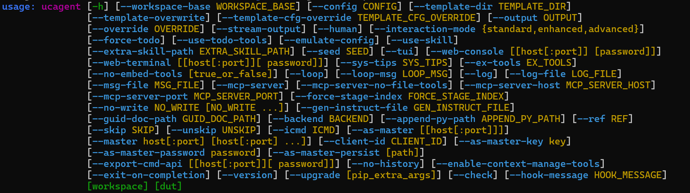

# Prerequisite Installation

> Note: All example output directories in this document use `output` as the example. Users can modify the custom workspace directory as needed.

## 1.1 System Requirements

- Python version for the open-source repository code: 3.11+
- Operating System: Linux / macOS
- API Requirements: When selecting the LangChain or command-line backend, an accessible model service is required; see [Direct Usage](../02_usage/01_direct.md) for specific environment variables
- Memory: 4GB+ recommended
- Dependencies:
  - [picker](https://github.com/XS-MLVP/picker) (Required for RTL verification, used to export Python DUT packages; see its project documentation for installation and simulator dependencies)
  - External Code Agent (Required only for MCP/command-line backends), e.g., [opencode](https://opencode.ai/)

## 1.2 Installing the UCAgent Main Package

**Method 1 (Recommended): Clone the repository and install dependencies**

```bash
git clone https://github.com/XS-MLVP/UCAgent.git
cd UCAgent
python3 -m venv .venv
source .venv/bin/activate
python -m pip install --upgrade pip
python -m pip install .
```

This fully clones the source code repository, retaining the Makefile locally, allowing the use of `make` shortcut commands subsequently.

**Method 2: Direct pip installation**

```bash
python3 -m venv ~/.venvs/ucagent
source ~/.venvs/ucagent/bin/activate
python -m pip install --upgrade pip
python -m pip install git+https://github.com/XS-MLVP/UCAgent@main
```

This installs only the UCAgent program package. The source code is not retained locally, there is no Makefile, and `make` commands cannot be used. You must launch it directly using the native `ucagent` command-line arguments.

## Installation Test

After installation, first check the current environment:

```bash
python --version
ucagent --help
```

Every time you open a new terminal, you must reactivate the virtual environment used during installation. A successful `ucagent --help` only indicates that the CLI is available; before performing RTL verification, you must also install the simulator, CMake, and compilation tools according to the picker documentation, and check:

```bash
picker --check
verilator --version
cmake --version
```

This uses the default Verilator backend of picker. The pure documentation-based [Mini Example](../03_develop/08_mini_example.md) does not require picker.

Example interface of `ucagent --help`:



See [Option Description](../02_usage/03_option.md) for grouped descriptions, default values, and complete examples of each parameter.

## 1.3 Installing Code Agent (Optional)

The default `langchain` backend in normal mode does not require an external Code Agent. You only need to install the corresponding client when selecting command-line backends such as `opencode`, `codex`, `claude`, or manually connecting to MCP. Subsequent examples in this chapter use opencode as the example; it is recommended to pin the verified version:

```bash
curl -fsSL https://opencode.ai/install | bash -s -- --version 1.19.3
```

The command-line backends currently built into UCAgent include `claude`, `opencode`, `copilot`, `qwen`, `iflow`, `kilo`, and `codex`. After installing the client, select it via `--backend=<name>`; refer to the official documentation for client login, model, and version requirements.
