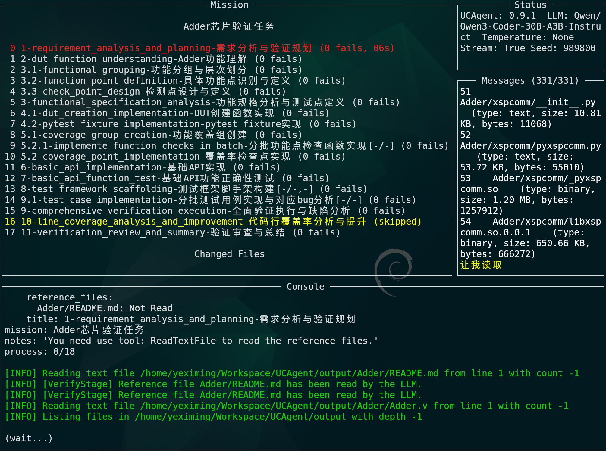

# TUI

## TUI (Interface and Operations)

UCAgent includes a built-in terminal user interface (TUI) based on Textual, designed for local interactive observation of task progress, message streams, and console output, as well as for directly entering commands (such as entering/exiting loops, switching modes, and executing debug commands).

### Interface Components

The TUI interface components are illustrated in the figure below.

- Mission Panel (Left)

  - Phase List: Displays the phases of the current task (index, title, phase skills (when skills are enabled), failure count, duration). Color meanings:
    - Green: Completed phases
    - Red: Current active phase
    - Yellow: Skipped phases (displayed as "skipped")
  - Changed Files: Recently modified files (including modification time and relative time, e.g., "3m ago"). More recent files are displayed in green.
  - Tools Call: Tool invocation status and counts. Busy tools are highlighted in yellow (e.g., SqThink(2)).
  - Daemon Commands: List of commands running in the background (with start time and elapsed duration).

- Status Panel (Top Right)

  - Displays a summary of API and agent status, as well as current panel size parameters (useful for reference when adjusting the layout).

- Messages Panel (Top Right Center)

  - Real-time message stream (model replies, tool outputs, system prompts).
  - Supports focus and scroll control; the title displays the "current/total" message position. For example: Messages (123/456).

- Console (Bottom)
  - Output: Area for command and system output, supporting paginated viewing.
  - Input: Command input line (default prompt "(UnityChip) "). Provides history, completion, and busy status indicators.

Note: The interface automatically refreshes once per second (without affecting input). When messages or output are too long, it enters paginated or manual scrolling mode.

### Operations and Shortcuts

**Global Operations**

- Enter: Executes the current input command; does nothing if the input is empty. Enter q/Q/exit/quit to exit the TUI and return to the PDB console.
- Ctrl+C: Cancels the currently running command; exits the TUI if no command is running.
- Esc:
  - If browsing Messages history, exits manual scrolling and returns to the end;
  - If Output is in paginated view, exits pagination;
  - If the help panel is open, closes the help panel;
  - Otherwise, clears the input line and focuses on the bottom input box.
- Tab: Command completion; press Tab again to cycle through candidates.
- Shift+Left: Clears the input line.

**Panel Resizing**

- Ctrl+Left / Ctrl+Right: Decreases/increases the width of the left Mission panel.
- Ctrl+Up / Ctrl+Down: Increases/decreases the height of the bottom Console output area.
- Ctrl+H / Ctrl+J / Ctrl+K / Ctrl+L: Vim-style panel adjustment shortcuts, functionally equivalent to Ctrl+Left / Ctrl+Down / Ctrl+Up / Ctrl+Right (i.e., h=left j=down k=up l=right).

**Console Operations**

- Up / Down:
  - If Output is in paginated mode, used for page navigation;
  - Otherwise, used for command history navigation (places historical commands into the input line, which can be edited and executed with Enter).
- PageUp / PageDown: Pages through the Console Output.
- Shift+Right: Clears the Console Output.

Pagination Mode Note: When Output enters paginated viewing, a prompt "PageUp/PageDown: scroll, Esc: exit" appears at the bottom. Esc exits pagination and returns to the input state.

**Messages Panel Operations**

- Up / Down (when Messages panel is focused): Manually scrolls the message list.
- Esc (when Messages panel is focused): Exits manual scrolling and resumes automatic following of the latest messages.

**Themes and Help**

- Ctrl+T: Opens the theme selector dialog. Press Enter to confirm the selected theme, or Esc to cancel and restore the original theme.
- F1: Shows/hides the shortcut key help panel.

After exiting the TUI, the UCAgent process remains running. To terminate the process, enter `quit` in the returned PDB console. If a task is currently executing, use `Ctrl+C` to cancel it and wait for the return before exiting.

### Commands and Usage

- Regular Commands: Type directly and press Enter, e.g., loop, tui, help, etc. (handled by the internal debugger).
- History Commands: Use Up / Down to select a historical command, then press Enter to execute.
- Clear Screen: Type clear and press Enter to clear only the Output (does not affect message records).
- Background Commands: Appending & to the end of a command runs it in the background; completion is indicated in the Output area. Current background commands can be viewed via list_demo_cmds.
- Executing System Commands: Input that cannot be recognized as a PDB command is executed directly as a shell command; input prefixed with `!` forces evaluation as a Python expression (native PDB behavior), and this mode prioritizes scrolling to the latest output after execution.
- Listing Background Commands: list_demo_cmds displays the list of running background commands and their start times.

#### Message Configuration (messages_config)

- Purpose: View or adjust the message compression strategy during runtime. The token limit and message count limit are two independent trigger conditions; exceeding either one triggers compression.
- Commands:
  - messages_config to view the current configuration
  - messages_config <key> <value> to set a configuration item
- Configurable Items:
  - max_tokens: The estimated context token limit that triggers compression; set to `0` to disable this condition
  - max_keep_msgs: The context message count limit that triggers compression; set to `0` to disable this condition
  - max_summary_tokens: The output token limit for the summary model, must be greater than `0`
  - tail_keep_msgs: The number of most recent messages to keep as-is after each compression
- Examples:
  - messages_config
  - messages_config max_keep_msgs 200
  - messages_config max_tokens 131072

`status` displays the message compression status using only three compact fields: `ProviderTokens` displays server-side cumulative tokens as `input/output/total`, `Context` displays estimated tokens and message count as `current value/threshold`, and `Compression` displays the reason for the most recent compression and the size before and after. If the server does not return usage, `ProviderTokens` displays `unavailable`; use `messages_config` to view detailed configuration.

Other Notes

- Auto-completion: Supports completion for command names and some parameters; if there are too many candidates, they are displayed in batches, and Tab can be pressed multiple times to view remaining items.
- Busy Indicator: During command execution, the input box title rotates to display (wait.), (wait..), (wait...), indicating processing is in progress.
- Auto-scrolling: Both the Messages panel and Console output area support smart auto-scrolling. By default, it automatically follows the latest content; using the mouse wheel or keyboard paging enters manual scrolling mode, keeping the current position unchanged; when manually scrolling to the end, it automatically resumes following mode. You can also press Esc to directly exit manual scrolling.
- Error Tolerance: If certain UI operations encounter exceptions (e.g., the terminal does not support certain control sequences), the TUI will attempt to fall back to a safe state and continue running.

## Using with Web Master

TUI and Web are not mutually exclusive; it is recommended to combine them based on the scenario:

1. TUI is suitable for local quick debugging and fine-grained command input.
2. Web Master is suitable for cluster observation, hosted task operations, and remote collaboration.

Collaboration Recommendations:

1. Use the Launch page to complete file preparation and compilation startup.
2. Use the Task page to track startup and logs.
3. Enter the Agent page to execute phase batch control and result review.
4. When local immediate fixes are needed, switch back to TUI or the local terminal.

Notes:

1. When web-terminal is enabled, it can run in parallel with the local terminal.
2. For multi-terminal session scenarios, it is recommended to distinguish tasks using different URLs or tabs.
