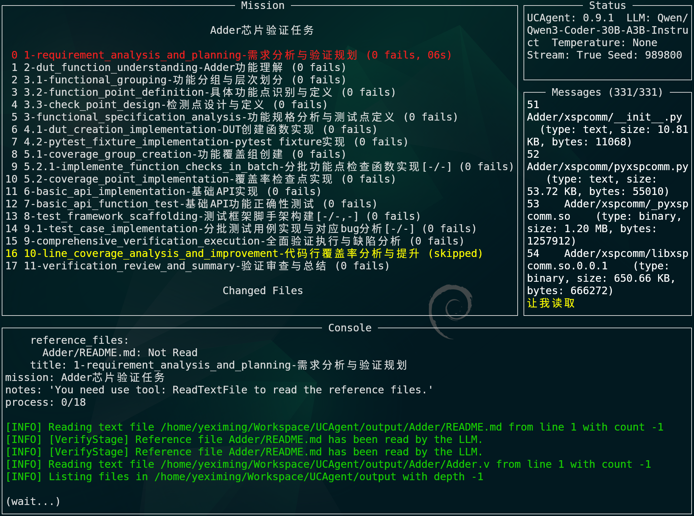

# TUI

## TUI（界面与操作）

UCAgent 自带基于 Textual 构建的终端界面（TUI），用于在本地交互式观察任务进度、消息流与控制台输出，并直接输入命令（如启动循环、查询状态、执行工具和服务控制命令等）。

### 界面组成

TUI 界面组成如下图所示

- Mission 面板（左侧）

  - 阶段列表：显示当前任务的阶段（索引、标题、阶段技能（技能开启时）、失败数、耗时）。颜色含义：
    - 绿色：已完成阶段
    - 红色：当前进行阶段
    - 黄色：被跳过的阶段（显示“skipped”）
  - Changed Files：近期修改文件（含修改时间与相对时间，如“3m ago”）。较新的文件以绿色显示。
  - Tools Call：工具调用状态与计数。忙碌中的工具会以黄色高亮（如 SqThink(2)）。
  - Daemon Commands：后台运行的命令列表（带开始时间与已运行时长）。

- Status 面板（右上）

  - 显示 API 与代理状态摘要，以及当前面板尺寸参数（便于调节布局时参考）。

- Messages 面板（右上中）

  - 实时消息流（模型回复、工具输出、系统提示）。
  - 支持焦点与滚动控制，标题会显示“当前/总计”的消息定位。例如：Messages (123/456)。

- Console（底部）
  - Output：命令与系统输出区域，支持分页浏览。
  - Input：命令输入行（默认提示符 “(UnityChip) ”）。提供历史、补全、忙碌提示等。

提示：界面每秒自动刷新一次（不影响输入）。当消息或输出过长时，会进入分页或手动滚动模式。

### 操作与快捷键

**全局操作**

- Enter：执行注册命令。`quit/exit/q` 或 Ctrl+Q 仅退出 TUI，任务和服务继续运行；`shutdown` 关闭整个实例。
- Ctrl+C：请求取消本会话的前景操作；空闲时不退出界面。
- Esc：
  - 若正在浏览 Messages 的历史，退出手动滚动并返回末尾；
  - 若 Output 正在分页查看，退出分页；
  - 若帮助面板已打开，关闭帮助面板；
  - 否则清空输入行并聚焦到底部输入框。
- Tab：命令补全；再次按 Tab 可循环浏览候选项。
- Shift+Left：清空输入行。

**面板大小调整**

- Ctrl+Left / Ctrl+Right：缩小/增大左侧 Mission 面板宽度。
- Ctrl+Up / Ctrl+Down：增大/缩小底部 Console 输出区域高度。
- Ctrl+H / Ctrl+J / Ctrl+K / Ctrl+L：Vim 风格的面板调整快捷键，功能分别等同于 Ctrl+Left / Ctrl+Down / Ctrl+Up / Ctrl+Right（即 h=左 j=下 k=上 l=右）。

**Console 操作**

- Up / Down：
  - 若 Output 在分页模式，用于翻页；
  - 否则用于命令历史导航（将历史命令放入输入行，可编辑后回车执行）。
- PageUp / PageDown：在 Console Output 中翻页浏览。
- Shift+Right：清空 Console Output。

分页模式提示：当 Output 进入分页浏览时，底部会提示 "PageUp/PageDown: scroll, Esc: exit"，Esc 退出分页并返回输入状态。

**Messages 面板操作**

- Up / Down（Messages 面板获焦时）：手动滚动消息列表。
- Esc（Messages 面板获焦时）：退出手动滚动，恢复自动跟随最新消息。

**主题与帮助**

- Ctrl+T：打开主题选择器弹窗。选中主题后按 Enter 确认，按 Esc 取消并恢复原主题。
- F1：显示/隐藏快捷键帮助面板。

TUI 中的 `q/quit/exit` 和 Ctrl+Q 只关闭当前界面并返回普通 Console，所有任务和服务保持运行；再次输入 `tui` 接回同一会话。需要结束整个实例时使用 `shutdown`。普通 Console 中的 `q/quit/exit` 保留关闭实例的行为。TUI 空回车不重复任务；Ctrl+C 取消最近的活动前台任务，空闲时保留界面。

### 命令与用法

- 普通命令：直接输入并回车，例如 loop、tui、help 等（由命令注册表和统一执行器处理）。
- 历史命令：用 Up / Down 选择历史命令，再按 Enter 执行。
- 清屏：输入 clear 并回车，仅清空 Output（不影响消息记录）。
- 后台命令：命令末尾添加 `&` 标记本会话的后台操作，完成后在 Output 提示；不会增加模型并发名额，Ctrl+C 只针对活动前台操作。
- 系统命令必须显式使用 `shell <command>`；未知命令直接报错，不提供 Python 表达式执行。
- 活动操作显示在命令输入框上方；`list_demo_cmds` 展示配置中的示例命令。

命令 JSON 参数、服务启停、操作查询与实例关闭的完整说明见[运行控制](10_runtime_control.md)。

#### 消息配置（messages_config）

- 作用：在运行中查看或调整消息压缩策略。token 上限与消息数上限是两个独立触发条件，任意一个超限都会压缩。
- 命令：
  - messages_config 查看当前配置
  - messages_config <key> <value> 设置配置项
- 可配置项：
  - max_tokens：触发压缩的预估上下文 token 上限；设为 `0` 可禁用该条件
  - max_keep_msgs：触发压缩的上下文消息数上限；设为 `0` 可禁用该条件
  - max_summary_tokens：摘要模型的输出 token 上限，必须大于 `0`
  - tail_keep_msgs：每次压缩后原样保留的最近消息数
- 示例：
  - messages_config
  - messages_config max_keep_msgs 200
  - messages_config max_tokens 131072

`status` 只用三个紧凑字段显示消息压缩状态：`ProviderTokens` 按 `input/output/total` 显示服务端累计 token，`Context` 按 `当前值/阈值` 显示预估 token 和消息数，`Compression` 显示最近一次压缩的原因和前后规模。服务端未返回 usage 时，`ProviderTokens` 显示 `unavailable`；详细配置使用 `messages_config` 查看。

其他说明

- 自动补全：支持命令名与部分参数的补全；候选项过多时分批显示，可多次按 Tab 查看剩余项。
- 忙碌提示：命令执行期间，输入框标题会轮转显示 (wait.), (wait..), (wait...)，表示正在处理。
- 自动滚动：Messages 面板和 Console 输出区均支持智能自动滚动。默认状态下自动跟随最新内容；使用鼠标滚轮或键盘翻页会进入手动滚动模式，保持当前位置不变；当手动滚动到末尾时，会自动恢复跟随模式。也可按 Esc 直接退出手动滚动。
- 错误容错：若某些 UI 操作异常（如终端不支持某些控制序列），TUI 会尽量回退到安全状态继续运行。

## 与 Web Master 协同使用

TUI 与 Web 并非互斥，推荐按场景组合：

1. TUI 适合本地快速调试与细粒度命令输入。
2. Web Master 适合集群化观察、托管任务运维与远程协作。

协同建议：

1. 用 Launch 页面完成文件准备与编译启动。
2. 用 Task 页面跟踪启动与日志。
3. 进入 Agent 页面执行阶段批量控制与结果复盘。
4. 需要本地即时修复时，切回 TUI 或本地终端。

注意：

1. 启用 web-terminal 时，可与本地终端并行。
2. 多终端会话场景建议用不同 URL 或页签区分任务。
