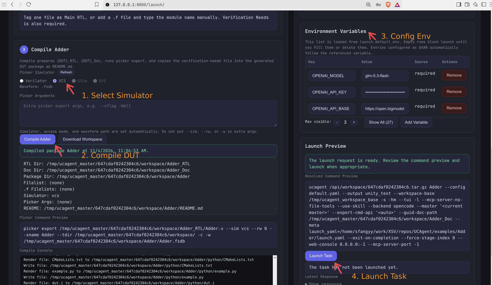
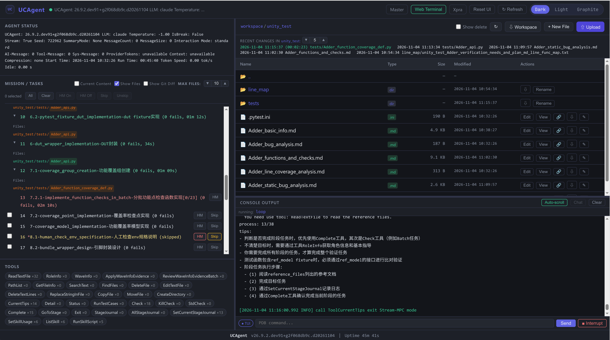
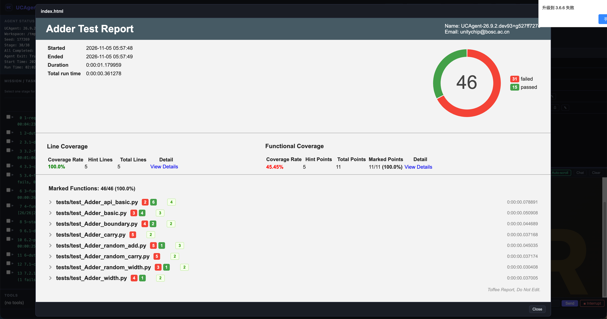
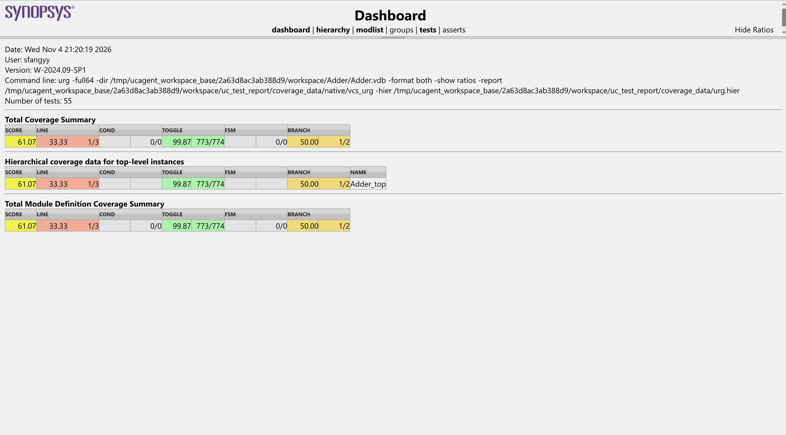
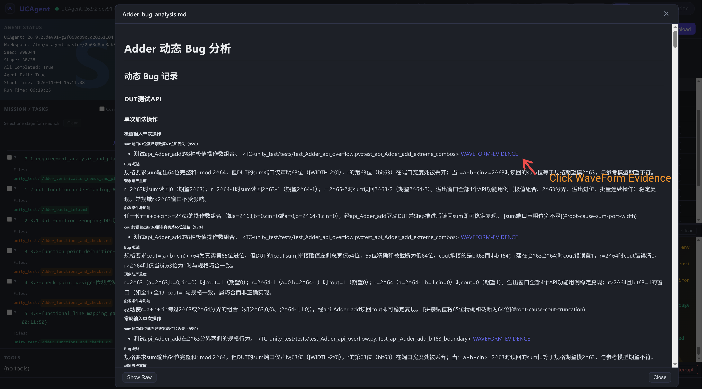
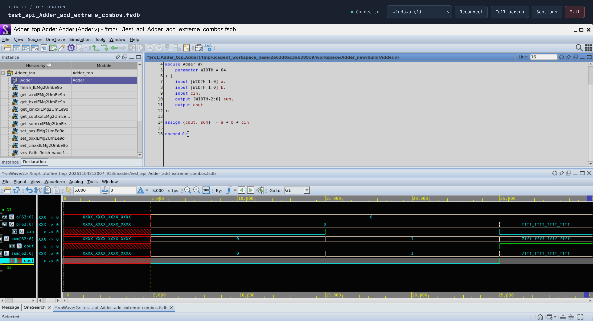

# Verify with VCS and Inspect Results

This guide follows one Web Master workflow: configure VCS → start verification → monitor progress → read reports → inspect FSDB waveforms. The Launch page exports and compiles the DUT automatically; no manual Picker compilation command is required.

Complete [Prerequisites and Installation](../01_start/00_installation.md) first, and have your RTL, specification, and model backend configuration ready. This guide uses an existing project and `Adder` as the example DUT name. Refer to the introductory documentation for Python installation, project preparation, and run modes. Replace every `/path/to/...` placeholder with an actual installation path.

## 1. Configure the VCS Environment

This section assumes VCS, Verdi, and licensing are already configured for your site, the UCAgent Python environment is active, and `picker`, `vcs`, and `verdi` are available in the current terminal. Before starting UCAgent, focus on enabling it to read the FSDB waveforms generated by VCS.

FSDB analysis uses wavekit and requires Verdi's NPI library, `libNPI.so`. Configure the actual installation path in the same Bash terminal used to start UCAgent:

```bash
export VERDI_HOME=/path/to/verdi/version
export WAVEKIT_NPI_LIB="$VERDI_HOME/share/NPI/lib/linux64/libNPI.so"
export LD_LIBRARY_PATH="$(dirname "$WAVEKIT_NPI_LIB")${LD_LIBRARY_PATH:+:$LD_LIBRARY_PATH}"
export GLIBC_TUNABLES=glibc.rtld.optional_static_tls=262144
```

| Setting | Purpose |
| --- | --- |
| `VERDI_HOME` | Verdi installation root; retain the existing value if your EDA environment already sets it correctly. |
| `WAVEKIT_NPI_LIB` | Explicit full path to `libNPI.so`. |
| `LD_LIBRARY_PATH` | Search paths for NPI and its dependencies, preserving existing entries. |
| `GLIBC_TUNABLES` | Reserve static TLS space for VCS dynamic libraries; set before starting Master/UCAgent. |

This is a common installation layout; use the actual `libNPI.so` location if yours differs. An explicit path is unnecessary when your existing environment already discovers NPI through `VERDI_HOME`. See [Waveform Formats and Extensions](../03_develop/10_waveform_analysis.md) for further configuration details.

Review the configured values:

```sh
echo "WAVEKIT_NPI_LIB=$WAVEKIT_NPI_LIB"
echo "LD_LIBRARY_PATH=$LD_LIBRARY_PATH"
echo "GLIBC_TUNABLES=$GLIBC_TUNABLES"
```

Confirm that the paths match your installation.

Example terminal output:

```text
WAVEKIT_NPI_LIB=/path/to/verdi/version/share/NPI/lib/linux64/libNPI.so
LD_LIBRARY_PATH=/path/to/verdi/version/share/NPI/lib/linux64
GLIBC_TUNABLES=glibc.rtld.optional_static_tls=262144
```

Before viewing Verdi in your browser, complete the server-side setup in [Graphical Applications with Xpra](09_web_xpra.md).

## 2. Configure and Start UCAgent

### Use a Shared Local Workspace

For this guide, run Master and child Agents as the same user on the same machine. Before starting Master, merge this setting into `~/.ucagent/setting.yaml`, preserving existing `launch` settings:

```yaml
launch:
  default_args:
    use_zip_workspace: false
```

Disabling archived workspaces makes child Agents use the Master's compiled workspace directly, avoiding signature failures caused by copying waveform metadata to another workspace path.

### Start Master from the Configured Terminal

```bash
ucagent --as-master-persist --as-master
```

Open the default address, `http://localhost:8800`, in your browser. For remote deployment, authentication, and backend configuration, follow the [Web Master Guide](07_web_master.md).

Configure environment variables before starting the service. Running `export` in another terminal does not update an existing Master or Agent process. When changes are necessary, coordinate running tasks before restarting the affected services from the correct environment.

### Launch a Task

Follow [Master Mode](../01_start/04_master_mode.md) to import RTL and Spec, mark **Verification Needs**, and select the top module. **Before compiling the DUT, select VCS under Picker Simulator**, then compile and launch the task. If VCS is disabled, check `picker` and `vcs` in the Master environment and click **Refresh**.

After selecting VCS, click the page’s compile button. Launch automatically generates and runs the Picker command with `--sim vcs`, DPI access (`--rw 0`), and FSDB output. **The following command is illustrative only; you do not need to write, enter, or run it manually:**

```bash
picker export /path/to/Adder.v \
  --sim vcs --rw 0 --sname Adder --tdir /path/to/workspace/ \
  -c -w /path/to/workspace/Adder/Adder.fsdb
```

Switching simulators requires recompilation; see the [Web Master Guide](07_web_master.md) for other launch settings.



Figure 1: Follow the annotations to select VCS, compile the DUT, configure task environment variables, and review the command before clicking **Launch Task**. Compilation has succeeded in this screenshot; the task has not started yet. Its `.tar.gz` command was captured in archived-workspace mode; after disabling that mode as described above, the actual command should use a local workspace directory.

## 3. Monitor Verification Progress

Use **Task** to inspect task status and stdout/stderr. Once the Agent is registered, open it from **Dashboard** to inspect the current stage, artifacts, and logs.

Stage completion means its checks passed; it does not establish that every DUT test passed. See the [Web Master Guide](07_web_master.md) for stage controls.

After opening the Agent page, **MISSION / TASKS** on the left shows stage progress, the upper-right file area lists workspace artifacts, and **CONSOLE OUTPUT** at the lower right shows runtime output. Click an artifact's **View** button to inspect its contents and use the console to follow current execution.



Figure 2: A running task. The left panel shows current and completed stages, the upper-right panel lists artifacts under `unity_test/`, and the lower-right panel displays live console output.

## 4. Read Reports

In the Agent's file browser, locate these artifacts within the **current workspace**:

| Location | What to read |
| --- | --- |
| `uc_test_report/` | HTML/JSON reports from executed tests, including case results, failure logs, and any coverage content actually generated. |
| `unity_test/{DUT}_bug_analysis.md` | Dynamic bug analysis from the default workflow, with failing cases, root causes, and waveform evidence. |
| `unity_test/{DUT}_test_summary.md` | The default workflow's verification summary, including scope, results, and remaining issues. |

Locate the generated HTML report and click its **Open in browser** icon. Markdown artifacts can be previewed directly. Reports may be in subdirectories; follow the actual output from this test run instead of substituting reports from another workspace or historical session.

### Inspect Coverage

In the toffee report, click **View Details** in the **Line Coverage** row to open the VCS native coverage report. The **View Details** link under **Functional Coverage** opens functional coverage details instead.

VCS raw coverage artifacts are typically `.vdb` databases. Report parsing requires a toffee-test version that supports this format. If coverage content is missing, check whether coverage was enabled, the database was generated, and report logs contain errors. See [Results and Workflow Summary](../01_start/06_summary.md) for the complete artifact overview.



Figure 3: The toffee report shows test outcomes, line coverage, and functional coverage. Use the Line Coverage link to open the native report.



Figure 4: The VCS URG Dashboard shows LINE, COND, TOGGLE, FSM, and BRANCH metrics. Use **hierarchy** or **modlist** to inspect instance or module details.

These screenshots illustrate navigation and come from different test runs. Their test counts and coverage percentages should not be compared as results from the same run.

### Inspect Waveforms

1. In the bug analysis, click **WAVEFORM-EVIDENCE** beside a test case to locate its evidence record, then click the waveform viewer link in that record.
2. Wait for the viewer page to start Verdi. The default FSDB viewer displays server-side Verdi through Xpra in your browser. If prompted, use the current CMD/Master authentication entry.
3. Compare inputs, outputs, and expectations using clock edges and transaction context. A cycle count in a test log is not necessarily a waveform timestamp.

Wait for the relevant test process to finish writing the waveform before inspection. To view the compiled design, retain its matching design database, including `simv.kdb`, from the same build. Do not combine FSDB files and databases from different builds. For missing or ambiguous databases, follow the page diagnostic and [waveform viewer configuration guidance](../03_develop/10_waveform_analysis.md).

Waveform viewing settings are generated by tools. Do not manually edit `.fsdb.json` to change links, signals, or time ranges, or move only the waveform while losing associated files. If the task has exited and its page is unavailable, retain the workspace and restore the viewing service through the original run mode.



Figure 5: Click **WAVEFORM-EVIDENCE** beside the relevant test case in the bug analysis to inspect its evidence and waveform viewer link.



Figure 6: Opening the waveform viewer link displays Verdi in the browser. Compare the RTL source above with the input and output waveforms below to analyze the test results.

## Troubleshooting

| Symptom | Check first |
| --- | --- |
| VCS is disabled in Launch | Whether the Master process can find `picker` and `vcs` through PATH, and whether configuration preceded service startup. |
| Compilation or simulation reports a license error | Follow site licensing requirements, check service reachability, and provide the exact error to the administrator. |
| WaveInfo cannot analyze FSDB | Check wavekit in the current Python, the NPI path, and its library dependencies; restart affected processes after repairing the environment. |
| FSDB analysis works but browser-based Verdi does not | Confirm that `verdi` and licensing are available; see [Graphical Applications with Xpra](09_web_xpra.md) for graphical service setup and session diagnostics. |
| Verdi reports mismatched or ambiguous design databases | Verify the matching build's database, FSDB, and sources; select the correct database or rebuild as directed. |
| Reports or waveforms are missing | Confirm the workspace and test session, whether tests ran and finished, and which report and waveform options were enabled. |
