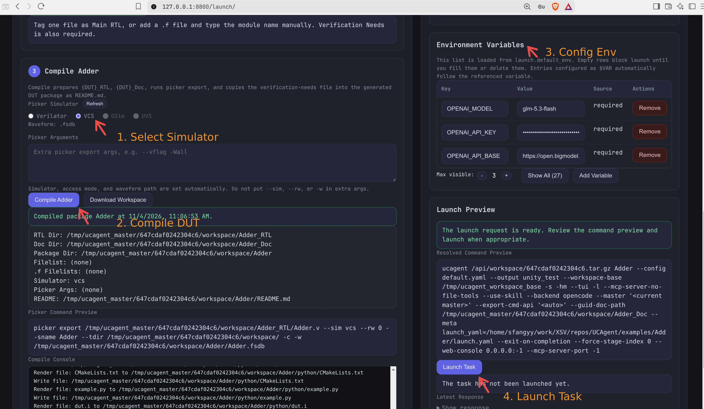
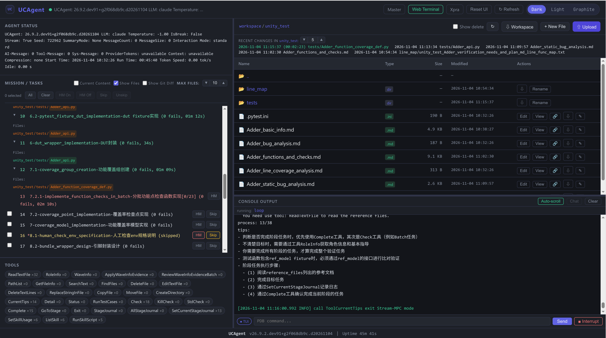
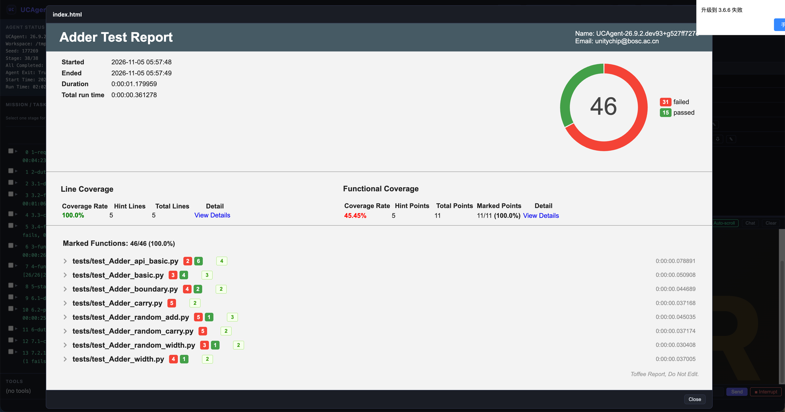
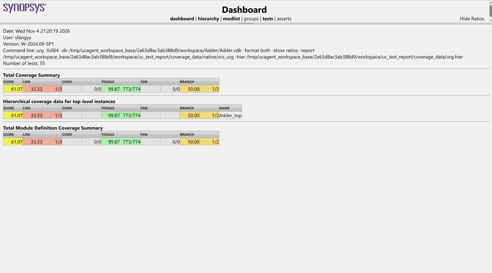
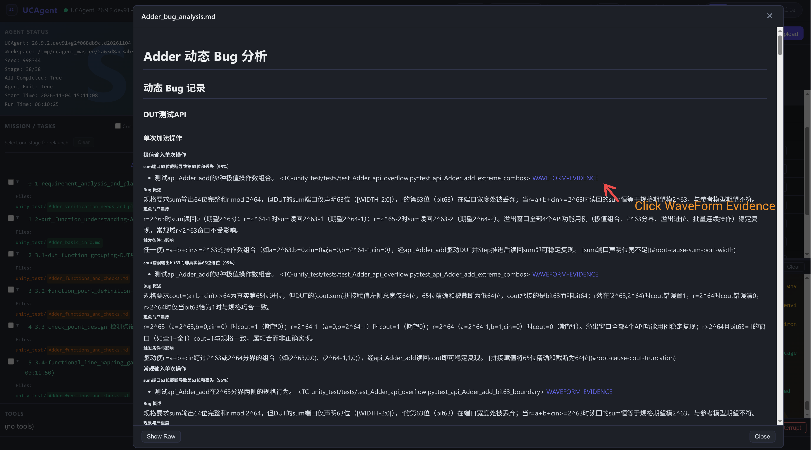
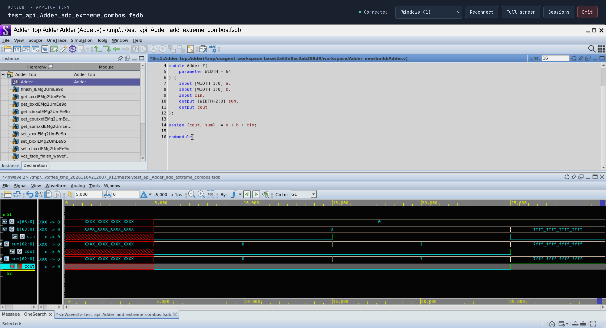

# 使用 VCS 验证与查看结果

开始前应已完成[前置依赖安装](../01_start/00_installation.md)，准备好待验证的 RTL、Spec 和模型后端配置。本文沿用已有工程，以 `Adder` 为 DUT 名称示例；Python 安装、工程准备和运行模式选择分别参考已有入门文档。所有 `/path/to/...` 均须替换为实际安装路径。

## 1. 仿真器环境配置（VCS）

本节假定 VCS、Verdi 和许可证已按站点要求配置好，当前终端已激活 UCAgent Python 环境，并能找到 `picker`、`vcs` 和 `verdi`。

FSDB 分析使用 wavekit，并依赖 Verdi 的 NPI 库 `libNPI.so`。在启动 UCAgent 的同一 Bash 终端中，按实际安装路径配置：

```bash
export VERDI_HOME=/path/to/verdi/version
export WAVEKIT_NPI_LIB="$VERDI_HOME/share/NPI/lib/linux64/libNPI.so"
export LD_LIBRARY_PATH="$(dirname "$WAVEKIT_NPI_LIB")${LD_LIBRARY_PATH:+:$LD_LIBRARY_PATH}"
export GLIBC_TUNABLES=glibc.rtld.optional_static_tls=262144
```

| 配置 | 用途 |
| --- | --- |
| `VERDI_HOME` | Verdi 安装根目录，已有 EDA 环境正确设置时直接沿用。 |
| `WAVEKIT_NPI_LIB` | 显式指定 `libNPI.so` 的完整路径。 |
| `LD_LIBRARY_PATH` | 为 NPI 及其依赖提供动态库搜索路径，保留已有内容。 |
| `GLIBC_TUNABLES` | 为 VCS 动态库预留静态 TLS 空间，须在启动 Master/UCAgent 前设置。 |

以上是常见安装布局；路径不同时使用实际的 `libNPI.so`。已有环境能通过 `VERDI_HOME` 找到 NPI 时，不必重复设置显式路径。更多配置说明见[波形分析文档](../03_develop/10_waveform_analysis.md)。

用以下命令查看配置值：

```sh
echo "WAVEKIT_NPI_LIB=$WAVEKIT_NPI_LIB"
echo "LD_LIBRARY_PATH=$LD_LIBRARY_PATH"
echo "GLIBC_TUNABLES=$GLIBC_TUNABLES"
```

确认路径与实际安装位置一致。

终端输出示例：

```text
WAVEKIT_NPI_LIB=/path/to/verdi/version/share/NPI/lib/linux64/libNPI.so
LD_LIBRARY_PATH=/path/to/verdi/version/share/NPI/lib/linux64
GLIBC_TUNABLES=glibc.rtld.optional_static_tls=262144
```

通过浏览器查看 Verdi 前，请按 [Xpra 图形应用](09_web_xpra.md) 完成服务端安装与配置。

## 2. UCAgent 的配置与启动

### 关闭压缩工作区模式

本文按 Master 与子 Agent 在同一台机器、同一用户下运行的方式操作。启动 Master 前，将以下配置合并到 `~/.ucagent/setting.yaml`，保留已有的 `launch` 配置：

```yaml
launch:
  default_args:
    use_zip_workspace: false
```

关闭后，子 Agent 直接使用 Master 编译出的工作区，避免波形元数据复制到不同工作区路径后出现签名校验失败。

### 从配置好的终端启动 Master

```bash
ucagent --as-master-persist --as-master
```

在浏览器访问默认入口 `http://localhost:8800`。远程部署、认证和后端配置沿用 [Web Master 使用指南](07_web_master.md)。

环境变量必须在启动前配置。另一个终端里的 `export` 不会改变已经运行的 Master 或 Agent 的环境；需要更新时，先安排好正在执行的任务，再从正确环境重启相关服务。

### 在 Launch 页面启动任务

按 [Master 模式](../01_start/04_master_mode.md) 导入 RTL 和 Spec、标记 **Verification Needs** 并选择顶层模块。**编译 DUT 前，在 Picker Simulator 中选择 VCS**，再执行编译并启动任务。若 VCS 置灰，检查 Master 环境中的 `picker`、`vcs`，然后点击 **Refresh**。

选择 VCS 后，点击页面的编译按钮即可，Launch 会自动生成并执行 Picker 命令，并自动设置 `--sim vcs`、DPI 访问（`--rw 0`）和 FSDB 输出。**以下仅为命令示例，无需手动编写、填写或执行：**

```bash
picker export /path/to/Adder.v \
  --sim vcs --rw 0 --sname Adder --tdir /path/to/workspace/ \
  -c -w /path/to/workspace/Adder/Adder.fsdb
```

切换仿真器后需重新编译。其他启动设置见 [Web Master 使用指南](07_web_master.md)。



图 1：按图中标注选择 VCS、编译 DUT、配置任务环境变量，检查命令预览后点击 **Launch Task**。图中编译已成功，任务尚未启动。截图中的 `.tar.gz` 命令来自压缩工作区模式；按本文关闭该模式后，实际命令应使用本地工作区目录。

## 3. 查看验证进度

在 **Task** 页面查看任务状态和输出日志；Agent 注册后，从 **Dashboard** 进入对应 Agent 页面，查看当前阶段、阶段产物和日志。

阶段完成表示该阶段的检查通过，不能据此认定所有 DUT 测试都通过。阶段控制操作见 [Web Master 使用指南](07_web_master.md)。

打开对应 Agent 页面后，左侧 **MISSION / TASKS** 展示阶段进度，右上方文件区展示工作区内的输出产物，右下方 **CONSOLE OUTPUT** 展示运行输出。可点击产物的 **View** 按钮查看内容，并结合控制台了解当前执行情况。



图 2：正在运行的任务页面。左侧显示当前阶段及已完成阶段，右上方列出 `unity_test/` 下的产物，右下方显示实时控制台输出。

## 4. 阅读报告

进入对应 Agent 的文件浏览区域，在**本次工作区**中查找：

| 位置 | 阅读内容 |
| --- | --- |
| `uc_test_report/` | 已运行测试生成的 HTML/JSON 报告，查看用例结果、失败日志及实际生成的覆盖率内容。 |
| `unity_test/{DUT}_bug_analysis.md` | 默认流程生成的动态 Bug 分析，查看失败用例、根因和波形证据。 |
| `unity_test/{DUT}_test_summary.md` | 默认流程生成的验证总结，了解验证范围、结果和遗留问题。 |

在文件列表中找到实际生成的 HTML 报告，点击 **Open in browser** 图标打开；Markdown 产物可直接预览。报告可能位于子目录，按本次测试实际输出定位，不使用其他工作区或历史会话的报告代替。

### 查看覆盖率

在 toffee 报告的 **Line Coverage** 区域点击 **View Details**，即可打开 VCS 原生覆盖率报告。右侧 **Functional Coverage** 下的同名链接用于查看功能覆盖率，请注意区分。

VCS 覆盖率原始产物通常为 `.vdb`，报告解析需要支持该格式的 toffee-test。没有覆盖率内容时，先确认测试是否启用覆盖率、数据库是否生成以及报告日志是否报错。完整产物说明见[结果分析与流程总结](../01_start/06_summary.md)。



图 3：toffee 报告展示用例结果、行覆盖率与功能覆盖率，点击 Line Coverage 下的 View Details 进入原生报告。



图 4：VCS URG Dashboard 展示 LINE、COND、TOGGLE、FSM、BRANCH 等指标，可通过 **hierarchy** 或 **modlist** 进一步查看实例或模块详情。

以上截图用于说明操作入口，来自不同测试运行，用例数量和覆盖率数值不作为同一次运行的对照。

### 查看波形

1. 在 Bug 分析中点击测试用例旁的 **WAVEFORM-EVIDENCE**，定位对应证据记录，再点击记录中的波形查看链接。
2. 等待波形查看页面启动 Verdi。默认 FSDB 查看器通过 Xpra 在浏览器中显示服务端 Verdi 窗口；遇到登录提示时使用当前 CMD/Master 的认证入口。
3. 结合时钟边沿和事务上下文比对输入、输出及预期行为。测试日志的 cycle 数不一定等于波形时间刻度。

等待相关测试进程完成波形写入后再查看。为查看编译后的设计，保留同一次构建生成的配套设计数据库，其中应包含 `simv.kdb`；不要混用其他构建的数据库与 FSDB。缺少或存在多个数据库时，按页面诊断和[波形查看配置说明](../03_develop/10_waveform_analysis.md)处理。

已有波形查看配置由工具生成；不要手工修改 `.fsdb.json` 来改变链接、信号或时间，也不要只移动波形而丢失关联文件。任务已退出、网页不可用时，保留工作区，按原运行模式恢复查看服务。



图 5：在 Bug 分析文档中点击对应测试用例旁的 **WAVEFORM-EVIDENCE**，查看关联波形证据及波形查看链接。



图 6：打开波形查看链接后，浏览器显示 Verdi 窗口，可结合上方 RTL 源码与下方输入输出波形分析测试结果。

## 常见问题

| 现象 | 优先检查 |
| --- | --- |
| Launch 中 VCS 置灰 | Master 进程能否通过 PATH 找到 `picker`、`vcs`；新终端中的配置是否在服务启动前生效。 |
| WaveInfo 无法分析 FSDB | 检查当前 Python 的 wavekit、NPI 库路径及其动态库依赖；环境修复后重启相关进程。 |
| 能分析 FSDB，但浏览器打不开 Verdi | 图形服务环境与会话诊断见 [Xpra 图形应用](09_web_xpra.md)。 |
| Verdi 提示设计数据库不匹配或不明确 | 确认同一次构建的数据库、FSDB 和关联源码，按诊断选择正确数据库或重新编译。 |
| 找不到报告或波形 | 确认工作区及测试会话、测试是否已运行并结束，以及实际启用的报告和波形选项。 |
