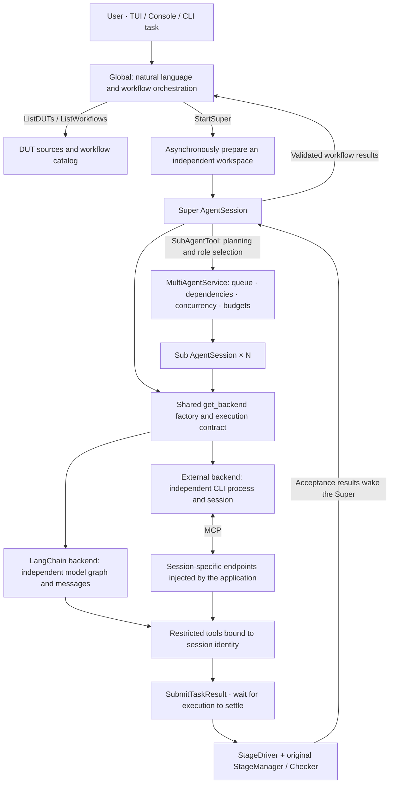

# Multi-Agent: Global / Super / Sub

`multi` launches three Agent tiers: Global accepts natural-language requests and orchestrates workflows; each Super executes one workflow; Subs execute authorized stages or tasks. `single` is the default mode. TUI and MCP do not change these responsibilities.

## Two Ways to Start

```bash
# Start only Global, then enter a task in its interface
ucagent --agent-mode multi --backend codex --config ./config.yaml

# Specify a DUT and workflow; Global automatically creates a Super
ucagent ./examples/Adder Adder --agent-mode multi --backend codex \
  --plugin-workflow unittest:unittest --max-subagents 2 --config ./config.yaml

# Prepare an Adder workspace and run the same three-tier chain
make test_multi_Adder BACKEND=langchain MAX_SUBAGENTS=2
make mcp_multi_Adder BACKEND=codex MAX_SUBAGENTS=2

# General interactive entry; DUT workspaces are prepared per task
make multi MULTI_BACKEND=codex
make multi_unit MULTI_WORKSPACE=examples/Adder MULTI_DUT=Adder MULTI_BACKEND=codex
```

Without an initial task, only Global starts. It opens the TUI by default, does not call the model, and creates no Super/Sub. `--human` selects the Console. `--loop-msg "task"` supplies one initial natural-language request; `--loop` without an explicit workflow submits one request to verify the current DUT.

When both a DUT and `--plugin-workflow` are supplied, Global automatically creates a task for that workflow. It neither waits for input nor asks the model to select the workflow again. In this case, `--loop-msg` adds requirements to that task. After the task ends, Global normally continues accepting instructions. With `--exit-on-completion`, it exits after child tasks finish, results are accepted, and Global sends its final reply; failures return a nonzero exit code.

`--plugin` extends Global's workflow catalog without activating business tools, templates, or stages on Global. Startup discovers installed plugins, repository plugins, and plugins in configured search paths. Each Super loads only the plugin owning its selected workflow. `global_agent.allowed_workflows` can restrict the catalog further; explicit tasks cannot bypass this restriction.

`--agent-mode single|multi` overrides `runtime_options.agent_mode`; the mode can also be set only in YAML or workspace configuration. `agent_run.role` identifies an internal child process, not another public mode. The mode cannot change during a run.

By default, Global, Super, and Sub inherit `--backend`. A launch profile may explicitly select a Super backend, which its Subs also use. `--max-subagents` accepts 1–128 and overrides the per-Super concurrency limit in every profile. `global_agent.max_parallel_supers` separately limits Super concurrency. These are upper bounds; the Super decides how to split the work.

Global's MCP service starts automatically for CLI backends and uses a dynamically allocated local port by default. Super/Sub use their own session endpoints. A single Agent with a CLI backend still requires MCP to be enabled explicitly. Configure the selected backend's model connection or CLI login before execution.

`test_multi_*` defaults to `BACKEND=langchain`; `mcp_multi_*` defaults to `BACKEND=codex`. Both directly submit the specified workflow and support `CFG / SIM / CWD / ARGS / MULTI_WORKFLOW`. General `make multi` and workflow-specific targets use `MULTI_*` variables; see `make multi_help`. Targets such as `multi_unit` only select the first task, so later tasks may use another workflow. Only an explicit `MULTI_WORKFLOW` or `allowed_workflows` restricts the catalog. See [Global Agent](13_global_agent.md) for the catalog, profiles, navigation, and artifacts.

## Architecture and Responsibilities



- `core/agent/session.py` combines the owner and backend to execute turns consistently. It reuses the single StageManager without preparing the workspace again.
- `core/multi_agent/global_agent` manages the workflow catalog, launch contracts, and result acceptance. The application and runtime own Super process lifecycles.
- `core/multi_agent/super_agent` manages stage authorization, roles, Sub tasks, queues, dependencies, and budgets. It neither launches CLIs nor accesses LangChain graphs directly.
- `core/multi_agent/mode.py` resolves public modes and internal roles consistently.
- `AgentBackendBase` provides `run_turn / cancel / wait_idle / close` and capability declarations. Only one turn runs at a time; a cancellation notification does not mean execution has actually exited.
- The LangChain backend manages model graphs, middleware, context, and model cancellation. `SessionCommandBackend` manages argv, process groups, private files, and endpoint lifecycles. YAML/templates declare CLI startup, resumption, MCP configuration, and public event fields; a new CLI does not require a new Python backend class.
- `application` injects the endpoint factory, `interfaces/server/worker_mcp.py` implements transport, and runtime manages shutdown. Core does not import outer-layer packages.

The scheduler does not branch on CLI brand or version. External CLIs register the shared `ucagent.core.backends.cmdline.SessionCommandBackend`; `backend=xx` selects their configuration. Codex/OpenCode already use this class. Built-in configurations still referencing the old `UCAgentCmdLineBackend` retain single-mode behavior; migration requires command and session configuration, not a new `XxxBackend`. The framework never silently falls back to LangChain.

## Configuration and Roles

```yaml
backend: {key_name: langchain}       # Default for all three tiers; --backend overrides it
runtime_options: {agent_mode: multi}
global_agent:
  launch_profiles:
    standard:
      max_subagents: 2
multi_agent:
  default_role: analyst
  delegation_scope: auto
  stage_roles: {review: reviewer}   # Actual stage name
  limits:
    # Cumulative workload limits are disabled unless set to a positive value.
    supervisor_backend_turns: 0
    worker_backend_turns: 0
    supervisor_model_rounds: 0
    worker_model_rounds: 0
    supervisor_tool_calls: 0
    worker_tool_calls: 0
    supervisor_timeout_seconds: 0
    worker_timeout_seconds: 0
    planning_revisions: 0
    # Only consecutive failures trip these limits; success resets the relevant streak.
    tool_error_streak: 8
    backend_error_streak: 3
    checker_repeat_failures: 8
    task_max_attempts: 2        # Limits retries of failed tasks only
  roles:
    analyst:
      system: "Produce artifacts for the authorized task and submit the result."
      allowed_tools: [ReadTextFile, EditTextFile]
    reviewer:
      system_file: prompts/reviewer.md
      allowed_tools: [ReadTextFile, EditTextFile]
```

Roles no longer default to overriding the backend with LangChain. Managed mode inherits the top-level backend and rejects conflicting legacy role fields. Choose either `system` or `system_file`; relative paths are resolved from the task workspace. Role selection follows task `role` → `stage_roles` → `default_role`. LangChain roles may use `model_overrides` for model connection/context settings. External CLIs use their own configuration rather than UCAgent's OpenAI parameters.

Cumulative tool calls, model rounds, backend turns, planning revisions, and total Super/Sub duration are optional safeguards; `0` disables them. Healthy execution does not pause merely because it runs for a long time or makes many successful calls. Consecutive tool errors, backend errors, or repeated identical Checker diagnostics pause execution at their thresholds and show the category and count. A successful corresponding operation resets its failure streak. `task_max_attempts` only limits failed-task retries. Individual tool-call timeouts still apply as configured.

Tool permissions are the intersection of the role allowlist and workflow tools. The framework binds lifecycle tools to the session identity. Super has planning/status tools and limited read-only tools; Sub cannot delegate again or skip stages globally. Every Sub has independent tool objects, backend, session, and cancellation state.

External backends do not yet support internal embeddings or stage-level LLM-assisted review. External execution automatically chooses tool paths without internal embeddings. Enabling incompatible `vmanager.llm_suggestion.*.enable` settings produces an explicit error rather than silently skipping review or starting LangChain. Use a supporting backend to retain those reviews.

See [multi-agent.yaml](../../examples/multi-agent.yaml) for a minimal three-tier configuration. The selected plugin workflow supplies the stages and acceptance criteria.

## Planning, Continuous Execution, and Acceptance

<a id="role-tool-matrix"></a>

### Role Tool Matrix

| Caller | `Check` | `Complete` | `CompleteSubStage` | `SubmitTaskResult` |
| --- | --- | --- | --- | --- |
| single Agent | Check the current stage and advance batches | Final acceptance and stage advancement | Not exposed | Not exposed |
| multi Global / Super | Not exposed as a model business tool | Not exposed as a model business tool | Not exposed | Not exposed |
| multi single-stage Sub | One Sub checks all batches continuously | Not exposed | Not exposed | Explicit submission after checks and closing evidence are ready |
| multi subtree Sub | Check the authorized current descendant | Not exposed | Accept and advance the descendant using the latest `step_token` | Explicit submission after all authorized descendants complete |
| multi file-task Sub | Not exposed | Not exposed | Not exposed | Submit against the input/output contract |

`Check` does not submit automatically. Successful `SubmitTaskResult` means submitted and awaiting execution teardown and acceptance, not stage completion. Once all writers stop, the framework rechecks artifacts and applies any root-stage gates; pure groups do not add a parent Checker. See [Multi-Agent Development Architecture](../03_develop/12_multi_agent_architecture.md) for state transitions and ownership.

Super must actually call the model and submit a plan through `SubAgentTool`. The framework does not analyze the task and generate a substitute plan. After submission, the current execution settles and waits for task acceptance events before waking Super; the model is not polled while waiting. A plain text reply continues in the same session and budget rather than counting as task completion. `PauseWorkflow` pauses by issue category; recovery actions and budget rules are described below. Ordinary chat does not re-enter the planning loop.

```json
{"plan_id":"stage-one","scope":"auto","tasks":[{"id":"work","instruction":"Complete the currently authorized stage","role":"analyst"}]}
```

Managed MCP submissions must include `CurrentTips.planning_token`. Only one token is valid for each planning step; late calls and duplicate dispatches cannot exceed the current authorization.

- `auto/subtree`: one Sub completes 3.1→3.2→… continuously, calling `CompleteSubStage` with the current `step_token`. Completing a substage or ending with plain text does not create a new task attempt. Premature `SubmitTaskResult` returns `SUBSTAGES_REMAIN`, leaving the same session active for repairs.
- `stage`: handles only the current step. For a batched stage, the same Sub completes all batches through `Check`, supplies required Skill evidence and the stage journal, then submits. Narrowing a subtree's scope requires `scope_reason`.
- `task`: independent file tasks may run in parallel. They must declare concrete inputs/outputs, nonoverlapping outputs, acyclic dependencies, and explicit dependencies on input producers. Check, stage journals, and Skill completion tools are unavailable. Existing artifact contracts and the final stage Checker still apply.

`auto/stage/subtree` delegations inherit workflow `write_dirs / un_write_dirs`. `inputs` specifies required inputs without additionally freezing files the workflow permits editing. `outputs` may be omitted or list only some artifacts; it does not narrow these delegations' write scope. Stage Checkers still accept artifacts. For example, a later stage may keep editing an input API file without declaring it again as an output. Inputs the workflow forbids modifying remain protected by write checks and final content verification.

Split `scope=task` tasks must declare concrete outputs and may write only those outputs. Files in `inputs` but not `outputs` are read-only; list a path in both for in-place editing. An in-place update within one task does not require a self-dependency, but inputs produced by other tasks still require explicit dependencies. Sub's `CurrentTips.file_access` reports the file tools' actual permissions. Split tasks may create parent directories needed for their outputs but cannot write unassigned files. Isolated tasks preserve existing file permissions when publishing updates.

The queue does not truncate tasks exceeding the concurrency limit. A/B must pass artifact acceptance before their dependent C can start. Workers being constructed, running, submitted but not exited, or cancelled but not exited all occupy Sub slots. Super does not occupy a Sub slot. Retries, replanning, and changed plan/task IDs do not reset a logical task's cumulative budget or absolute deadline.

**The exclusive Sub initiates Check; CompleteSubStage completes substages; the framework performs final Complete for the authorized root stage after all Subs exit.** These operations always use the same StageDriver, StageManager, and Checker. Pure grouping nodes do not add a parent Checker. Skill, human review, BatchTask, and signed-evidence gates remain effective. Neither `SubmitTaskResult` nor a zero process exit code proves acceptance. A task that times out after advancing the last substage but before submission cannot make the workflow succeed.

Sub does not expose `Complete`. `Check` validates and advances batches without submitting automatically. `CompleteSubStage` retains current `step_token` authorization and advances only the subtree's current step. For a single stage, first pass `Check` for every batch, then complete required Skill registration and the journal, and finally call `SubmitTaskResult` explicitly. `CurrentTips.submission` and `Check` report submission readiness and next actions. A `ready` submission is rejected while checks fail, batches remain, or closing evidence is missing; the current Sub stays active. Business edits or tool calls that may change results invalidate the previous submission-check receipt and require another `Check`. File-split tasks still submit under their artifact contracts; blocked work can still report `needs_attention`.

Normal batch advancement does not return to Super for replanning. If a real execution failure occurs after a batch advances, recovery planning uses the latest batch state rather than replaying completed batches. Final acceptance still occurs after Sub exits; successful submission only means acceptance is pending. Automatic summarization/clearing on stage completion remains disabled, while threshold-based and manual summarization retain their behavior.

## External Execution, Cancellation, and Output

Session data lives under `.ucagent/multi_agent/<run>/super/` or `<run>/<plan>/<task>/<attempt>/`. Each CLI has its own prompt, stdout/stderr, MCP URL/credentials, and process group. The task cwd is not the session directory: exclusive tasks use the real workspace; parallel file tasks use private copies of declared inputs/existing outputs, then validate and publish declared artifacts after exit.

All CLIs share `SessionCommandBackend` and describe the external program through configuration rather than brand-specific Python files:

| Configuration | Meaning |
| --- | --- |
| `executable / argv / new_args / resume_args` | Executable, shared arguments, new-session arguments, and resume arguments; always executed as argv, never through a shell |
| `files / env` | Private configuration files in the session directory and process environment; support MCP URLs, credential environment variables, and role tool names |
| `output.format / output.events` | Optional JSONL mappings for text, session ID, completion, errors, and usage; raw dictionaries do not enter message logs |
| `inspect / validate` | Optional JSON configuration inspection and validation commands; built-in configurations use them to disable other inherited MCP endpoints |
| `yield_timeout` | Maximum wait after an accepted tool response for the CLI to save context; defaults to 5 seconds; active cancellation does not wait |

Arguments and files use Jinja templates with `workspace / session_dir / prompt_file / session_id / mcp_url / server_name / tools / managed`. The child process receives its MCP token through `UCAGENT_WORKER_MCP_TOKEN`. Configuration is written only to the private session directory, never over project or user-global settings. A new CLI can declare these fields directly in user configuration, including inline templates for complex JSON/arguments, without installing files in UCAgent's assets directory.

```yaml
backend:
  key_name: client_a
  client_a:
    clss: ucagent.core.backends.cmdline.SessionCommandBackend
    args:
      executable: cli-a
      argv: ["{{ executable }}", --config, "{{ session_dir }}/mcp.json"]
      new_args: [run, --json]
      resume_args: [run, --json, --session, "{{ session_id }}"]
      files:
        mcp.json: |
          {"mcpServers":{"ucagent":{"url":{{ mcp_url | tojson }},"headers":{"Authorization":"Bearer {env:UCAGENT_WORKER_MCP_TOKEN}"}}}}
      output:
        format: jsonl
        events:
          - {match: {event: start}, session: conversation}
          - {match: {event: message}, text: body.text}
          - {match: {event: done}, done: true}
```

This is an interface illustration. Adapt arguments, MCP configuration format, credential substitution, and event fields to the target CLI. MCP standardizes tool calls, not CLI startup/resume arguments. Prompts use stdin by default, with `prompt_file` also available. Plain-text CLIs are supported without JSONL; they may resume through independent history in `session_dir` and `resume_args`, but cannot use an unisolated "latest session" in a shared directory. Missing resume configuration or required session IDs produce explicit errors, not replacement sessions masquerading as resumed ones.

The built-in Codex configuration declares explicit session IDs, a read-only native sandbox, and restricted tool permissions. Managed sessions set `include_permissions_instructions=false` to avoid applying the native process's read-only sandbox instructions to MCP file operations. The native sandbox remains active; UCAgent's task authorization and tool checks enforce MCP file permissions. OpenCode declares explicit session IDs, disables external plugins, and configures tool permissions for an independently named Agent. Both disable other inherited MCP endpoints while retaining the CLI's own model/login configuration. Single-Agent native tool policies are configured separately and are not inadvertently restricted by multi permissions. New CLIs also need native tool permissions: the MCP server can restrict only tools executed through itself, and a private cwd is not an operating-system sandbox.

After submission, the MCP response settles before the generic CLI backend ends the turn. CLI cancellation targets its process group. While actual model requests, child processes, or in-flight tools have not exited, status remains pending and resources are not released early. See [Runtime Control](10_runtime_control.md) for Console shutdown grace periods and forced exit.

By default, `log/ucagent-log.log` records scheduling events and `log/ucagent-msg.log` records messages; override them with `--log-file/--msg-file`. Events correlate backend/session/task/attempt. Messages retain existing text-body filtering: raw external-event dictionaries do not enter the model or message body, and unknown CLI events remain in private stdout. Required planning_token/step_token values remain in the actual protocol.

`TaskStatus` reports cumulative backend turns, managed tool calls, and remaining time. Internal CLI model rounds that cannot be observed appear as null, not a fabricated zero. `SubAgentTool.call_count` counts actual tool calls; worker counts are tracked separately by `metrics.worker_starts`.

LangChain Super/Sub have independent Langfuse callbacks correlated to the same run/session, and the shared client closes only after execution settles. HTTP client isolation and repair of invalid tool JSON within the original session are preserved. CLIs record only available public text, tool events, and usage; MCP alone cannot reveal their complete internal model context.

## Validation Boundaries

Automated tests cover both three-tier launch paths, independent child processes and MCP transport, real Checkers and artifact receipts, exit after results return to Global, and Super/Sub dependency scheduling, continuous substages, and cancellation. End-to-end process tests use offline CLI decision scripts and do not replace real-model or actual Adder/EDA verification.

Sub queue recovery after restart, nested Subs, and combining multi with Master are not supported yet.

For cross-workflow chains, Global creates a subsequent Super after upstream acceptance; see [Workflow Handoff](12_workflow_handoff.md).

## Issue Categories, Pausing, and Recovery

Policies depend on issue categories rather than specific tool names or error strings:

| Category | Common action | Recovery condition |
| --- | --- | --- |
| `repairable` | Return failure and Checker feedback to Super for replanning within the existing budget | New execution passes acceptance |
| `capability` | Check capabilities declared by actually authorized tools; require using available capabilities when conditions are already satisfied | Missing conditions pass rechecking |
| `environment` | Show missing environment/input conditions and concrete actions | Verifiable conditions pass; unverified items remain explicitly marked |
| `input` | Preserve state and ask a concrete question | A reply arrives |
| `review` | Use the existing review entry point and version validation | Review passes; an ordinary reply cannot replace approval |
| `budget` | Pause and show cumulative consumption and suggested additions | The operator explicitly grants the corresponding budget |
| `operator` | Settle execution and preserve files and progress | The operator resumes |

Sub reports unfinished work with `SubmitTaskResult(status="needs_attention", summary=..., issue=...)`.
`issue` contains `kind`, `summary`, `next_action`, and optional `conditions` and `evidence_ids`. Runtime generates actual call evidence. Unverifiable judgments are labeled Agent reports; model text is not proof of permission or environment failure. `ready` still requires stage Checker acceptance.

```json
{
  "status": "needs_attention",
  "summary": "A required input is missing; other completed work is preserved",
  "issue": {
    "kind": "environment",
    "summary": "Missing inputs/requirements.md",
    "next_action": "Provide the input, then recheck and continue",
    "conditions": [{"kind": "file_exists", "value": "inputs/requirements.md"}],
    "evidence_ids": []
  }
}
```

Built-in condition checks include `file_exists`, `file_writable` (workspace write policy), `tool_available`, and `capability_available`. Their `value` is a workspace-relative path, tool name, or capability name as appropriate. Tools can declare `capabilities`; Sub's `CurrentTips` returns actually available tools and capabilities. Trusted extensions can register read-only checks through `service.requirement_checks.register(name, check)`, whose callback accepts `(service, record, value)` and returns a Boolean. Unknown checks appear as unverified and never execute arbitrary checking commands.

Super distinguishes these inputs:

- Ordinary text or `MessageSuper`: supplemental guidance delivered at the next planning boundary, without automatically resuming paused tasks.
- `chat "question"`: read-only discussion that neither submits plans, changes the pause reason, nor consumes stage planning revisions. The model call still obeys execution-time and call-count limits.
- TUI status-card actions `Resume`, `Reply`, `Add budget`, and `Review`: submit the corresponding operation. `/resume`, `/reply reply text`, and `/budget` are also available.
- Console `workflow_recovery`: reads the current issue, budget, and available actions. `workflow_recover` accepts structured recovery requests, for example:

```text
workflow_recover {"issue_id":"ID from current status","action":"grant","grant":{"planning_revisions":3,"worker_tool_calls":100},"message":"Continue with the additional requirements"}
```

Budget additions apply to the current stage or specific logical task. Consumption is not reset, and past grants remain in history. Renaming a plan cannot refresh its budget. Human waiting time does not consume Sub execution time, but individual tool timeouts remain effective. Repeating the same recovery request starts execution only once; an old issue ID cannot recover a new issue. Recovery waits for old execution to exit so two executions cannot write to the same task concurrently.

Pausing preserves the workspace and accepted progress. If declared inputs or artifacts of an accepted stage change during the pause, recovery revalidates from the earliest affected stage and clears stale review, read, and Skill-completion evidence for that stage and later stages. Pause/resume applies to live sessions; after a process has exited, use Global's retry entry point to create a new attempt.
