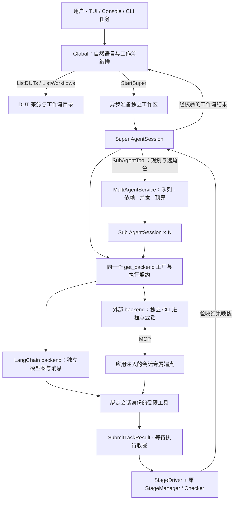

# 多 Agent：Global / Super / Sub

`multi` 启动三层 Agent：Global 接收自然语言并编排工作流；每个 Super 执行一个工作流；Sub 执行授权阶段或任务。`single` 为默认模式。TUI 和 MCP 不改变 Agent 的职责。

## 两种启动方式

```bash
# 只启动 Global，进入窗口后输入任务
ucagent --agent-mode multi --backend codex --config ./config.yaml

# 命令行指定模块和工作流，启动 Global 后自动创建 Super
ucagent ./examples/Adder Adder --agent-mode multi --backend codex \
  --plugin-workflow unittest:unittest --max-subagents 2 --config ./config.yaml

# 准备 Adder 工作区并执行同一条三层链路
make test_multi_Adder BACKEND=langchain MAX_SUBAGENTS=2
make mcp_multi_Adder BACKEND=codex MAX_SUBAGENTS=2

# 通用交互入口；DUT 工作区按任务准备
make multi MULTI_BACKEND=codex
make multi_unit MULTI_WORKSPACE=examples/Adder MULTI_DUT=Adder MULTI_BACKEND=codex
```

无初始任务时只有 Global，默认进入 TUI，不调用模型、不创建 Super/Sub。`--human` 选择 Console。`--loop-msg "任务"` 提供一次初始自然语言输入；没有指定工作流的 `--loop` 提交一次验证当前 DUT 的请求。

同时给出 DUT 和 `--plugin-workflow` 时，Global 自动按指定工作流创建任务，不再等待输入，也不让模型重新选择工作流。此时 `--loop-msg` 是该任务的补充要求。任务结束后默认继续接收指令；加 `--exit-on-completion` 则在子任务完成、结果验收及 Global 最终回复后退出，失败返回非零退出码。

`--plugin` 扩展 Global 的工作流目录，不在 Global 上激活业务工具、模板或阶段。启动时自动发现已安装插件、仓库插件和配置搜索路径内的插件；每个 Super 只加载所选工作流所属插件。`global_agent.allowed_workflows` 可进一步限制目录；显式任务不得超出限制。

`--agent-mode single|multi` 覆盖 `runtime_options.agent_mode`，也可仅在 YAML 或工作区配置中设置模式。`agent_run.role` 是内部子进程身份，不是另一个公开模式。运行中不能切换模式。

`--backend` 默认由 Global、Super、Sub 继承；启动 profile 可显式指定 Super 后端，其 Subs 使用同一后端。`--max-subagents` 范围为 1—128，覆盖各 profile 的每个 Super 并发上限；`global_agent.max_parallel_supers` 单独限制 Super 并发。并发数是上限，实际任务拆分由 Super 决定。

CLI 后端的 Global MCP 服务自动启用，默认分配本机端口；Super/Sub 使用各自的会话端点。单 Agent 的 CLI 后端仍需显式启用 MCP。执行前须准备所选后端的模型连接或 CLI 登录配置。

`test_multi_*` 默认 `BACKEND=langchain`，`mcp_multi_*` 默认 `BACKEND=codex`，两者均直接提交指定工作流，支持 `CFG / SIM / CWD / ARGS / MULTI_WORKFLOW`。通用 `make multi` 及工作流专用目标使用 `MULTI_*` 变量，详见 `make multi_help`。`multi_unit` 等目标只指定首个任务，后续仍可切换工作流；只有显式设置 `MULTI_WORKFLOW` 或 `allowed_workflows` 才限制目录。工作流目录、profile、界面导航和产物管理见 [Global Agent](13_global_agent.md)。

## 架构与职责



- `core/agent/session.py` 组合 owner 和 backend，统一执行轮次；复用唯一 StageManager，不重复准备工作区。
- `core/multi_agent/global_agent` 管理工作流目录、启动契约与结果验收；应用和 runtime 负责 Super 进程的生命周期。
- `core/multi_agent/super_agent` 管理阶段授权、角色、Sub 任务、队列、依赖和预算；不启动 CLI、不直接访问 LangChain 图。
- `core/multi_agent/mode.py` 统一解析公开模式与内部角色。
- `AgentBackendBase` 提供 `run_turn / cancel / wait_idle / close` 和能力声明。一次只执行一轮，取消通知不等于实际退出。
- LangChain backend 管理模型图、中间件、上下文与模型取消；`SessionCommandBackend` 管理 argv、进程组、私有文件与端点生命周期。CLI 的启动、恢复、MCP 配置和公开事件字段由 YAML/模板声明；新增 CLI 无需新增 Python 后端类。
- `application` 注入端点工厂，`interfaces/server/worker_mcp.py` 实现传输，runtime 管理统一退出；core 不反向导入外层包。

调度层没有 CLI 品牌或版本判断。外部 CLI 统一注册 `ucagent.core.backends.cmdline.SessionCommandBackend`，`backend=xx` 选择其配置。Codex/OpenCode 已使用这个公共类；其他仍指向旧 `UCAgentCmdLineBackend` 的内置配置保留 single 行为，迁移时只需补齐命令和会话配置，无需创建 `XxxBackend`。框架不会暗中回退 LangChain。

## 配置与角色

```yaml
backend: {key_name: langchain}       # 默认作用于三层，可用 --backend 覆盖
runtime_options: {agent_mode: multi}
global_agent:
  launch_profiles:
    standard:
      max_subagents: 2
multi_agent:
  default_role: analyst
  delegation_scope: auto
  stage_roles: {review: reviewer}   # 实际阶段 name
  limits:
    # 以下累计工作量保险丝默认关闭；设为正数才会限制执行。
    supervisor_backend_turns: 0
    worker_backend_turns: 0
    supervisor_model_rounds: 0
    worker_model_rounds: 0
    supervisor_tool_calls: 0
    worker_tool_calls: 0
    supervisor_timeout_seconds: 0
    worker_timeout_seconds: 0
    planning_revisions: 0
    # 只对连续异常熔断；成功操作会清零对应的连续失败计数。
    tool_error_streak: 8
    backend_error_streak: 3
    checker_repeat_failures: 8
    task_max_attempts: 2        # 仅限制失败任务的重试次数
  roles:
    analyst:
      system: "根据授权任务生成产物并提交结果。"
      allowed_tools: [ReadTextFile, EditTextFile]
    reviewer:
      system_file: prompts/reviewer.md
      allowed_tools: [ReadTextFile, EditTextFile]
```

角色不再默认覆盖为 LangChain；托管模式继承顶层 backend，旧角色字段与顶层冲突时报错。`system/system_file` 二选一，相对路径以业务工作区为基准。角色选择顺序：任务 `role` → `stage_roles` → `default_role`。LangChain 角色可用 `model_overrides` 修改模型连接/上下文设置；外部 CLI 使用自身配置，不套用 UCAgent 的 OpenAI 参数。

累计工具调用、模型轮次、后端轮次、规划次数和 Super/Sub 总时长都是可选保险丝，`0` 表示关闭；默认不因健康执行持续时间或成功调用数量而暂停。连续工具错误、后端错误及相同 Checker 诊断达到阈值后会暂停并显示异常类别与计数；对应操作成功后清零连续失败计数。`task_max_attempts` 只限制失败任务的重试次数。单次工具调用自身的超时仍按工具配置生效。

工具权限取角色白名单与工作流工具交集，生命周期工具由框架绑定身份。Super 仅有规划/状态和有限只读工具；Sub 不能再委派或全局跳阶段。每个 Sub 都有独立工具对象、backend、会话及取消状态。

外部 backend 尚未适配内部 embedding 与阶段 LLM 辅助审核。外部执行自动选择不使用内部 embedding 的工具路径；启用不兼容的 `vmanager.llm_suggestion.*.enable` 会明确报错，不静默跳过审核或启动 LangChain。要保留这些审核，应使用支持它们的后端。

最小三层启动配置见 [multi-agent.yaml](../../examples/multi-agent.yaml)。阶段和验收条件由选定的插件工作流提供。

## 规划、连续执行与验收

Super 必须真实调用模型，通过 `SubAgentTool` 提交计划。框架不会自行分析生成替代计划。提交后收拢当前执行，等待任务验收事件再唤醒 Super；等待期间不轮询模型。普通文字回复会在同一会话与原预算内续跑，不能当作业务完成。`PauseWorkflow` 按问题类别暂停；恢复动作与预算规则见下文。普通聊天不会重新进入规划循环。

```json
{"plan_id":"stage-one","scope":"auto","tasks":[{"id":"work","instruction":"完成当前授权阶段","role":"analyst"}]}
```

托管 MCP 提交需带 `CurrentTips.planning_token`。每次规划只有一个有效 token，迟到调用和重复派发不能越过当前授权。

- `auto/subtree`：一个 Sub 连续完成 3.1→3.2→…；用当前 `step_token` 调用 `CompleteSubStage`。子阶段完成或普通文字结束不会创建新任务尝试。过早 `SubmitTaskResult` 返回 `SUBSTAGES_REMAIN`，继续当前会话修复。
- `stage`：只处理当前步骤，完成实现与日志后提交。对子树缩小 scope 必须说明 `scope_reason`。
- `task`：独立文件任务，可并行；必须声明具体 inputs/outputs，输出不重叠，依赖无环，输入生产者是显式依赖。不开放 Check、阶段日志和 Skill 完成工具。已有产物契约及最终阶段 Checker 仍执行。

`auto/stage/subtree` 委派继承工作流的 `write_dirs / un_write_dirs`；`inputs` 表示必须存在的输入，不会额外冻结工作流允许修改的文件。`outputs` 可省略或只列出部分产物，不会缩小这些委派的写入范围；产物仍由阶段 Checker 验收。例如，后续阶段可继续编辑作为输入的 API 文件，无须重复将其声明为输出。工作流禁止修改的输入仍受写入检查及结束时的内容校验保护。

`scope=task` 拆分任务必须声明具体输出，且只能写入这些输出；`inputs` 中未同时列入 `outputs` 的文件只读，需要原地修改时将同一路径列入两者。同任务的原地更新不需要自依赖；其他任务生产的输入仍必须声明依赖。Sub 的 `CurrentTips.file_access` 返回文件工具实际采用的权限；拆分任务可创建其输出所需的父目录，但不能写入未分配的其他文件。隔离任务回传已有文件时保留其原有权限。

队列不截断超额任务。A/B 通过产物验收后才能解锁依赖它们的 C。构造中、执行中、已提交但未退出、取消但未退出都占 Sub 名额。Super 不占该名额。重试、重新规划、换 plan/task ID 不能刷新同一逻辑任务的累计预算或绝对时限。

**Check 由独占 Sub 发起；子阶段 Complete 也由 Sub 发起；授权根阶段的最终 Complete 由框架在所有 Sub 退出后执行。** 这些操作始终经过同一个 StageDriver、StageManager 和 Checker。纯分组节点不追加父 Checker。Skill、人工审核、BatchTask 和签名证据门槛保持有效。`SubmitTaskResult` 或进程零退出码都不代表验收通过。最后一个子阶段推进完但尚未提交的超时任务也不能让工作流成功结束。

独占 Sub 的 `Complete` 是受限兼容工具：子树要求最新 step_token；单阶段要求日志，转换为提交，返回 validation_pending，不能直接绕过最终验收。阶段完成后的自动摘要/清空继续停用，阈值摘要和手动摘要保持原行为。

## 外部执行、取消与输出

会话资料位于 `.ucagent/multi_agent/<run>/super/` 或 `<run>/<plan>/<task>/<attempt>/`。每个 CLI 独立 prompt、stdout/stderr、MCP URL/凭据和进程组。业务 cwd 不等于会话目录：独占任务使用真实工作区；并行文件任务使用声明输入/已有输出的私有副本，退出后验证并发布声明产物。

所有 CLI 共用 `SessionCommandBackend`，通过以下配置描述外部程序，不新增品牌专属 Python 文件：

| 配置 | 含义 |
| --- | --- |
| `executable / argv / new_args / resume_args` | 可执行文件、公共参数、新会话参数、续接参数；始终以 argv 执行，不经过 shell |
| `files / env` | 会话目录内的私有配置文件与进程环境；支持 MCP URL、凭据环境变量和角色工具名 |
| `output.format / output.events` | 可选的 JSONL 字段映射：正文、会话 ID、结束、错误、用量；原始字典不进入消息日志 |
| `inspect / validate` | 可选的 JSON 配置探测和验证命令；内置配置用它关闭继承的其他 MCP 端点 |
| `yield_timeout` | 已接收工具响应后，最多等多久让 CLI 保存上下文，默认 5 秒；主动取消不等待 |

参数和文件使用 Jinja 模板，可引用 `workspace / session_dir / prompt_file / session_id / mcp_url / server_name / tools / managed`。MCP token 通过 `UCAGENT_WORKER_MCP_TOKEN` 提供给子进程。配置内容只写入私有会话目录，不覆盖项目配置或用户全局配置。新 CLI 可以直接在用户配置中声明这些字段，复杂 JSON/命令参数也可内联模板，不必向 UCAgent 的 assets 目录安装文件。

```yaml
backend:
  key_name: client_a
  client_a:
    clss: ucagent.core.backends.cmdline.SessionCommandBackend
    args:
      executable: cli-a
      argv: ["{{ executable }}", --config, "{{ session_dir }}/mcp.json"]
      new_args: [run, --json]
      resume_args: [run, --json, --session, "{{ session_id }}"]
      files:
        mcp.json: |
          {"mcpServers":{"ucagent":{"url":{{ mcp_url | tojson }},"headers":{"Authorization":"Bearer {env:UCAGENT_WORKER_MCP_TOKEN}"}}}}
      output:
        format: jsonl
        events:
          - {match: {event: start}, session: conversation}
          - {match: {event: message}, text: body.text}
          - {match: {event: done}, done: true}
```

上例是接口示意；命令参数、MCP 配置格式、凭据替换语法和事件字段应按目标 CLI 填写。MCP 统一工具调用，不统一 CLI 的启动与恢复参数。提示词默认经 stdin 传入，同时提供 `prompt_file`。支持纯文本 CLI，无需实现 JSONL；这类客户端可通过 `session_dir` 内独立的历史存储及 `resume_args` 续接，不能在共享目录中无隔离地使用“最近会话”。缺少续接配置或需要的 session ID 时明确报错，不创建替代会话冒充恢复。

内置 Codex 配置声明明确 session ID、只读原生沙箱、受限工具授权。托管会话设置 `include_permissions_instructions=false`，避免将原生进程的只读沙箱提示误用于 MCP 文件操作；原生沙箱仍生效，MCP 文件权限由 UCAgent 的任务授权与工具校验执行。OpenCode 配置声明明确 session ID、关闭外部插件、独立命名 Agent 的工具权限。两者都禁用继承的其他 MCP 端点，保留 CLI 自身的模型/登录配置。单 Agent 的原生工具策略单独配置，不被 multi 权限误伤。新增 CLI 还应配置原生工具权限：MCP 服务端只能限制经自身执行的工具，私有 cwd 本身不是系统沙箱。

提交后先等 MCP 响应收拢，再让通用 CLI 后端结束本轮；CLI 取消作用于其进程组。实际模型请求、子进程、在途工具未退出时继续显示 pending，不提前释放资源。Console 的退出宽限与强退见[运行控制](10_runtime_control.md)。

默认 `log/ucagent-log.log` 记录调度事件，`log/ucagent-msg.log` 记录消息；可用 `--log-file/--msg-file` 覆盖。事件关联 backend/session/task/attempt。消息沿用现有 text 正文过滤，外部事件原始字典不灌入模型或消息正文；未知 CLI 事件留在私有 stdout。必要的 planning_token/step_token 保留在实际协议中。

`TaskStatus` 提供累计 backend 轮次、受管工具次数与剩余时间。CLI 不可观测的内部模型轮次显示 null，不伪造为 0。`SubAgentTool.call_count` 是实际工具调用数，worker 数量另看 `metrics.worker_starts`。

LangChain Super/Sub 的 Langfuse callback 独立、共享同一个 run/session 关联，收拢后再关闭共享客户端；保留 HTTP 客户端隔离及非法工具 JSON 在原会话修复的行为。CLI 只记录能取得的公开文本、工具事件及用量，不能仅凭 MCP 获取它的完整内部模型上下文。

## 验收边界

自动化测试覆盖两种三层启动入口、独立子进程和 MCP 传输、真实 Checker 与产物回执、结果返回 Global 后退出，以及 Super/Sub 的依赖调度、连续子阶段和取消。端到端进程测试使用离线 CLI 决策脚本，不能替代真实模型或实际 Adder/EDA 验证。

Sub 队列重启恢复、嵌套 Sub 和 multi 与 Master 联用尚不支持。

跨工作流串联由 Global 在上游验收后创建后续 Super，见[工作流接力](12_workflow_handoff.md)。


## 分类处理、暂停与恢复

处理策略按问题类别定义，不匹配具体工具名或错误字符串：

| 类别 | 统一措施 | 恢复条件 |
| --- | --- | --- |
| `repairable` 可修复失败 | 失败及 Checker 反馈返回 Super，在原预算内重新规划 | 新执行通过验收 |
| `capability` 能力不匹配 | 核对实际授权工具声明的能力；条件已满足时要求继续使用可用能力 | 缺失条件重新检查通过 |
| `environment` 环境或输入缺失 | 展示未满足条件和具体处理动作 | 可验证条件检查通过；未验证项仍明确标注 |
| `input` 用户决定 | 保留现场并提出具体问题 | 收到回复 |
| `review` 人工审核 | 使用原有审核入口和版本校验 | 审核通过，普通回复不能替代审核 |
| `budget` 执行额度耗尽 | 暂停，展示累计消耗和追加建议 | 操作员明确追加对应额度 |
| `operator` 主动暂停 | 收拢执行，保留文件与进度 | 操作员继续 |

Sub 使用 `SubmitTaskResult(status="needs_attention", summary=..., issue=...)` 报告未完成工作。
`issue` 包含 `kind`、`summary`、`next_action`，以及可选的 `conditions`、`evidence_ids`。实际调用证据由运行时生成；无法验证的判断标为 Agent 报告，不将模型文字当作权限或环境故障的证明。`ready` 仍需阶段 Checker 验收。

```json
{
  "status": "needs_attention",
  "summary": "必需输入尚未提供，其他已完成工作保留",
  "issue": {
    "kind": "environment",
    "summary": "缺少 inputs/requirements.md",
    "next_action": "提供该输入，然后重新检查并继续",
    "conditions": [{"kind": "file_exists", "value": "inputs/requirements.md"}],
    "evidence_ids": []
  }
}
```

内置条件检查包括 `file_exists`、`file_writable`（工作区写策略）、`tool_available`、`capability_available`。条件的 `value` 分别为工作区相对文件路径、工具名或能力名。工具可声明 `capabilities`；Sub 的 `CurrentTips` 返回实际可用的能力与工具。可信扩展可通过 `service.requirement_checks.register(name, check)` 注册只读条件检查，回调接收 `(service, record, value)` 并返回布尔值；未知检查显示“尚未核实”，不执行任意检查命令。

Super 的输入语义分开：

- 普通文本或 `MessageSuper`：补充指导，在下一次规划边界送达，不自动恢复暂停任务。
- `chat "问题"`：只读讨论；不提交计划、不改变暂停原因、不消耗阶段规划次数。单次模型调用仍受执行时间和调用次数限制。
- TUI 状态卡的 `Resume`（继续）、`Reply`（回复）、`Add budget`（追加额度）、`Review`（审核）：提交对应操作；也可使用 `/resume`、`/reply 回复内容`、`/budget`。
- Console 的 `workflow_recovery`：读取当前问题、额度与可用操作；`workflow_recover` 接收结构化恢复请求。例如：

```text
workflow_recover {"issue_id":"从当前状态读取的ID","action":"grant","grant":{"planning_revisions":3,"worker_tool_calls":100},"message":"按补充要求继续"}
```

追加额度作用于当前阶段或具体逻辑任务；消耗不清零，历史追加保留。重新命名计划不能刷新预算。人工等待不消耗 Sub 的执行时限，工具自身超时仍有效。重复提交同一个恢复请求只启动一次；旧问题 ID 不能恢复新问题。恢复前必须等待旧执行退出，不能同时写入同一任务。

暂停后保留工作区和已验收进度。若已验收阶段声明的输入或产物在暂停期间变化，恢复时从最早受影响阶段重新验收，并清除该阶段及后续阶段的旧审核、读取和 Skill 完成证据。暂停恢复针对存活的会话；进程已经退出时使用 Global 的重试入口，创建新尝试。
