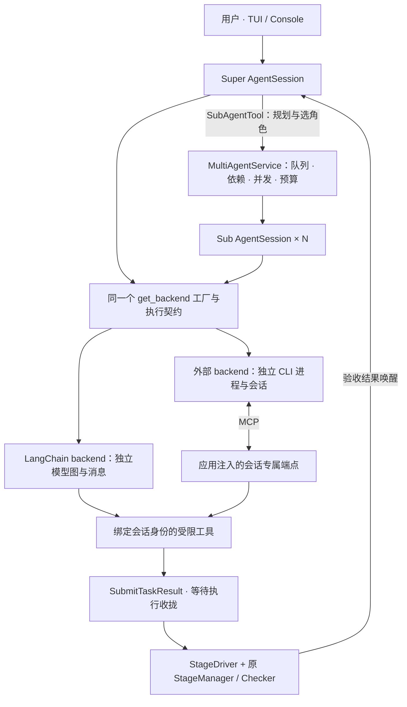

# 多 Agent：统一后端会话

multi-agent 管理规划、任务依赖、并发和验收；`backend` 决定 Agent 如何执行。Super 和每个 Sub 都通过同一个 `get_backend()` 工厂创建独立后端。TUI 是交互界面，MCP 是工具传输，不选择另一套调度流程。默认仍为 single。

## 启动

```bash
# 单 Agent 保持原入口
ucagent ./workspace DUT --agent-mode single

# LangChain Super + 独立 LangChain Sub
ucagent ./workspace DUT --agent-mode multi --backend langchain --max-subagents 2 --no-embed-tools

# 外部 CLI Super + 独立外部 CLI Sub；主、子进程均由框架管理
ucagent ./workspace DUT --agent-mode multi --backend codex --max-subagents 2 --no-embed-tools

# 原 Adder 工作区和 TUI 入口，默认开启日志
make test_multi_Adder BACKEND=langchain MAX_SUBAGENTS=2
make mcp_multi_Adder BACKEND=codex MAX_SUBAGENTS=2
make mcp_multi_Adder BACKEND=opencode MAX_SUBAGENTS=2
```

`test_multi_*` 默认 `BACKEND=langchain`，`mcp_multi_*` 默认 `BACKEND=codex`，均可覆盖。后者还开放主 MCP 服务；二者都启动托管规划闭环，支持原 `CFG / SIM / CWD / ARGS`。TUI 与 backend 可自由组合，无需在另一个终端维持 Super。执行前须准备所选后端的模型连接或 CLI 登录配置。

托管 CLI 的会话专属 MCP 端点由应用注入，执行前等待 ready；不要求用户另开主 MCP 服务。单 Agent 的原 CLI 入口仍要求显式启动 MCP。框架不会因为 `--tui` 或 `--mcp-server` 自动改变 backend。

`--agent-mode single|multi` 控制 `runtime_options.multi_agent_enabled`。single 不读角色文件、不创建队列或 Sub；`--max-subagents` 只用于 multi，范围 1—128。运行中不能切换模式。并发数是上限，是否拆分由 Super 分析依赖决定，测试/波形等共享状态仍独占执行。

手动外部 Super 仍可使用 `--backend blank --mcp-server`，但必须在角色中明确指定已注册的执行 backend。此模式没有内部规划模型，客户端自行调用 `SubAgentTool`；执行后显示 `waiting_plan`。它不支持自动 `loop/StartWorkflow`，也不是托管 CLI 模式。

## 架构与职责



- `core/agent/session.py` 组合 owner 和 backend，统一执行轮次；复用唯一 StageManager，不重复准备工作区。
- `core/multi_agent` 管理授权、角色、任务、队列、依赖和结果；不启动 CLI、不直接访问 LangChain 图。
- `AgentBackendBase` 提供 `run_turn / cancel / wait_idle / close` 和能力声明。一次只执行一轮，取消通知不等于实际退出。
- LangChain backend 管理模型图、中间件、上下文与模型取消；`SessionCommandBackend` 管理 argv、进程组、私有文件与端点生命周期。CLI 的启动、恢复、MCP 配置和公开事件字段由 YAML/模板声明；新增 CLI 无需新增 Python 后端类。
- `application` 注入端点工厂，`interfaces/server/worker_mcp.py` 实现传输，runtime 管理统一退出；core 不反向导入外层包。

调度层没有 CLI 品牌或版本判断。外部 CLI 统一注册 `ucagent.core.backends.cmdline.SessionCommandBackend`，`backend=xx` 选择其配置。Codex/OpenCode 已使用这个公共类；其他仍指向旧 `UCAgentCmdLineBackend` 的内置配置保留 single 行为，迁移时只需补齐命令和会话配置，无需创建 `XxxBackend`。框架不会暗中回退 LangChain。

## 配置与角色

```yaml
backend: {key_name: langchain}       # 同时作用于 Super/Sub，可用 --backend 覆盖
runtime_options: {multi_agent_enabled: true}
multi_agent:
  max_workers: 2
  default_role: analyst
  delegation_scope: auto
  stage_roles: {review: reviewer}   # 实际阶段 name
  limits:
    supervisor_backend_turns: 8    # 同一规划授权内的执行/恢复轮次
    worker_backend_turns: 80       # 同一逻辑任务，跨重试累计
    supervisor_model_rounds: 8     # 仅具备真实模型调用计量的 backend
    worker_model_rounds: 80
    supervisor_tool_calls: 40
    worker_tool_calls: 200
    supervisor_timeout_seconds: 300
    worker_timeout_seconds: 1800
    task_max_attempts: 2
    planning_revisions: 3
  roles:
    analyst:
      system: "根据授权任务生成产物并提交结果。"
      allowed_tools: [ReadTextFile, EditTextFile]
    reviewer:
      system_file: prompts/reviewer.md
      allowed_tools: [ReadTextFile, EditTextFile]
```

角色不再默认覆盖为 LangChain；托管模式继承顶层 backend，旧角色字段与顶层冲突时报错。`system/system_file` 二选一，相对路径以业务工作区为基准。角色选择顺序：任务 `role` → `stage_roles` → `default_role`。LangChain 角色可用 `model_overrides` 修改模型连接/上下文设置；外部 CLI 使用自身配置，不套用 UCAgent 的 OpenAI 参数。

工具权限取角色白名单与工作流工具交集，生命周期工具由框架绑定身份。Super 仅有规划/状态和有限只读工具；Sub 不能再委派或全局跳阶段。每个 Sub 都有独立工具对象、backend、会话及取消状态。

外部 backend 尚未适配内部 embedding 与阶段 LLM 辅助审核。multi 外部执行要求 `--no-embed-tools`；启用不兼容的 `vmanager.llm_suggestion.*.enable` 会明确报错，不静默跳过审核或启动 LangChain。要保留这些审核，应使用支持它们的后端。

最小阶段示例见 [multi-agent.yaml](../../examples/multi-agent.yaml)，展示一个 Sub 连续完成两个子阶段，再由下一个 Sub 汇总。

## 规划、连续执行与验收

Super 必须真实调用模型，通过 `SubAgentTool` 提交计划。框架不会自行分析生成替代计划。提交后收拢当前执行，等待任务验收事件再唤醒 Super；等待期间不轮询模型。普通文字回复会在同一会话与原预算内续跑，不能当作业务完成。`PauseWorkflow` 用于实际阻塞，用户可用 `continue <补充信息>` 或 `StartWorkflow(instruction=...)` 恢复。

```json
{"plan_id":"stage-one","scope":"auto","tasks":[{"id":"work","instruction":"完成当前授权阶段","role":"analyst"}]}
```

托管 MCP 提交需带 `CurrentTips.planning_token`。每次规划只有一个有效 token，迟到调用和重复派发不能越过当前授权。

- `auto/subtree`：一个 Sub 连续完成 3.1→3.2→…；用当前 `step_token` 调用 `CompleteSubStage`。子阶段完成或普通文字结束不会创建新任务尝试。过早 `SubmitTaskResult` 返回 `SUBSTAGES_REMAIN`，继续当前会话修复。
- `stage`：只处理当前步骤，完成实现与日志后提交。对子树缩小 scope 必须说明 `scope_reason`。
- `task`：独立文件任务，可并行；必须声明具体 inputs/outputs，输出不重叠，依赖无环，输入生产者是显式依赖。不开放 Check、阶段日志和 Skill 完成工具。已有产物契约及最终阶段 Checker 仍执行。

队列不截断超额任务。A/B 通过产物验收后才能解锁依赖它们的 C。构造中、执行中、已提交但未退出、取消但未退出都占 Sub 名额。Super 不占该名额。重试、重新规划、换 plan/task ID 不能刷新同一逻辑任务的累计预算或绝对时限。

**Check 由独占 Sub 发起；子阶段 Complete 也由 Sub 发起；授权根阶段的最终 Complete 由框架在所有 Sub 退出后执行。** 这些操作始终经过同一个 StageDriver、StageManager 和 Checker。纯分组节点不追加父 Checker。Skill、人工审核、BatchTask 和签名证据门槛保持有效。`SubmitTaskResult` 或进程零退出码都不代表验收通过。最后一个子阶段推进完但尚未提交的超时任务也不能让工作流成功结束。

独占 Sub 的 `Complete` 是受限兼容工具：子树要求最新 step_token；单阶段要求日志，转换为提交，返回 validation_pending，不能直接绕过最终验收。阶段完成后的自动摘要/清空继续停用，阈值摘要和手动摘要保持原行为。

## 外部执行、取消与输出

会话资料位于 `.ucagent/multi_agent/<run>/super/` 或 `<run>/<plan>/<task>/<attempt>/`。每个 CLI 独立 prompt、stdout/stderr、MCP URL/凭据和进程组。业务 cwd 不等于会话目录：独占任务使用真实工作区；并行文件任务使用声明输入/已有输出的私有副本，退出后验证并发布声明产物。

所有 CLI 共用 `SessionCommandBackend`，通过以下配置描述外部程序，不新增品牌专属 Python 文件：

| 配置 | 含义 |
| --- | --- |
| `executable / argv / new_args / resume_args` | 可执行文件、公共参数、新会话参数、续接参数；始终以 argv 执行，不经过 shell |
| `files / env` | 会话目录内的私有配置文件与进程环境；支持 MCP URL、凭据环境变量和角色工具名 |
| `output.format / output.events` | 可选的 JSONL 字段映射：正文、会话 ID、结束、错误、用量；原始字典不进入消息日志 |
| `inspect / validate` | 可选的 JSON 配置探测和验证命令；内置配置用它关闭继承的其他 MCP 端点 |
| `yield_timeout` | 已接收工具响应后，最多等多久让 CLI 保存上下文，默认 5 秒；主动取消不等待 |

参数和文件使用 Jinja 模板，可引用 `workspace / session_dir / prompt_file / session_id / mcp_url / server_name / tools / managed`。MCP token 通过 `UCAGENT_WORKER_MCP_TOKEN` 提供给子进程。配置内容只写入私有会话目录，不覆盖项目配置或用户全局配置。新 CLI 可以直接在用户配置中声明这些字段，复杂 JSON/命令参数也可内联模板，不必向 UCAgent 的 assets 目录安装文件。

```yaml
backend:
  key_name: client_a
  client_a:
    clss: ucagent.core.backends.cmdline.SessionCommandBackend
    args:
      executable: cli-a
      argv: ["{{ executable }}", --config, "{{ session_dir }}/mcp.json"]
      new_args: [run, --json]
      resume_args: [run, --json, --session, "{{ session_id }}"]
      files:
        mcp.json: |
          {"mcpServers":{"ucagent":{"url":{{ mcp_url | tojson }},"headers":{"Authorization":"Bearer {env:UCAGENT_WORKER_MCP_TOKEN}"}}}}
      output:
        format: jsonl
        events:
          - {match: {event: start}, session: conversation}
          - {match: {event: message}, text: body.text}
          - {match: {event: done}, done: true}
```

上例是接口示意；命令参数、MCP 配置格式、凭据替换语法和事件字段应按目标 CLI 填写。MCP 统一工具调用，不统一 CLI 的启动与恢复参数。提示词默认经 stdin 传入，同时提供 `prompt_file`。支持纯文本 CLI，无需实现 JSONL；这类客户端可通过 `session_dir` 内独立的历史存储及 `resume_args` 续接，不能在共享目录中无隔离地使用“最近会话”。缺少续接配置或需要的 session ID 时明确报错，不创建替代会话冒充恢复。

内置 Codex 配置声明明确 session ID、只读原生沙箱、受限工具授权；OpenCode 配置声明明确 session ID、关闭外部插件、独立命名 Agent 的工具权限。两者都禁用继承的其他 MCP 端点，保留 CLI 自身的模型/登录配置。单 Agent 的原生工具策略单独配置，不被 multi 权限误伤。新增 CLI 还应配置原生工具权限：MCP 服务端只能限制经自身执行的工具，私有 cwd 本身不是系统沙箱。

提交后先等 MCP 响应收拢，再让通用 CLI 后端结束本轮；CLI 取消作用于其进程组。实际模型请求、子进程、在途工具未退出时继续显示 pending，不提前释放资源。Console 的退出宽限与强退见[运行控制](10_runtime_control.md)。

默认 `log/ucagent-log.log` 记录调度事件，`log/ucagent-msg.log` 记录消息；可用 `--log-file/--msg-file` 覆盖。事件关联 backend/session/task/attempt。消息沿用现有 text 正文过滤，外部事件原始字典不灌入模型或消息正文；未知 CLI 事件留在私有 stdout。必要的 planning_token/step_token 保留在实际协议中。

`TaskStatus` 提供累计 backend 轮次、受管工具次数与剩余时间。CLI 不可观测的内部模型轮次显示 null，不伪造为 0。`SubAgentTool.call_count` 是实际工具调用数，worker 数量另看 `metrics.worker_starts`。

LangChain Super/Sub 的 Langfuse callback 独立、共享同一个 run/session 关联，收拢后再关闭共享客户端；保留 HTTP 客户端隔离及非法工具 JSON 在原会话修复的行为。CLI 只记录能取得的公开文本、工具事件及用量，不能仅凭 MCP 获取它的完整内部模型上下文。

## 验收边界

本轮定向验收使用真实子进程/MCP、三种配置的模拟 CLI（Codex/OpenCode/client_a）：主子隔离、跨轮恢复、连续子阶段和后续规划；另验证 LangChain/CLI 的 A/B→C 调度、取消与失败，以及 single 配置。已用本机 Codex/OpenCode 做无模型调用的有效 MCP 配置检查。此前专用后端的真实模型最小闭环属于历史记录，不能代替本轮回归；本轮没有运行真实模型闭环、实际 Adder 或全量测试。

工作流自动切换、运行中自然语言收件箱、队列重启恢复、嵌套 Sub 和 Master 尚未实施。实现完全位于 UCAgent，不导入旁边的旧 SubAgent 项目。
