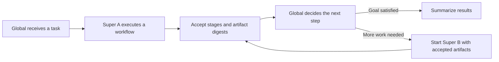

# Workflow Handoff

In three-tier `multi` mode, Global owns cross-workflow orchestration. A Super completes its current workflow and returns accepted results; Global decides whether to launch another Super based on the original goal, latest instructions, and available artifacts.

## Execution Flow



Users do not need to submit a DAG. Independent workflows may start in parallel; a workflow depending on upstream artifacts may start only after upstream acceptance succeeds. Every workflow is subject to Global's catalog, launch profiles, concurrency limits, and request budgets. See [Global Agent](13_global_agent.md) for configuration.

## Artifact Handoff

When calling `StartSuper`, Global uses `inputs` to specify the target's declared input paths and their sources. For example:

```json
{
  "workflow_ref": "relay-sink:consume",
  "instruction": "Increment the validated value and check the result.",
  "inputs": {
    "inputs/payload.json": {
      "agent_id": "super-source",
      "attempt": 1,
      "path": "result_a/payload.json"
    }
  }
}
```

The input mapping must exactly match the target workflow's declarations. Sources must be accepted files from a successful attempt. Digests are rechecked during copying, and the target uses read-only copies in an independent workspace. Invalid or modified artifacts cannot serve as inputs. A `StartSuper` response means only that the task was accepted for execution; final success still depends on workflow Checkers and the run receipt.

The public `multi` entry does not enable `runtime_options.workflow_handoff_enabled`. The embedded internal Super's handoff engine does not participate in this three-tier launch chain. Its test record is documented in [Internal Handoff Engine Validation](../03_develop/11_workflow_handoff_validation.md).
