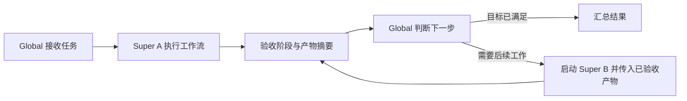

# 工作流接力

三层 `multi` 中，跨工作流编排由 Global 负责。Super 完成当前工作流并返回经过验收的结果；Global 根据原始目标、最新指令和可用产物决定是否启动后续 Super。

## 执行流程



无需用户提交 DAG。独立工作流可以并行启动；依赖上游产物的工作流只能在上游验收成功后启动。所有工作流受 Global 的目录、启动 profile、并发和请求预算约束，配置见 [Global Agent](13_global_agent.md)。

## 产物交接

Global 调用 `StartSuper` 时，用 `inputs` 指定目标声明的输入路径及其来源。例如：

```json
{
  "workflow_ref": "relay-sink:consume",
  "instruction": "Increment the validated value and check the result.",
  "inputs": {
    "inputs/payload.json": {
      "agent_id": "super-source",
      "attempt": 1,
      "path": "result_a/payload.json"
    }
  }
}
```

输入映射必须完整匹配目标工作流声明。来源必须是成功 attempt 中已验收的文件；复制时复核摘要，目标使用独立工作区中的只读副本。无效或已被修改的产物不能作为输入。`StartSuper` 返回只表示任务已接受，最终成功仍取决于工作流 Checker 和运行回执。

公开 `multi` 入口不启用 `runtime_options.workflow_handoff_enabled`。嵌入式内部 Super 的接力引擎不参与这条三层启动链路，其测试记录见[内部接力引擎验证](../03_develop/11_workflow_handoff_validation.md)。
