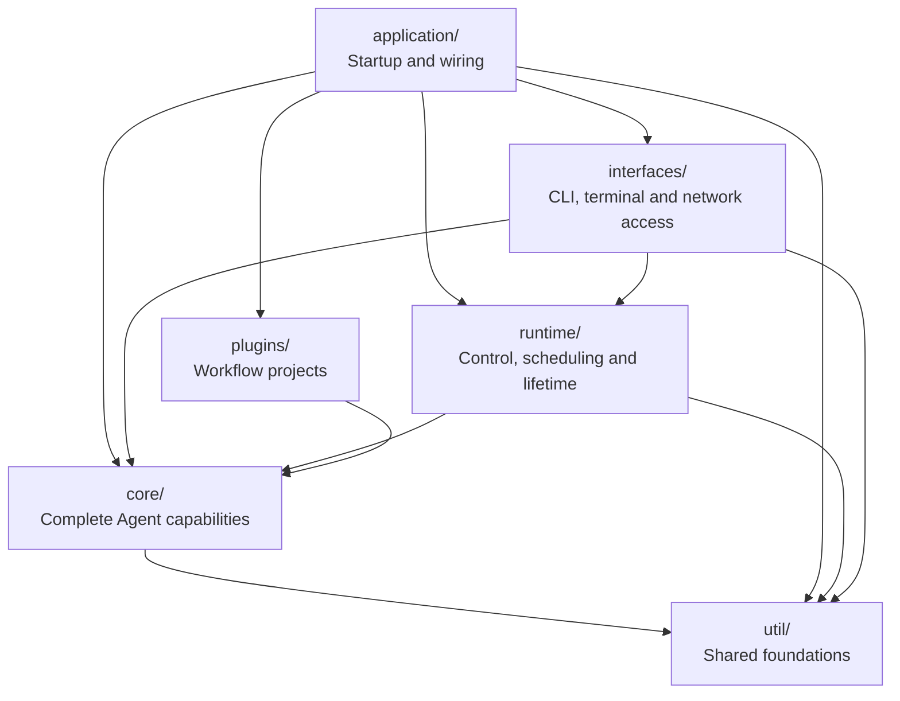
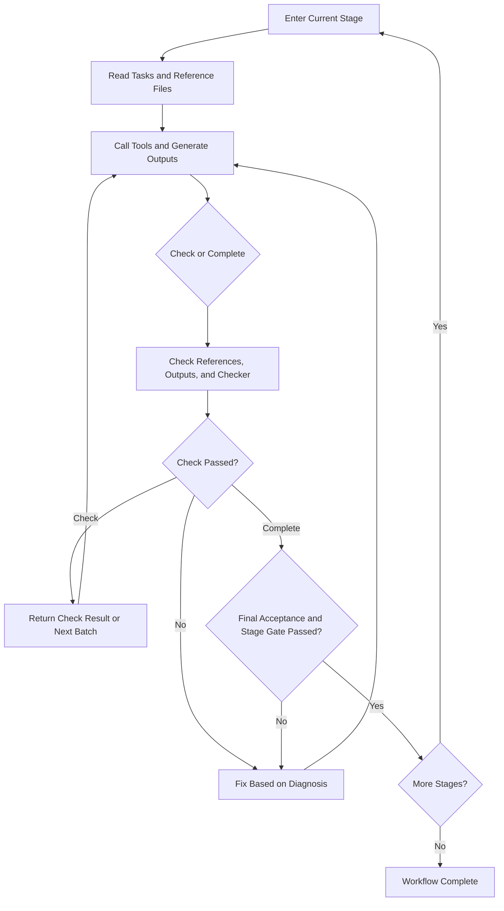

# Architecture and Operation

UCAgent defines tasks through workflows, executes them through an Agent and its tools, and accepts artifacts through stages and Checkers. The package groups existing capabilities by responsibility: a complete Agent in `core/`, startup in `application/`, instance ownership in `runtime/`, and human/network access in `interfaces/`.

## Directory Responsibilities

| Directory | Responsibility |
| --- | --- |
| `core/agent/` | Task configuration, Agent-owned construction, execution, messages and statistics |
| `core/backends/` | LangChain, command-line and blank backends; client configuration templates in `assets/` |
| `core/interaction/` | Enhanced execution, reflection and adaptive tool orchestration |
| `core/stage/` | Stage progression, Check/Complete, history, human/model review |
| `core/checkers/` | Checker lifecycle, diagnostics and BatchTask |
| `core/tools/` | Complete generic file, shell, planning, memory, context and Skill tools |
| `core/workspace/` | Task documents/templates/skills, instruction generation and permission restoration |
| `core/plugins.py` | Plugin declarations, discovery, validation and capability registries |
| `core/locales/` | Framework language configuration; Chinese defaults are `zh.yaml` |
| `application/` | Entry orchestration, launch requests/plans, workspace sources, logging and runtime wiring |
| `application/presets/` | Application-mode presets, including `zh/master.yaml` |
| `runtime/` | Host lifetime, operation scheduling/cancellation, service ownership, sessions and output buffers |
| `runtime/control/` | Controller, command schemas, dispatch and plugin command registration |
| `interfaces/cli/` | CLI syntax, management actions and conversion to launch data |
| `interfaces/terminal/` | Console and result formatting; TUI lives in `tui/` |
| `interfaces/server/` | HTTP, MCP, Master, Web Terminal, pages, static assets and viewer conversion |
| `plugins/` | Independently owned workflow projects and their documents/templates/skills and domain implementations |
| `util/` | Shared configuration, file policy, logging and other foundation functions |

`core/` contains the full Agent implementation, including concrete backends and tools. It is not limited to abstract interfaces. Plugin resources stay with their workflow; core preparation selects and materializes them as one task contract. Root `setting.yaml` remains the cross-layer defaults file.

## Directory Dependency Direction

The arrows below describe the main source dependency direction, not runtime callbacks. The application selects and wires existing concrete implementations; no new execution framework is introduced.

The core package does not import `application`, `runtime` or `interfaces`. Runtime does not import application or concrete interfaces. Interfaces do not call back into application startup. Utilities do not import these business packages. `tests/test_dependency_boundaries.py` checks absolute, relative and function-local imports. These package boundaries do not claim that every internal module or dynamically loaded plugin is globally acyclic.

Service constructors are supplied by application wiring. Runtime sessions receive result-formatting callbacks from terminal/application callers, so shared session state has no frontend import. Plugin command declarations are registered by runtime control rather than the core plugin loader.

## Startup, Execution and Shutdown

1. `ucagent`, `python -m ucagent`, and source `ucagent.py` reach `application/entry.py`, which calls CLI parsing and handles management requests before constructing an Agent.
2. CLI conversion supplies plain launch data; application creates a `LaunchRequest`, resolves workspace sources and logging, and invokes core task configuration. `core/locales/<language>.yaml` supplies framework prompts; `application/presets/<language>/` supplies named application presets. The [configuration precedence](03_workflow.md#3-configuration-loading-and-template-variables) is preserved.
3. `core/agent/construction.py` prepares selected workflow resources and constructs stages, tools, backends and execution state. Python callers use the same path through `from ucagent import VerifyAgent`, without importing application startup.
4. Application creates RuntimeHost and sessions, supplies concrete service constructors and presentation callbacks, and hands over cleanup. MCP and other requested services become ready before user/model startup commands execute.
5. Startup commands retain their ordering. TUI readiness releases the display gate; runtime owns their execution. Tasks without an interface or service default to execution; service and interactive launches wait for explicit model work.
6. Runtime schedules Agent work. Backends invoke tools; stage tools enter the same StageManager and Checkers. HTTP controls the runtime, while MCP exposes the same task tools. MCP calls do not automatically create HTTP operation IDs.
7. TUI detaches without closing the task. Instance shutdown drains work and services, persists state, and restores acquired resources. Workspace-contained shared-library links retain their original target permissions.

LangChain prepares models on first model work. Command-line backends prepare against a ready MCP endpoint. Queries and deterministic tools do not prepare the main model; explicitly enabled embedding/review capabilities retain their own requirements. See [Runtime Control](../02_usage/10_runtime_control.md).

## Stage Execution Loop

`Check` does not advance the stage, but batch Checkers can switch to the next batch after passing. `Complete` performs its own final check; ordinary stages do not require calling `Check` first. The "No Applicable Work" branch of skills additionally requires the current `Check` to pass; see [Skills](../02_usage/08_skill.md).

## How Stages Accept

- `reference_files` declares reference files that need to be read. Read records are generated by the `ReadTextFile` tool; file reads by external clients are not logged.
- `output_files` declares required output paths or patterns. File existence is just the first condition; content rules are verified by the Checker.
- `checker` executes in configuration order, returning a diagnosis upon the first failure.
- `Complete` also requires applicable skills and human review for the current stage.

Checkers do not automatically pass just because the Agent claims "completed." Custom Checkers should verify observable facts and return specific locations, expected conditions, and next steps on failure. Lifecycle and batch rules are detailed in [Custom Checkers](07_checkers.md).

## Operation, Stage Control, and Persistence Boundaries

- `OperationExecutor` records IDs, states, results, errors, cancellation flags, sessions, and parent/child relationships for long operations. One top-level model operation is admitted per instance; queries need not wait for it to finish.
- Cancellation is cooperative. The model slot is released only after work actually ends. `RuntimeHost` initiates shutdown, drains operations, persists state, synchronizes the workspace, closes services, and restores resources. Detaching a view does not own these steps.
- `StageCoordinator` coordinates stage writes and maintains `control_revision`. Human review and flag updates use the observed revision to reject conflicts and stale writes. Approve-and-continue saves approval before submitting continuation.
- Check/Complete business rules remain in `StageManager` / `VerifyStage`. Coordination does not bypass Checkers, reading records, stage journals, skills, or human review gates.
- Stage state, history, and tool evidence retain their existing persistence mechanisms. Operation records and output buffers are primarily in memory. Long-operation recovery across process restarts, unified decision-event replay, and remote TUI reattachment are not implemented.

Plugins explicitly contribute tools, Checkers, resources, stage hooks, and commands; see [Runtime Commands](09_plugins.md#runtime-commands). Backends still load classes from configuration and service assembly retains dedicated entry points; the current implementation does not place every capability behind one plugin contribution contract.

## Boundaries of Configuration and Resources

Variables like `{DUT}` and `{OUT}` in workflow configurations are rendered after configuration loading. Guide_Doc is a file that must be read during runtime; initial templates are copied to the workspace via the template rendering process. Files listed in `reference_files` do not automatically imply their contents undergo variable substitution. See [Template Files and Generated Outputs](04_template.md) for writing guidelines for both resource types.

Skills can accelerate tasks, but when skills are disabled or the skill directory is missing, the stage must still have a complete task description, standard tool paths, and identical acceptance criteria.

The Master page and task management mechanism are described in [Web Master User Guide](../02_usage/07_web_master.md). When beginning to write extensions, continue reading [Custom Development Introduction](01_quick_start.md) and [Workflow Configuration](03_workflow.md).
