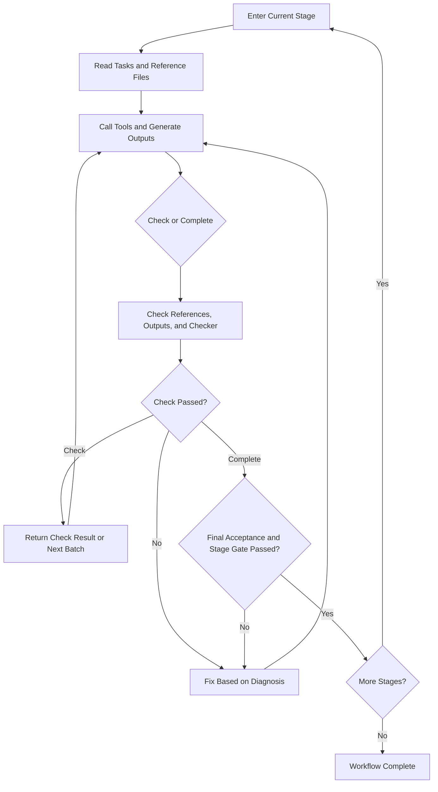

# Architecture and Operation

UCAgent defines tasks using configuration, executes operations using tools, and accepts outputs using Checkers. The backend handles model interaction; the Stage Manager manages the current stage, checks, and progression. This chapter explains the component relationships that need to be understood for custom development.

## Core Components

| Component | Responsibility | Primary Code Entry Point |
| --- | --- | --- |
| `VerifyAgent` | Loads configuration, prepares workspace, assembles backend, tools, and stages | `ucagent/verify_agent.py` |
| Backend | Interacts with the model or a Code Agent via CLI | `ucagent/abackend/` |
| `StageManager` / `VerifyStage` | Provides stage tasks, manages Check, Complete, history, and skip states | `ucagent/stage/` |
| Tool | Reads, edits, computes, runs tests, or calls external services | `ucagent/tools/` |
| Checker | Determines if a task meets requirements based on files, configuration, test results, and evidence | `ucagent/checkers/` |
| Guide_Doc / Template | Provides run instructions, complete format examples, and initial files | `ucagent/lang/<lang>/doc/`, `template/` |
| Skill (Optional) | Provides task methods and scripts to help fulfill a set of acceptance requirements | `ucagent/lang/<lang>/skills/` |

Tools execute actions, while Checkers verify results. For example, a write file tool succeeding only indicates that the write is complete; whether the document content complies with rules is still determined by the corresponding Checker.

## From Startup to Execution

1. Load configuration layer by layer, parsing environment variables and template variables. See [Workflow Configuration](03_workflow.md#3-configuration-loading-and-template-variables) for the complete order.
2. Prepare runtime Guide_Doc, initial templates, optional skills, and configuration snapshots.
3. Assemble backend, tools, and stages to restore available task states.
4. Enter the console or execution loop. The Agent reads the current task and reference materials, calling tools to generate outputs.
5. The Agent calls `Check` to get feedback, fixing failed items; calls `Complete` to request final acceptance and progression.

`Check` does not advance the stage, but batch Checkers can switch to the next batch after passing. `Complete` performs its own final check; ordinary stages do not require calling `Check` first. The "No Applicable Work" branch of skills additionally requires the current `Check` to pass; see [Skills](../02_usage/08_skill.md).

## How Stages Accept

- `reference_files` declares reference files that need to be read. Read records are generated by the `ReadTextFile` tool; file reads by external clients are not logged.
- `output_files` declares required output paths or patterns. File existence is just the first condition; content rules are verified by the Checker.
- `checker` executes in configuration order, returning a diagnosis upon the first failure.
- `Complete` also requires applicable skills and human review for the current stage.

Checkers do not automatically pass just because the Agent claims "completed." Custom Checkers should verify observable facts and return specific locations, expected conditions, and next steps on failure. Lifecycle and batch rules are detailed in [Custom Checkers](07_checkers.md).

## Boundaries of Configuration and Resources

Variables like `{DUT}` and `{OUT}` in workflow configurations are rendered after configuration loading. Guide_Doc is a file that must be read during runtime; initial templates are copied to the workspace via the template rendering process. Files listed in `reference_files` do not automatically imply their contents undergo variable substitution. See [Template Files and Generated Outputs](04_template.md) for writing guidelines for both resource types.

Skills can accelerate tasks, but when skills are disabled or the skill directory is missing, the stage must still have a complete task description, standard tool paths, and identical acceptance criteria.

The Master page and task management mechanism are described in [Web Master User Guide](../02_usage/07_web_master.md). When beginning to write extensions, continue reading [Custom Development Introduction](01_quick_start.md) and [Workflow Configuration](03_workflow.md).
