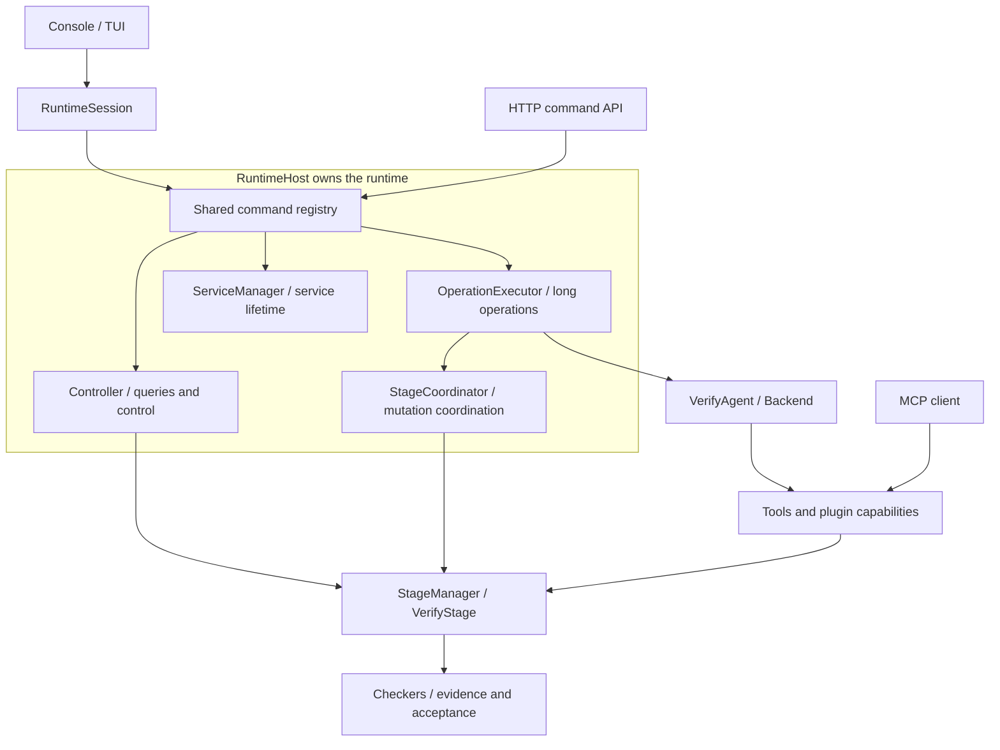
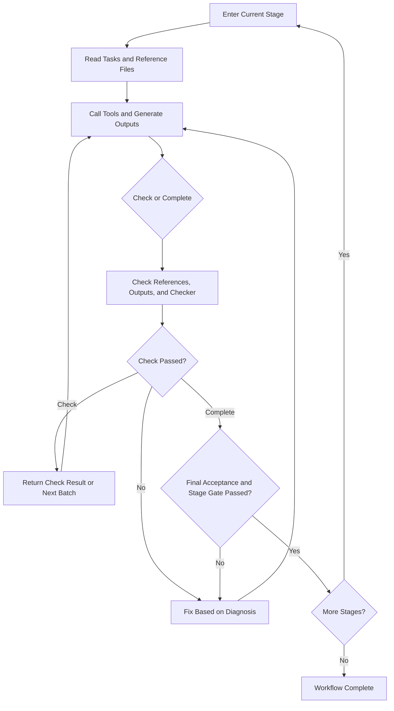

# Architecture and Operation

UCAgent defines tasks using configuration, executes operations using tools, and accepts outputs using Checkers. The backend handles model interaction, the stage layer handles validation and progression, and the runtime owns operations, services, and instance lifetime. Console, TUI, and HTTP provide interaction interfaces. This chapter describes the implemented component relationships.

## Core Components

| Component | Responsibility | Primary Code Entry Point |
| --- | --- | --- |
| `VerifyAgent` | Loads configuration, prepares workspace, assembles backend, tools, and stages | `ucagent/verify_agent.py` |
| `RuntimeHost` | Owns instance lifetime, controller, executor, services, and startup coordinator | `ucagent/control/runtime/host.py` |
| `Controller` / `CommandRegistry` | Expose business operations and queries; declare commands, aliases, arguments, and dispatch | `ucagent/control/controller.py`, `commands.py` |
| `OperationExecutor` / `StageCoordinator` | Manage long operations, cancellation, the model-operation slot, and stage mutation coordination | `ucagent/control/runtime/operations.py` |
| `ServiceManager` | Manage readiness and shutdown of MCP, HTTP, Master connections, and terminal services | `ucagent/control/runtime/services.py` |
| `RuntimeSession` / `Console` / TUI | Preserve local interaction state, accept input, and render output | `ucagent/control/runtime/session.py`, `ucagent/control/console.py`, `ucagent/tui/` |
| Backend | Interacts with the model or a Code Agent via CLI | `ucagent/abackend/` |
| `StageManager` / `VerifyStage` | Provides stage tasks, manages Check, Complete, history, and skip states | `ucagent/stage/` |
| Tool | Reads, edits, computes, runs tests, or calls external services | `ucagent/tools/` |
| Checker | Determines if a task meets requirements based on files, configuration, test results, and evidence | `ucagent/checkers/` |
| Guide_Doc / Template | Provide runtime guidance, complete examples, and initial files | Resource directories declared by the workflow plugin and configured paths |
| Skill (Optional) | Provide methods and scripts for the same acceptance requirements | Plugin-declared skill directories and configured additional paths |

Tools execute actions, while Checkers verify results. For example, a write file tool succeeding only indicates that the write is complete; whether the document content complies with rules is still determined by the corresponding Checker.

## Interfaces and the Runtime

The diagram shows the main call paths. The CLI injects the same Controller, registry, executor, and service manager into HTTP and local interfaces. Structured status, cancellation, and review endpoints call their runtime owners directly. MCP exposes the assembled tools; Check/Complete reach the same stage layer and mutation coordination, but MCP calls do not automatically create shared operation records. Some TUI status reads and HTTP file endpoints also bypass the command registry.

`RuntimeHost` owns the instance. `RuntimeSession` preserves the working directory, command history, foreground ownership, and display state; it is neither a separate verification task nor a complete model session. Console and TUI share the local session; HTTP maintains command sessions by client identifier. Views submit operations, read state, and subscribe to output, without owning execution threads or startup command processing.

`control/runtime/startup.py` coordinates initialization, `output.py` manages output/message buffers, and `presentation.py` formats command results. The buffers support view subscriptions, but are not a persistent event system covering all business state changes.

## From Startup to Execution

1. The CLI parses arguments, discovers and validates selected plugins, and resolves the workflow. `VerifyAgent` loads layered configuration; see [Workflow Configuration](03_workflow.md#3-configuration-loading-and-template-variables).
2. `VerifyAgent` prepares Guide_Doc, templates, skills, and the configuration snapshot; assembles stages, tools, and backend; initializes the backend and restores available stage state. The model execution loop has not been submitted yet.
3. The CLI creates `RuntimeHost` and a local `RuntimeSession`, creates Console as required by the mode, and injects the HTTP service factory. `host.start()` connects output/messages and starts the supervisor; it does not execute model work.
4. MCP requested by startup flags starts first, followed by service commands derived from startup flags, with readiness/failure checks. HTTP and Master connections do not depend on entering TUI. Services requested in custom `--icmd` or configuration `init_cmds` retain their later queue positions.
5. `StartupCommands` receives initialization commands. With `--tui`, the CLI opens TUI, whose readiness event only releases a gate; the runtime executes initialization. Without TUI, no display readiness wait is required.
6. Initialization submits product information, repeated `--icmd` values, optional `--loop`, and configuration `init_cmds`, in that order. In interactive/service modes, a model loop does not block later ordinary queries. Later model commands wait for previous model work; other asynchronous initialization commands are awaited in order.
7. The executor calls Agent/backend, which uses tools for the current stage and requests acceptance through `Check` / `Complete`. After TUI returns, the CLI enters Console's input loop. Without a local interface, the runtime continues managing the instance.

Default execution depends on the interface: `--human` / `--tui` wait for explicit startup commands or user input. A run without interactive/service interfaces defaults to `continue` if no model work was submitted; HTTP/MCP service mode does the same for non-`blank` backends. See [Runtime Control](../02_usage/10_runtime_control.md) for usage.

## Stage Execution Loop

`Check` does not advance the stage, but batch Checkers can switch to the next batch after passing. `Complete` performs its own final check; ordinary stages do not require calling `Check` first. The "No Applicable Work" branch of skills additionally requires the current `Check` to pass; see [Skills](../02_usage/08_skill.md).

## How Stages Accept

- `reference_files` declares reference files that need to be read. Read records are generated by the `ReadTextFile` tool; file reads by external clients are not logged.
- `output_files` declares required output paths or patterns. File existence is just the first condition; content rules are verified by the Checker.
- `checker` executes in configuration order, returning a diagnosis upon the first failure.
- `Complete` also requires applicable skills and human review for the current stage.

Checkers do not automatically pass just because the Agent claims "completed." Custom Checkers should verify observable facts and return specific locations, expected conditions, and next steps on failure. Lifecycle and batch rules are detailed in [Custom Checkers](07_checkers.md).

## Operation, Stage Control, and Persistence Boundaries

- `OperationExecutor` records IDs, states, results, errors, cancellation flags, sessions, and parent/child relationships for long operations. One top-level model operation is admitted per instance; queries need not wait for it to finish.
- Cancellation is cooperative. The model slot is released only after work actually ends. `RuntimeHost` initiates shutdown, drains operations, persists state, synchronizes the workspace, closes services, and restores resources. Detaching a view does not own these steps.
- `StageCoordinator` coordinates stage writes and maintains `control_revision`. Human review and flag updates use the observed revision to reject conflicts and stale writes. Approve-and-continue saves approval before submitting continuation.
- Check/Complete business rules remain in `StageManager` / `VerifyStage`. Coordination does not bypass Checkers, reading records, stage journals, skills, or human review gates.
- Stage state, history, and tool evidence retain their existing persistence mechanisms. Operation records and output buffers are primarily in memory. Long-operation recovery across process restarts, unified decision-event replay, and remote TUI reattachment are not implemented.

Plugins explicitly contribute tools, Checkers, resources, stage hooks, and commands; see [Runtime Commands](09_plugins.md#runtime-commands). Backends still load classes from configuration and service assembly retains dedicated entry points; the current implementation does not place every capability behind one plugin contribution contract.

## Boundaries of Configuration and Resources

Variables like `{DUT}` and `{OUT}` in workflow configurations are rendered after configuration loading. Guide_Doc is a file that must be read during runtime; initial templates are copied to the workspace via the template rendering process. Files listed in `reference_files` do not automatically imply their contents undergo variable substitution. See [Template Files and Generated Outputs](04_template.md) for writing guidelines for both resource types.

Skills can accelerate tasks, but when skills are disabled or the skill directory is missing, the stage must still have a complete task description, standard tool paths, and identical acceptance criteria.

The Master page and task management mechanism are described in [Web Master User Guide](../02_usage/07_web_master.md). When beginning to write extensions, continue reading [Custom Development Introduction](01_quick_start.md) and [Workflow Configuration](03_workflow.md).
