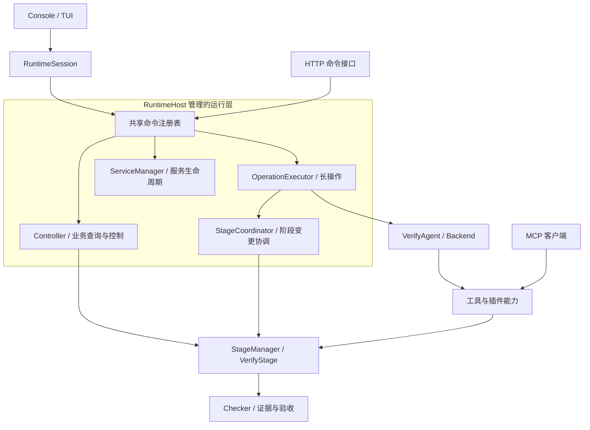
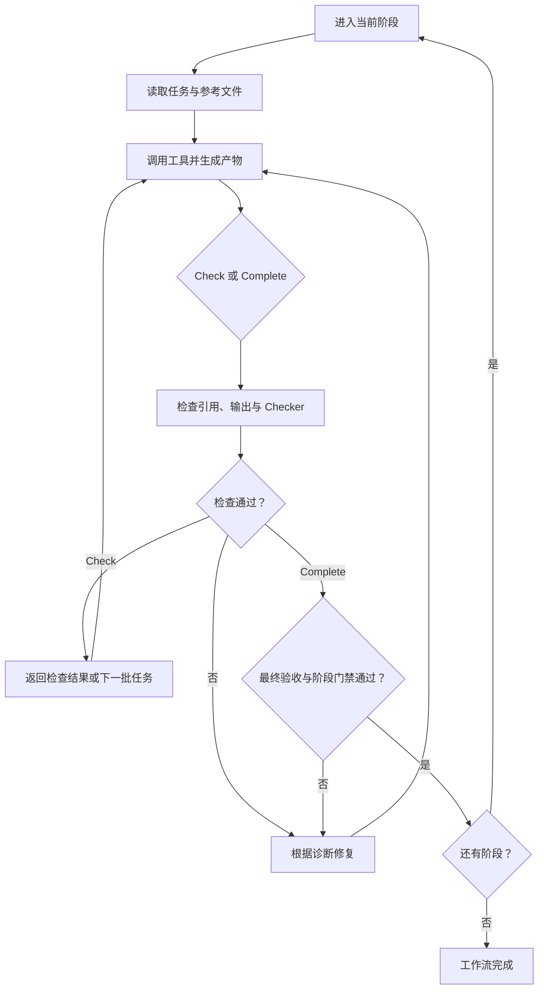

# 架构与工作原理

UCAgent 用配置定义任务，用工具执行操作，用 Checker 验收产物。后端负责模型交互，阶段层负责检查和推进，运行层负责操作、服务和实例生命周期。Console、TUI 与 HTTP 是交互入口。本章说明当前已经实现的组件关系。

## 核心组件

| 组件 | 职责 | 主要代码入口 |
| --- | --- | --- |
| `VerifyAgent` | 加载配置，准备工作区，装配后端、工具和阶段 | `ucagent/verify_agent.py` |
| `RuntimeHost` | 管理实例生命周期，持有控制器、执行器、服务与启动协调器 | `ucagent/control/runtime/host.py` |
| `Controller` / `CommandRegistry` | 提供业务操作与查询，声明命令、别名、参数和分派规则 | `ucagent/control/controller.py`、`commands.py` |
| `OperationExecutor` / `StageCoordinator` | 管理长操作、取消、模型操作槽位，以及阶段变更协调 | `ucagent/control/runtime/operations.py` |
| `ServiceManager` | 管理 MCP、HTTP、Master 连接和终端等服务的就绪与关闭 | `ucagent/control/runtime/services.py` |
| `RuntimeSession` / `Console` / TUI | 保存本地交互状态，接收输入并展示输出 | `ucagent/control/runtime/session.py`、`ucagent/control/console.py`、`ucagent/tui/` |
| Backend | 与模型或命令行 Code Agent 交互 | `ucagent/abackend/` |
| `StageManager` / `VerifyStage` | 提供阶段任务，管理 Check、Complete、历史和跳过状态 | `ucagent/stage/` |
| Tool | 读取、编辑、计算、运行测试或调用外部服务 | `ucagent/tools/` |
| Checker | 根据文件、配置、测试结果和证据判断任务是否满足要求 | `ucagent/checkers/` |
| Guide_Doc / 模板 | 提供运行指导、完整格式示例和初始文件 | 当前工作流插件声明的资源目录及配置路径 |
| Skill（可选） | 提供任务方法和脚本，帮助完成同一套验收要求 | 插件声明的技能目录及配置中的额外技能路径 |

工具执行动作，Checker 验证结果。例如，写文件工具成功只说明写入完成；文档内容是否符合规则，仍由相应 Checker 判断。

## 入口与运行层的连接

图展示主要调用关系。CLI 为 HTTP 注入与本地界面相同的 Controller、注册表、执行器和服务管理器；结构化状态、取消和审核接口直接调用对应运行对象。MCP 暴露已装配的工具，其中 Check/Complete 进入同一个阶段层，也受阶段变更协调约束，但 MCP 调用不自动生成统一操作记录。TUI 的部分状态读取和 HTTP 文件接口也不经过命令注册表。

`RuntimeHost` 负责实例，`RuntimeSession` 负责工作目录、命令历史、前台操作归属和显示状态；它不是独立验证任务，也不代表完整模型会话。Console 和 TUI 复用本地会话，HTTP 按客户端标识维护自己的命令会话。界面只提交操作、读取状态和订阅输出，不持有执行线程或负责启动命令队列。

`control/runtime/startup.py` 协调初始化，`output.py` 管输出与消息缓冲，`presentation.py` 格式化命令结果。这些缓冲支持界面订阅，但还不是覆盖所有业务状态变化的持久化事件系统。

## 从启动到执行

1. CLI 解析参数、发现并校验选中的插件、解析工作流；`VerifyAgent` 按层加载配置。完整顺序见[工作流配置](03_workflow.md#3-配置加载和模板变量)。
2. `VerifyAgent` 准备 Guide_Doc、模板、技能和配置快照，装配阶段、工具和 backend，初始化 backend 并恢复可用的阶段状态。此时尚未提交模型执行循环。
3. CLI 创建 `RuntimeHost` 和本地 `RuntimeSession`，按模式创建 Console；注入 HTTP 服务工厂。`host.start()` 安装输出/消息连接并启动运行监督线程，不直接执行模型任务。
4. 先启动参数要求的 MCP，再执行启动参数生成的服务命令，并检查就绪或失败。HTTP、Master 连接等无需依赖进入 TUI。自定义 `--icmd` / 配置 `init_cmds` 中的服务命令仍在各自队列位置执行。
5. `StartupCommands` 接收初始化命令。如果指定 `--tui`，CLI 打开 TUI，TUI 就绪后只释放启动门闩；命令由运行层执行。不使用 TUI 时不等待显示就绪。
6. 初始化按产品信息、重复的 `--icmd`、可选 `--loop`、配置 `init_cmds` 的顺序提交。交互/服务模式的模型循环不会阻塞后续普通查询；后续模型命令等待前一个模型操作结束，其他异步初始化命令按完成顺序推进。
7. 执行器调用 Agent/backend，Agent 使用工具完成当前阶段，再通过 `Check` / `Complete` 验收。TUI 返回后，CLI 才进入普通 Console 的输入循环；无本地界面时由运行层继续管理实例。

默认执行策略与入口有关：`--human` / `--tui` 等待明确的启动命令或用户输入；无交互、无服务的单次模式会在未提交模型任务时默认 `continue`；HTTP/MCP 服务模式的非 `blank` 后端也会采用这一默认执行策略。具体操作见[运行控制](../02_usage/10_runtime_control.md)。

## 阶段执行循环

`Check` 不推进阶段，但批量 Checker 可以在检查通过后切换到下一批。`Complete` 会自行执行最终检查；普通阶段不要求先调用一次 `Check`。技能的“无适用工作”分支另要求当前 `Check` 通过，详见[技能](../02_usage/08_skill.md)。

## 阶段如何验收

- `reference_files` 声明需要阅读的参考文件。阅读记录由 `ReadTextFile` 工具产生；外部客户端自己的文件读取不会登记该记录。
- `output_files` 声明必须存在的输出路径或模式。文件存在只是第一道条件，内容规则由 Checker 验证。
- `checker` 按配置顺序执行，遇到第一个失败就返回诊断。
- `Complete` 还需要满足当前阶段适用的技能与人工审核要求。

Checker 不会因为 Agent 声称“已完成”而自动通过。自定义 Checker 应验证可观察的事实，并在失败时返回具体位置、期望条件和下一步。生命周期和批次规则见[自定义 Checker](07_checkers.md)。

## 操作、阶段控制与持久化边界

- `OperationExecutor` 为长操作保存 ID、状态、结果、错误、取消标志、会话和父子关系；同一实例只允许一个顶层模型操作。状态查询不需要等待模型操作结束。
- 取消采用协作机制，操作实际结束后才释放模型槽位。关闭由 `RuntimeHost` 发起，等待操作清理后保存状态、同步工作区、关闭服务并恢复资源；前端卸载不承担这些职责。
- `StageCoordinator` 协调阶段写入并维护 `control_revision`；人工审核和阶段开关按观察到的版本提交，拒绝冲突和过期操作。审核通过并继续时，先保存审核结果，再提交后续执行。
- Check/Complete 的业务规则仍属于 `StageManager` / `VerifyStage`。协调层不会绕过 Checker、阅读记录、阶段日志、技能或人工审核门禁。
- 阶段状态、历史与工具证据沿用各自保存机制。操作记录、输出缓冲主要在内存中；当前不提供进程重启后的长操作恢复、统一决策事件回放或远程 TUI 重新连接。

插件通过显式贡献接口提供工具、Checker、资源、阶段 hook 和命令；命令扩展见[插件开发](09_plugins.md#运行控制命令)。backend 仍按配置加载类，服务装配也保留专门入口，不能把当前实现描述为所有能力均已使用同一种插件契约。

## 配置和资源的边界

工作流配置中的 `{DUT}`、`{OUT}` 等变量，在配置加载后渲染。Guide_Doc 是运行时需要阅读的文件；初始模板通过模板渲染过程复制到工作区。不能仅因文件列在 `reference_files` 中，就假定文件正文也会进行变量替换。两类资源的编写方式见[模板文件与生成产物](04_template.md)。

技能可以加速任务，但关闭技能或缺少技能目录时，阶段仍必须具备完整任务说明、普通工具路径和相同的验收标准。

Master 的页面与任务管理机制见 [Web Master 使用指南](../02_usage/07_web_master.md)。开始编写扩展时，继续阅读[定制开发入门](01_quick_start.md)和[工作流配置](03_workflow.md)。
