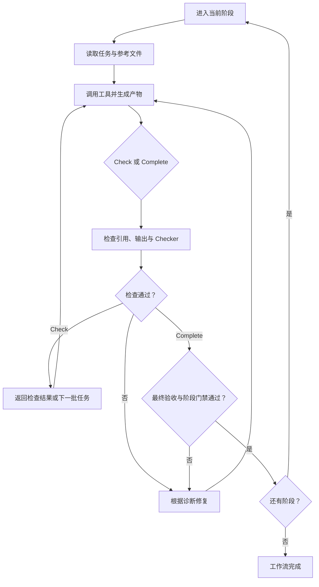

# 架构与工作原理

UCAgent 用配置定义任务，用工具执行操作，用 Checker 验收产物。后端负责模型交互；Stage Manager 负责当前阶段、检查和推进。本章解释定制开发需要理解的组件关系。

## 核心组件

| 组件 | 职责 | 主要代码入口 |
| --- | --- | --- |
| `VerifyAgent` | 加载配置，准备工作区，装配后端、工具和阶段 | `ucagent/verify_agent.py` |
| Backend | 与模型或命令行 Code Agent 交互 | `ucagent/abackend/` |
| `StageManager` / `VerifyStage` | 提供阶段任务，管理 Check、Complete、历史和跳过状态 | `ucagent/stage/` |
| Tool | 读取、编辑、计算、运行测试或调用外部服务 | `ucagent/tools/` |
| Checker | 根据文件、配置、测试结果和证据判断任务是否满足要求 | `ucagent/checkers/` |
| Guide_Doc / 模板 | 提供运行指导、完整格式示例和初始文件 | `ucagent/lang/<lang>/doc/`、`template/` |
| Skill（可选） | 提供任务方法和脚本，帮助完成同一套验收要求 | `ucagent/lang/<lang>/skills/` |

工具执行动作，Checker 验证结果。例如，写文件工具成功只说明写入完成；文档内容是否符合规则，仍由相应 Checker 判断。

## 从启动到执行

1. 按层加载配置，解析环境变量和模板变量。完整顺序见[工作流配置](03_workflow.md#3-配置加载和模板变量)。
2. 准备运行时 Guide_Doc、初始模板、可选技能和配置快照。
3. 装配后端、工具和阶段，恢复可用的任务状态。
4. 进入控制台或执行循环。Agent 读取当前任务与参考资料，调用工具生成产物。
5. Agent 调用 `Check` 获取反馈，修复失败项；调用 `Complete` 请求最终验收并推进。

`Check` 不推进阶段，但批量 Checker 可以在检查通过后切换到下一批。`Complete` 会自行执行最终检查；普通阶段不要求先调用一次 `Check`。技能的“无适用工作”分支另要求当前 `Check` 通过，详见[技能](../02_usage/08_skill.md)。

## 阶段如何验收

- `reference_files` 声明需要阅读的参考文件。阅读记录由 `ReadTextFile` 工具产生；外部客户端自己的文件读取不会登记该记录。
- `output_files` 声明必须存在的输出路径或模式。文件存在只是第一道条件，内容规则由 Checker 验证。
- `checker` 按配置顺序执行，遇到第一个失败就返回诊断。
- `Complete` 还需要满足当前阶段适用的技能与人工审核要求。

Checker 不会因为 Agent 声称“已完成”而自动通过。自定义 Checker 应验证可观察的事实，并在失败时返回具体位置、期望条件和下一步。生命周期和批次规则见[自定义 Checker](07_checkers.md)。

## 配置和资源的边界

工作流配置中的 `{DUT}`、`{OUT}` 等变量，在配置加载后渲染。Guide_Doc 是运行时需要阅读的文件；初始模板通过模板渲染过程复制到工作区。不能仅因文件列在 `reference_files` 中，就假定文件正文也会进行变量替换。两类资源的编写方式见[模板文件与生成产物](04_template.md)。

技能可以加速任务，但关闭技能或缺少技能目录时，阶段仍必须具备完整任务说明、普通工具路径和相同的验收标准。

Master 的页面与任务管理机制见 [Web Master 使用指南](../02_usage/07_web_master.md)。开始编写扩展时，继续阅读[定制开发入门](01_quick_start.md)和[工作流配置](03_workflow.md)。
