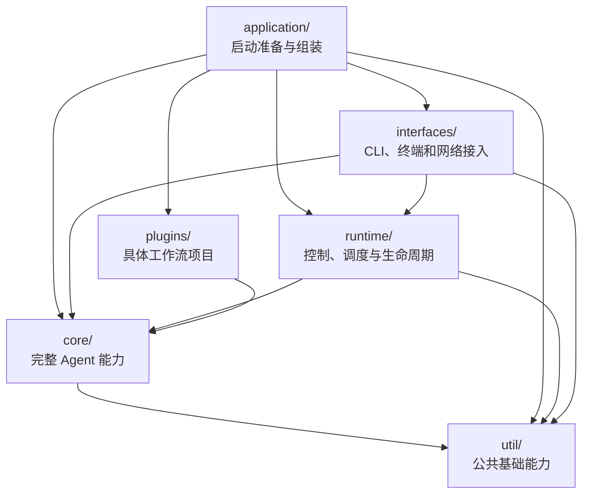
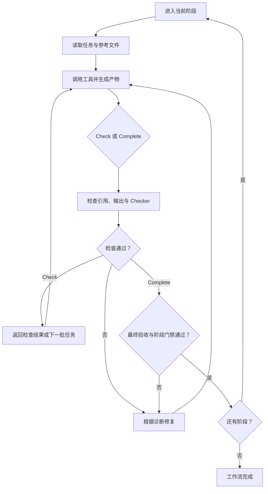

# 架构与工作原理

UCAgent 通过工作流定义任务，由 Agent 和工具执行，通过阶段与 Checker 验收产物。目录按现有能力的职责组织：`core/` 是完整 Agent，`application/` 负责启动，`runtime/` 托管实例，`interfaces/` 提供人机和网络接入。

## 目录职责

| 目录 | 职责 |
| --- | --- |
| `core/agent/` | 任务配置、自有组件构造、执行、消息与统计 |
| `core/backends/` | LangChain、命令行与 blank 后端；`assets/` 保存客户端配置模板 |
| `core/interaction/` | 增强执行、反思与自适应工具编排 |
| `core/stage/` | 阶段推进、Check/Complete、历史、人工及模型审核 |
| `core/checkers/` | Checker 生命周期、诊断与 BatchTask |
| `core/tools/` | 完整的通用文件、Shell、规划、记忆、上下文和技能工具 |
| `core/workspace/` | 任务文档、模板、技能、指令文件与权限恢复 |
| `core/plugins.py` | 插件声明、发现、校验与能力注册 |
| `core/locales/` | 框架语言配置，中文默认配置为 `zh.yaml` |
| `application/` | 入口编排、启动请求与计划、工作区来源、日志和运行组件连接 |
| `application/presets/` | 应用模式预设，包括 `zh/master.yaml` |
| `runtime/` | Host 生命周期、操作调度与取消、服务管理、会话与输出缓冲 |
| `runtime/control/` | Controller、命令参数与分派、插件命令注册 |
| `interfaces/cli/` | CLI 语法、管理操作和启动数据转换 |
| `interfaces/terminal/` | Console 与结果展示，`tui/` 提供可视化终端 |
| `interfaces/server/` | HTTP、MCP、Master、Web Terminal、页面、静态资源和查看器转换 |
| `plugins/` | 独立工作流项目及其文档、模板、技能和领域实现 |
| `util/` | 配置加载、文件策略、日志等共享基础能力 |

`core/` 包含完整 Agent 实现，包括具体后端和工具，并非只有抽象接口。插件资源仍随工作流保存，核心准备逻辑按同一任务契约选择并落地。根目录 `setting.yaml` 保留跨层全局默认配置。

## 目录依赖方向

下图箭头表示主要源码依赖方向，不表示运行时回调。应用层选择并连接现有具体实现，不引入新的执行框架。

核心包不导入 `application`、`runtime` 或 `interfaces`；运行时不导入应用启动和具体接入实现；接入层不反向调用应用启动；基础函数不导入上述业务包。`tests/test_dependency_boundaries.py` 检查绝对、相对和函数内导入。这些包边界不代表所有内部模块和动态插件都构成全局无环图。

服务构造器由应用层传入。运行会话由终端或应用调用者提供结果格式化回调，因此共享会话状态不导入前端。插件命令声明由运行控制层注册，核心插件加载器不依赖运行控制实现。

## 从启动到执行与退出

1. `ucagent`、`python -m ucagent` 和源码 `ucagent.py` 均进入 `application/entry.py`，由它调用 CLI 解析，并在构造 Agent 前处理管理请求。
2. CLI 转换得到普通启动数据，应用层建立 `LaunchRequest`，准备工作区来源和日志，再调用核心任务配置。`core/locales/<语言>.yaml` 提供框架提示词，`application/presets/<语言>/` 提供应用预设。[配置优先级](03_workflow.md#3-配置加载和模板变量)保持不变。
3. `core/agent/construction.py` 准备选定工作流资源，构造阶段、工具、后端和执行状态。Python 调用者通过 `from ucagent import VerifyAgent` 使用同一路径，不需要导入应用启动层。
4. 应用层创建 RuntimeHost 和会话，传入具体服务构造器与展示回调，再交接清理责任。MCP 和其他要求的服务就绪后，才执行用户或模型启动命令。
5. 初始命令保留顺序。TUI 就绪释放显示门闩，命令仍由运行时执行。无界面、无服务的普通任务默认执行；服务和交互启动等待明确模型工作请求。
6. 运行时调度 Agent；后端调用工具，阶段工具进入同一 StageManager 和 Checker。HTTP 控制运行实例，MCP 暴露同一任务工具；MCP 调用不自动生成 HTTP 操作 ID。
7. TUI 脱离不关闭任务。实例关闭时等待操作与服务清理，保存状态并恢复资源；工作区内共享库符号链接的真实目标恢复原始权限。

LangChain 在首次模型工作前准备模型；命令行后端根据已就绪的 MCP 端点准备配置。查询和确定性工具不准备主模型；显式启用的 embedding、审核能力仍保留各自要求。具体用法见[运行控制](../02_usage/10_runtime_control.md)。

## 阶段执行循环

`Check` 不推进阶段，但批量 Checker 可以在检查通过后切换到下一批。`Complete` 会自行执行最终检查；普通阶段不要求先调用一次 `Check`。技能的“无适用工作”分支另要求当前 `Check` 通过，详见[技能](../02_usage/08_skill.md)。

## 阶段如何验收

- `reference_files` 声明需要阅读的参考文件。阅读记录由 `ReadTextFile` 工具产生；外部客户端自己的文件读取不会登记该记录。
- `output_files` 声明必须存在的输出路径或模式。文件存在只是第一道条件，内容规则由 Checker 验证。
- `checker` 按配置顺序执行，遇到第一个失败就返回诊断。
- `Complete` 还需要满足当前阶段适用的技能与人工审核要求。

Checker 不会因为 Agent 声称“已完成”而自动通过。自定义 Checker 应验证可观察的事实，并在失败时返回具体位置、期望条件和下一步。生命周期和批次规则见[自定义 Checker](07_checkers.md)。

## 操作、阶段控制与持久化边界

- `OperationExecutor` 为长操作保存 ID、状态、结果、错误、取消标志、会话和父子关系；同一实例只允许一个顶层模型操作。状态查询不需要等待模型操作结束。
- 取消采用协作机制，操作实际结束后才释放模型槽位。关闭由 `RuntimeHost` 发起，等待操作清理后保存状态、同步工作区、关闭服务并恢复资源；前端卸载不承担这些职责。
- `StageCoordinator` 协调阶段写入并维护 `control_revision`；人工审核和阶段开关按观察到的版本提交，拒绝冲突和过期操作。审核通过并继续时，先保存审核结果，再提交后续执行。
- Check/Complete 的业务规则仍属于 `StageManager` / `VerifyStage`。协调层不会绕过 Checker、阅读记录、阶段日志、技能或人工审核门禁。
- 阶段状态、历史与工具证据沿用各自保存机制。操作记录、输出缓冲主要在内存中；当前不提供进程重启后的长操作恢复、统一决策事件回放或远程 TUI 重新连接。

插件通过显式贡献接口提供工具、Checker、资源、阶段 hook 和命令；命令扩展见[插件开发](09_plugins.md#运行控制命令)。backend 仍按配置加载类，服务装配也保留专门入口，不能把当前实现描述为所有能力均已使用同一种插件契约。

## 配置和资源的边界

工作流配置中的 `{DUT}`、`{OUT}` 等变量，在配置加载后渲染。Guide_Doc 是运行时需要阅读的文件；初始模板通过模板渲染过程复制到工作区。不能仅因文件列在 `reference_files` 中，就假定文件正文也会进行变量替换。两类资源的编写方式见[模板文件与生成产物](04_template.md)。

技能可以加速任务，但关闭技能或缺少技能目录时，阶段仍必须具备完整任务说明、普通工具路径和相同的验收标准。

Master 的页面与任务管理机制见 [Web Master 使用指南](../02_usage/07_web_master.md)。开始编写扩展时，继续阅读[定制开发入门](01_quick_start.md)和[工作流配置](03_workflow.md)。
