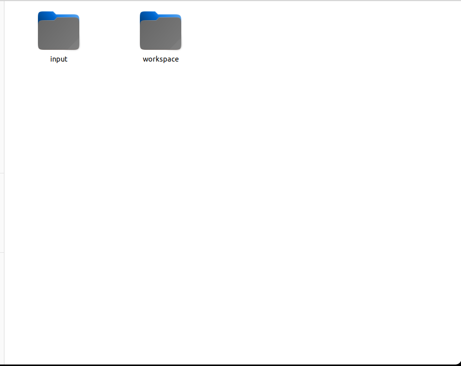

---
classoption:
  - fontset=none
CJKmainfont: Noto Serif CJK SC
CJKsansfont: Noto Sans CJK SC
---

# Workflow Builder Documentation Center

This directory serves as the complete entry point for Workflow Builder usage and maintenance documentation. The responsibility of Workflow Builder is not to directly complete a specific business task, but rather to generate a UCAgent sub-workflow that can run independently, be verified, evaluated, and maintained incrementally, based on requirement documents and sample inputs provided by users. When reading the documentation, it is crucial to distinguish between two layers of objects: the "build workflow" within the current repository and the "business workflow" ultimately generated into the business workspace. Both possess a Makefile, configuration files, and execution phases, but they differ in working directories, input/output, and modification boundaries.


## Documentation Sections

| Section | Target Audience | Main Content |
| --- | --- | --- |
| [QuickStart](01_quickstart/00_overview.md) | First-time users | Complete generation, evaluation, incremental repair, and console approval using a DOCX workflow case |
| [Usage](02_usage/00_overview.md) | Daily users and project leads | Input/output contracts, full commands, approvals, version management, and collaboration prompts |
| [Develop](03_develop/00_overview.md) | Users performing secondary development on the Workflow Builder parent workflow | 24 stages, all Tools/Checkers/GuideDocs, incremental evaluation, console, regression testing, and secondary development of generated artifacts |
| [Q&A_Experience](04_q_and_experience/00_overview.md) | Troubleshooting and long-term maintenance personnel | Issues encountered during actual runs, verification methods, repair mechanisms, and design experiences |
| `resource/` | Documentation maintainers | Workspace, TUI, evaluation, incremental, and console screenshots |

## Recommended Reading Path

Upon first use, read the [QuickStart Overview](01_quickstart/00_overview.md), complete environment configuration, and then sequentially execute the run, evaluation, approval, and incremental processes. For long-term operation of new business, subsequently read the [Complete Usage Overview](02_usage/00_overview.md) and input/output contracts. When preparing to modify the generator, tool protocols, or Checker, enter the [Developer Documentation Overview](03_develop/00_overview.md); do not infer parent workflow rules solely by reversing-engineering a single generation artifact.

When processes fail continuously, show no artifact changes for extended periods, or exhibit repeated context compression, first locate the issue in [Q&A & Experience](04_q_and_experience/00_overview.md) based on the phenomenon, then decide whether to continue supervision, take over the current stage, or modify Workflow Builder. Do not directly modify the UCAgent core source code simply because a business artifact contains errors.

## Three Types of Workflows

1. **Build Workflow**: Reads `<business_root_dir>/input/guide.md` and `test_input/`, generating the business workflow in `<business_root_dir>/workspace/workflow/`. The entry point is `make WS=... run`.
2. **Evaluation Workflow**: Reviews tools, Checkers, process configurations, and environment facilities, and optionally executes expensive runtime evaluations. Reports are written to `eval/` in the workspace and do not directly modify `workflow/`.
3. **Incremental Workflow**: Reads approved issues and user suggestions, establishes the candidate directory for this iteration, implements repairs, runs deterministic checks, deploys, and saves old versions. The entry point is `make WS=... run_inc`.

Evaluation and approval, build design, incremental reports, and historical versions can be viewed and managed via the "Workflow Build and Evaluation Console". The console binds only to the local address, defaulting to port `8765`.

## Directory Hierarchy Terminology

This document uses `~/work/UCAgent` as the source directory and `~/work/ucagent_tasks/docx` as the case business root directory. Replace with actual paths as needed and confirm source, Python, and business workspace configurations in `setup.py`.

This document uses the following fixed terminology:

- **Workflow Builder Directory**: The parent directory of this README, i.e., `examples/workflow_builder/`.
- **Business Root Directory**: For example `~/work/ucagent_tasks/docx/`, containing `input/` and `workspace/`.
- **Build Workspace**: The `workspace/` under the business root directory, which is the location where UCAgent build, evaluation, and incremental processes run.
- **Generated Workflow Root Directory**: The `workflow/` under the build workspace, which is the independent workflow delivered to the business user.
- **Business Execution Target**: `input/<TARGET>/` within the generated workflow, which must not be confused with the `input/` in the build workspace.



## Environment Entry

For first-time use, run:

```bash
cd ~/work/UCAgent/examples/workflow_builder
export UCAGENT_HOME="$HOME/work/UCAgent"
python setup.py
make configure-check
```

Configuration is saved in `.workflow_builder/local.mk`, belonging only to the current machine and ignored by Git. Command-line arguments can still override defaults:

```bash
make WS=~/work/ucagent_tasks/docx/workspace run
```

Agent credentials, model tokens, and other secrets must not be written to this configuration file; they should be injected via the current shell or a trusted secret management system.

## Documentation Maintenance Rules

- Commands must match current Makefile targets; do not record deleted targets.
- Path examples must specify the relative directory to avoid ambiguity like just `workspace/`.
- Screenshots must include alternative text and contextual explanations; the main text cannot rely solely on images to convey critical steps.
- Q&A must distinguish between "causes confirmed by logs" and "possible causes yet to be verified".
- Tool and Checker documentation must reference real source code entry points and explain core business logic, not just list class names.
- After modifying workflow contracts, check if QuickStart, Usage, Develop, and Q&A sections need updates.
