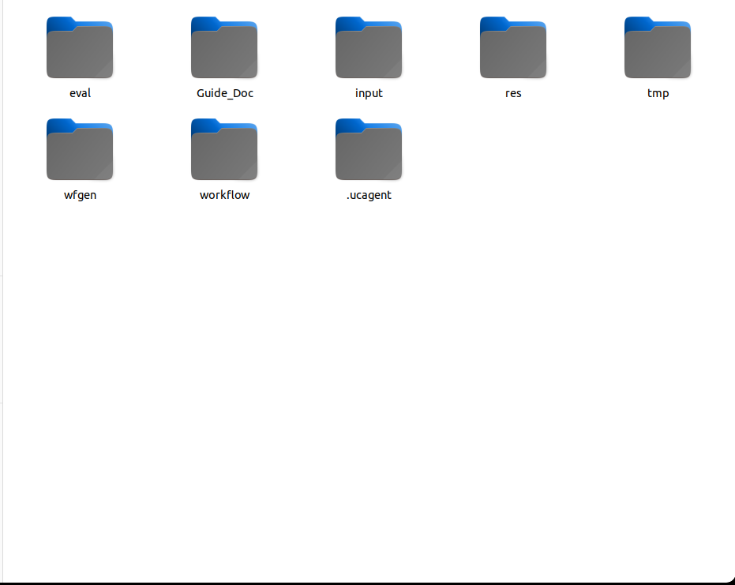

# Quick Start Overview: Using the DOCX Workflow

This set of documents guides users from an empty business directory to generate a UCAgent workflow that "produces DOCX documentation based on text, images, and layout requirements," then executes static evaluation, approval issues, and incremental repair, while observing the entire process through a graphical console. The case focuses on how to use the Workflow Builder and does not prescribe the unique implementation of the DOCX generation tool.

## Required Dependencies

| Dependency | Purpose | Check Command |
| --- | --- | --- |
| Linux or compatible shell environment | Running Makefile, tmux, and UCAgent commands | `bash --version` |
| GNU Make | Unified startup for build, evaluation, incremental, and console | `make --version` |
| Python 3.11 or project-supported version | Running UCAgent, configuring programs, and console | `python3 --version` |
| Installed UCAgent virtual environment | Executing actual Agent processes | `test -x "$UCAGENT_VENV/bin/python"` |
| tmux | Supervising strategies and shared terminals | `tmux -V` |
| PyYAML and other UCAgent dependencies | Parsing configuration and structured data | Install via UCAgent's own installation method |

The DOCX business workflow may ultimately use `python-docx`, Pillow, LibreOffice, or font packages, but these are business dependencies of the generation workflow and should be declared in the generated product's `requirements.txt`, `setup.py`, and documentation. Workflow Builder does not require all future business dependencies to be pre-installed before startup.

## Files That Should Exist Before Starting

```text
docx/                       # Business root directory for this example
└── input/
    ├── guide.md
    └── test_input/
        ├── content.md
        ├── document_requirements.md
        └── assets/
```

`guide.md` describes the workflow to be generated; `test_input/` contains sample data for the build process to understand input contracts and create example targets, not the final output directory of the business workflow. Sample materials should be as small as possible, publicly available, and reusable, without containing real secrets or large production files.

## Four-Step Reading Order

1. [Start the build workflow](01_build_workflow.md): Prepare DOCX requirements and generate `workspace/workflow/`.
2. [Start the evaluation workflow](02_evaluate_workflow.md): Review tools, Checker, process, and environment separately.
3. [Start the incremental workflow](03_incremental_workflow.md): Handle only approved issues and user suggestions.
4. [Use the build and evaluation console](04_console.md): Read reports, batch approvals, view build designs, and versions.

## Environment Configuration

The following assumes the source code is located at `~/work/UCAgent`, and the case business root directory is `~/work/ucagent_tasks/docx`. Replace paths if different and confirm Python and workspace during configuration.

Execute in the Workflow Builder directory:

```bash
cd ~/work/UCAgent/examples/workflow_builder
export UCAGENT_HOME="$HOME/work/UCAgent"
export UCAGENT_VENV="$UCAGENT_HOME/.venv"
source "$UCAGENT_VENV/bin/activate"
python setup.py --set WS="$HOME/work/ucagent_tasks/docx/workspace"
make configure-check
make configure-show
```

Methods for configuring model connections are described in [Direct Usage](../../../02_usage/01_direct.md#1-configure-the-model). `ucagent_env` and `proxy_on` are certain user-defined shell functions, not UCAgent commands; configured environments can be used as-is. The purpose of `setup.py` is to provide persistent native defaults for the Makefile without modifying `~/.bashrc`. The `WS=...` in the command line takes precedence over the saved default workspace.

## Criteria for Successful Completion

After completing this set of documents, you should be able to confirm the following facts:

- `~/work/ucagent_tasks/docx/workspace/workflow/` exists, containing configuration, tools, Checker, GuideDoc, user documents, and environment facilities.
- The build process is not "faked" by manually writing business products; each stage is completed by the actual Agent and verified by the Checker.
- `eval/` contains structured reports saved by evaluation type, with key issues that can be approved in the console.
- The incremental process has an independent run id, candidate directory, and historical versions, with deterministic checks passing after repair.
- Users can distinguish the Makefile of the build workflow from the Makefile of the generated workflow itself.



## Recommended Installation Order

Workflow Builder requires UCAgent source code and an available Python environment. First complete [Source Installation](../../../01_start/00_installation.md#12-installing-the-ucagent-main-package), then configure this directory. When using other virtual environments, change `UCAGENT_VENV` to the actual path of that environment and confirm `PYTHON` during interactive configuration. Basic system tools can be installed according to the distribution, such as Ubuntu/Debian using:

```bash
sudo apt-get update
sudo apt-get install -y make tmux python3 python3-venv
cd ~/work/UCAgent
test -x .venv/bin/python
```

The above commands do not install model credentials for the user, nor do they automatically install LibreOffice or fonts needed for future DOCX business workflows. The `requirements.txt` of the generated workflow distinguishes between Python packages and system dependencies; install according to their documentation before actually running the business workflow.

## Two Layers of Input for This Case

The following paths start from the business root directory `~/work/ucagent_tasks/docx/`. The first layer of input is the build requirement for Workflow Builder, located in `input/`; the second layer is the business target that the generated workflow will process, located in `workspace/workflow/input/<TARGET>/`. Build samples will be converted to the generated workflow's `input/example/`, but users should not manually create the entire `workflow/` before the build.

| Moment | User Preparation | Agent Generation |
| --- | --- | --- |
| Before Build | `input/guide.md`, `input/test_input/` | None |
| During Build | Review requirements and TUI | `wfgen/`, `workflow/` |
| Before Business Run | Copy or create `workflow/input/<TARGET>/` | Local environment configuration |
| After Business Run | Review results | `workflow/output/<TARGET>/` |

## Suggested Retained Run Records

When running a new business for the first time, record the build start time, workspace, tmux session, UCAgent version, current stage, number of stage failures, and final return code. If a stage exceeds ten minutes, also record the most recent tool invocation and target file timestamps. This information helps distinguish between normal long generation, Checker retries, context idle loops, and model connection anomalies.

## Quick Start Does Not Skip Acceptance

The quick path still requires the generated workflow's `python setup.py --check`, `make check`, and `make check_example` to pass. The existence of DOCX files does not equal validity: the business Checker should at least be able to reopen files, verify structure, and generate reports. Evaluation and incremental processes cannot be skipped for approval and version history even if they are examples, otherwise users learn incorrect operational boundaries.
