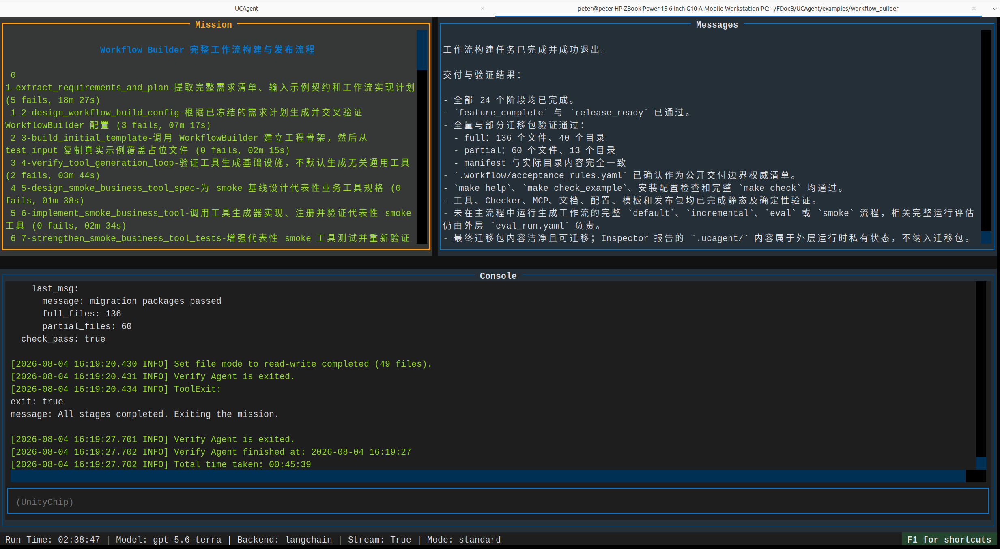

# Start the run build workflow

This section prepares a DOCX case input from scratch and runs the Workflow Builder in supervised mode. The following commands assume the UCAgent repository is located at `~/work/UCAgent` and the business root directory is `~/work/ucagent_tasks/docx`.

## 1. Prepare Business Requirements

First, create the business input directory:

```bash
mkdir -p ~/work/ucagent_tasks/docx/input/test_input/assets
```

Create `~/work/ucagent_tasks/docx/input/guide.md`, clearly defining the goal, input, output, tools, Checker, documentation, and acceptance criteria. You may use the following minimal example and continue to supplement business details:

```markdown

# DOCX Documentation Workflow Requirements

## Goal

Generate a workflow that reads Markdown content, images, and document requirements from a target directory, and outputs deliverable DOCX, processing reports, and structured validation results.

## Inputs

- `input/<TARGET>/content.md`: Body text and heading hierarchy.
- `input/<TARGET>/document_requirements.md`: Paper size, margins, fonts, headers/footers, table of contents, and image requirements.
- `input/<TARGET>/assets/`: Local images referenced in the body text.

## Outputs

- `output/<TARGET>/document.docx`
- `output/<TARGET>/generation_report.json`
- `output/<TARGET>/validation_report.json`

## Tools and Checkers

Tools are responsible for parsing requirements, planning document structure, generating DOCX, and reading the generated results. The Checker validates input completeness, DOCX openability, required sections, images, styles, and report fields. If tools fail, they must return a structured error; pseudo-success files must not be left behind.

## Documentation and Environment

Provide complete user documentation, developer documentation, `requirements.txt`, `setup.py`, `Makefile`, sample inputs, and `make check/check_example/run` entry points.
```

This version is only for explaining the minimum structure. Formal requirements should specify tool inputs/outputs, exception handling, Checker evidence, and business acceptance criteria item by item; otherwise, the Agent will need to make numerous design decisions during the initial phase.

## 2. Prepare Sample Inputs

Place a smaller but complete case in `~/work/ucagent_tasks/docx/input/test_input/`:

```text
test_input/
├── content.md
├── document_requirements.md
└── assets/
    └── architecture.png
```

The body text must include at least one level-2 heading, paragraphs, lists, a table, and an image reference. Document requirements should specify Chinese font fallback, page size, behavior when images are missing, and output filename. This allows the generator to plan meaningful tool testing and Checker fixtures.

When using the sample body text below, you can copy the document screenshot as `assets/architecture.png`:

```bash
cp ~/work/UCAgent/docs/content/04_case/03_workflow_builder/resource/workflow_builder_running.png \
  ~/work/ucagent_tasks/docx/input/test_input/assets/architecture.png
```

## 3. Check Environment

```bash
cd ~/work/UCAgent/examples/workflow_builder
python setup.py --check
test -f ~/work/ucagent_tasks/docx/input/guide.md
test -d ~/work/ucagent_tasks/docx/input/test_input
```

If not using local configuration, you must explicitly pass the source, Python, and workspace paths to Make; passing only `WS` is insufficient. Do not start the environment check until it passes. Whether an agent is required depends on the model service; do not write tokens into `guide.md` or `.workflow_builder/local.mk`.

## 4. Start Supervised Mode

Launch the TUI directly:

```bash
make WS=~/work/ucagent_tasks/docx/workspace run
```

The `run` target defaults to `--loop`, allowing the Agent to automatically retrieve and continue tasks. When observing in a shared tmux session, you can use the `session` target from the Makefile, or create your own tmux session and execute the same command within it. In supervised mode, do not generate business files for the Agent; after consecutive failures, locate the parent workflow contract, guide documentation, or Checker issues.



## 5. Observe Progress

Normally, `workspace/wfgen/workflow_implementation_plan.md` appears first, followed by the requirements manifest, input sample manifest, workflow build spec, and finally the materialization of `workspace/workflow/`. Stage records in the plan file can only be appended with content from the current stage; they must not overwrite previous stages.

Check periodically:

```bash
find ~/work/ucagent_tasks/docx/workspace/wfgen -maxdepth 1 -type f -print
find ~/work/ucagent_tasks/docx/workspace/workflow -maxdepth 2 -type f | head
```

Do not terminate immediately due to a single long model call. Continuous failures, repeated checks with unchanged timestamps, continuous context compression, or explicit exception stacks are signals requiring diagnosis.

## 6. Post-Build Verification

```bash
cd ~/work/ucagent_tasks/docx/workspace/workflow
python setup.py --check
make check
make check_example
```

The generated `setup.py` and `Makefile` for the workflow itself reside in `workspace/workflow/`; they are distinct from the environment configuration files in the Workflow Builder root directory. When failures occur, retain the full exit code and logs; do not declare completion based solely on the existence of an output file.

## Common Failures

- `missing guide file`: `WS` should point to the `workspace/` directory under the business root, not the business root itself.
- TUI did not start automatically: Confirm you used `make ... run` and that `RUN_LOOP_ARGS` was not cleared.
- Restoring old stages: This is historical `.ucagent` behavior; whether to clear history depends on whether the current run requires resuming.
- Referenced file missing: Check if the workflow build spec incorrectly references future files as current references.
- Repeated stage failures: First examine the Checker's accurate description in the TUI, then check the "Issues and Fixes" section of `workflow_implementation_plan.md`.

## Ready-to-Use Sample Body Text

`input/test_input/content.md` may include:

```markdown

# Workflow Builder User Guide

## Goal

This document explains the workspace, generation, evaluation, and incremental repair processes for engineers using UCAgent for the first time.

## Steps

1. Prepare requirements and sample inputs.
2. Start the build workflow and observe stages.
3. Run static evaluation and approve issues.

## Result Table

| Action | Primary Result |
| --- | --- |
| Build | workflow/ |
| Evaluate | eval/*.json |


```

`document_requirements.md` should specify A4 paper size, margins, heading hierarchy, Chinese font fallback, page numbers, table of contents, table styles, maximum image width, behavior when images are missing, and output filename. Images can be copied from a smaller screenshot in the document's `resource/` folder as a sample, but image-only provision without alternative text is not acceptable.

## tmux Startup and Viewing

When another terminal is used for read-only observation:

```bash
make WS=~/work/ucagent_tasks/docx/workspace session
tmux attach -t ucagent_workflow_builder -r
```

Read-only attach does not pass keystrokes to the TUI. To stop, enter the writable session, press `Ctrl+C` to cancel the current command, then follow the UCAgent prompt to exit; do not delete the tmux session directly, allowing child processes and permission daemons to remain in the background.

## Stage Observation Table

| Observation Result | Judgment | Next Step |
| --- | --- | --- |
| Tool calls continue to change, files increase | Normal execution | Continue supervision |
| Same Checker fails 1–2 times with content changes | Agent is fixing | Do not intervene |
| Same error repeats multiple times, no file changes | Likely contract or guide issue | Check Stage GuideDoc and Checker |
| Automatic retry after model stream anomaly | External call interruption | Observe if retry recovers |
| Full re-read immediately after compression | Context strategy issue | Limit reads and revise parent guide |

## Artifact Inspection Order

After build completion, first verify that `workflow_implementation_plan.md` covers all stages and issue records. Then check whether tools and Checkers in `workflow_build.yaml` are more specific than the original user requirements. Subsequently verify public files in `workflow/`, config registration, developer documentation source analysis, and environment entry points. Only then run Make acceptance. This order avoids repeatedly running expensive checks when obvious design gaps exist.
