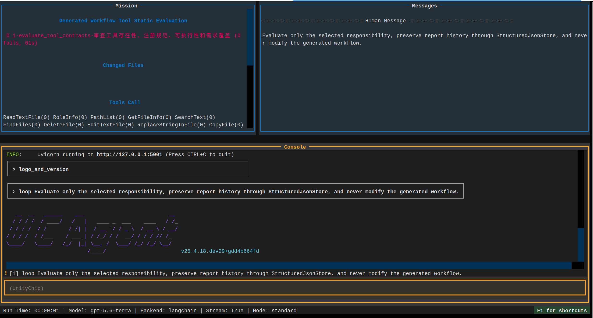

# Start Evaluation Workflow

The evaluation process is used to independently review generated business workflows. Static evaluation must not modify `workflow/` and should not trigger full sub-workflows solely to prove issues. Running an evaluation incurs high costs and must be explicitly chosen by the user.

## Evaluation Prerequisites

```bash
test -d ~/work/ucagent_tasks/docx/workspace/workflow
cd ~/work/UCAgent/examples/workflow_builder
python setup.py --check
```

The workspace must contain `eval/`, `res/`, and `tmp/`. The Make entry will initialize structured files, but professional knowledge in `res/` must be provided by the user; the evaluation Agent must not pretend the user has written professional judgment.

## Component Execution

```bash
make WS=~/work/ucagent_tasks/docx/workspace run_eval_tools
make WS=~/work/ucagent_tasks/docx/workspace run_eval_checkers
make WS=~/work/ucagent_tasks/docx/workspace run_eval_flow
make WS=~/work/ucagent_tasks/docx/workspace run_eval_env
```

The four responsibilities are:

- `eval_tools`: Existence, UCAgent registration syntax, callability, error structure, and business requirement coverage.
- `eval_checkers`: Source code, docstrings, constructor arguments, registration consistency, positive and negative fixtures, and decision semantics.
- `eval_flow`: `config/inc` configuration, stage handoffs, references and output files, GuideDoc, and user documentation.
- `eval_env`: Makefile, setup.py for generating workflows, shell, dependencies, paths, ports, and migration capabilities.

Alternatively, run them sequentially and aggregate:

```bash
make WS=~/work/ucagent_tasks/docx/workspace run_eval
```

## Running Evaluation

Only choose the following when static checks cannot answer whether the "actual process is stuck or the output is usable":

```bash
make WS=~/work/ucagent_tasks/docx/workspace run_eval_runtime_default
```

Incremental run mode uses `run_eval_runtime_inc`. Evaluate only one run mode at a time to avoid mixing costs, logs, and conclusions.

## Reading Results

Reports are located in the `eval/` directory of the build workspace. Aggregation commands are:

```bash
make WS=~/work/ucagent_tasks/docx/workspace aggregate_eval
make WS=~/work/ucagent_tasks/docx/workspace eval-list
```

A valid finding must include a stable id, severity, object, evidence, impact, recommendation, and source run. Issues that prevent UCAgent from starting, cause the process to hang, result in erroneous deployment, or corrupt formal documents have the highest priority; reporting unmet requirements as successful also constitutes a high risk.



## Failure Judgment

The evaluation Agent's own consecutive failures do not necessarily indicate a problem with the evaluated workflow. First, distinguish between: reporting tool parameter errors, reference files causing context issues, network stream interruptions, conflicting evaluation guidance, or indeed finding the target defect. Only conclusions with source code or deterministic command evidence can enter approval.

## Minimum Evidence per Component

| Component | Minimum Evidence Required |
| --- | --- |
| tools | spec, source entry, registration record, one successful call and one failed call |
| checkers | spec, class/docstring, constructor arguments, positive/negative fixtures, stage registration |
| flow | variable definitions and usage, stage input/output mapping, specific reference files, GuideDoc |
| env | Make variable passing, setup check, dependency declaration, path and port checks |

Evaluation cannot search only for class names just because source files are long, nor can it read all components in full at once to be "complete". Process one target at a time, read the index and direct dependencies first, write evidence to the report, then proceed to the next target.

## Report Status Judgment

`passed` indicates that all mandatory checks have evidence and no blocking findings exist; `failed` indicates confirmed issues violating the contract; `blocked` indicates evaluation cannot be completed due to missing targets, dependencies, or user knowledge. Network interruptions or Agent call errors belong to evaluation run failures and should not be written as high findings in the evaluated workflow.

A finding's recommendation should be scoped to the fix. For example, stating "block and add negative fixture in unknown placeholder validation in config generator" is more suitable for approval and incremental implementation than "optimize config".

## Post-Aggregation Human Review

First, check for startup failures, hangs, file corruption, or false success risks in critical/high findings. Then, verify if different components share the same root cause. Finally, randomly spot-check evidence from passed checks. Evaluation quality is not just about what is found, but also about whether it incorrectly marks unverified items as passed.

If the report omits obvious issues, check whether the evaluation rules cover general data flows rather than hardcoding a specific string as the only rule. After correcting the rules, re-run the corresponding components and retain the old runs for comparison.
