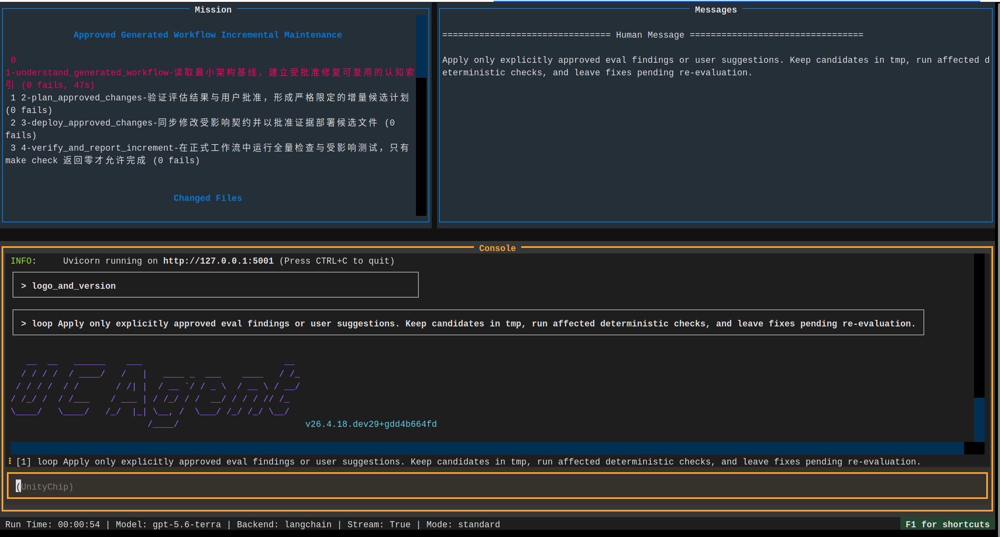

# Start Incremental Workflow

The incremental process handles only findings and suggestions explicitly approved by the user. New suggestions require approval before entering the current round of fixes.

## 1. Approve or Add Suggestions

```bash
make WS=~/work/ucagent_tasks/docx/workspace eval-list
make WS=~/work/ucagent_tasks/docx/workspace eval-suggest \
  TITLE='Supplement DOCX font fallback explanation' \
  DESCRIPTION='User documentation should explain alternative strategies when the Linux environment lacks specified fonts'
make WS=~/work/ucagent_tasks/docx/workspace eval-list
```

Copy the full `review_id` of the entry to be processed from the `eval-list` output, replace the example values below, and approve. Findings use prefixes like `flow/...`, `tools/...`, etc.; it is recommended to use `user/...`:

```bash
make WS=~/work/ucagent_tasks/docx/workspace eval-approve \
  ID='user/<suggestion-id>' \
  REASON='Allow supplementing font fallback explanation in user-generated workflow documents and running document checks'
```

The approval reason should specify the target for modification and the acceptance criteria. Approval does not require the user to input large blocks of fix code individually, but rather authorizes the incremental process to formulate candidate solutions within a controlled scope.

## 2. Start Incremental Process

```bash
make WS=~/work/ucagent_tasks/docx/workspace run_inc
```

The entry point assigns a new incremental run id, saving the current round's manifest, candidate files, evidence, and status under `tmp/inc_runs/<run-id>/`. Different runs cannot share a candidate directory without an identity, as this would confuse old reports, old patches, and the current approval scope.



## 3. Fix and Deployment Semantics

The incremental process first reads the summary, approved entries, relevant source code, and necessary documentation, then establishes a mapping for each approved item. Before modifying formal files, save the old version; run affected checks immediately after modification. After deployment, "waiting for approval" no longer blocks fixing `make check`; the only correct closure at this point is to continue fixing until regression passes, or explicitly report that a fix is impossible and stop.

Formal acceptance must include at least:

```bash
cd ~/work/ucagent_tasks/docx/workspace/workflow
make check
make check_example
```

If modifying tools or Checkers, also run the corresponding fixture or tool tests. Modifying only reports without deploying files, or deploying without running checks, do not constitute completion.

## 4. View Results

- `eval/incremental_report.json`: Current round's goals, execution status, checks, and unresolved issues.
- `eval/applied_changes.json`: Actually deployed files, versions, and verification evidence.
- `tmp/inc_runs/<run-id>/`: Current round's candidates and process evidence.
- `tmp/change_history/`: Old versions of formal files and recovery records.

After completing the incremental process, re-run affected evaluation components. Old findings will not automatically become new conclusions just because files were modified. Aggregated reports can only form a true closure when reading a new round of evaluation results.

## Common Errors

- No approved entries: The incremental process should end quickly and should not freely search for and fix other issues.
- Long first-stage reading: The cognitive phase should read indexes and summaries, then read directionally according to approved goals, not scan all large documents in full.
- `make check` failure followed by idle spinning: This is an error in the state machine termination condition; immediately enter fix and re-verification.
- Formal files read-only: The controlled deployer should handle this via temporary files in the same directory and atomic replacement, saving the old version; relying on ordinary overwrite writes is not acceptable.
- Fix too fast: Check applied changes, source code diffs, and actual command return codes to confirm it is not just updating the report.

## Approval Reason Examples

Good approval reasons:

```text
Allow modification of workflow/config.yaml and its generation source so that the first stage only references specific files existing before execution;
Must retain existing stage names, and accept with static config check and `make check` returning 0.
```

Insufficient reasons are "Agree to fix" or "Optimize all." They lack modification boundaries, making it difficult for the incremental Agent to judge whether to modify GuideDoc, Checker, or generator. If deferring, explain missing business decisions, such as whether the user has decided to allow downloading fonts over the network.

## Directory of Current Run

```text
tmp/inc_runs/<run-id>/
├── context/
├── batches/<batch-id>/attempts/<attempt-id>/
│   ├── candidates/
│   └── evidence/
└── history/
```

Different implementations may add index files, but candidates, evidence, and history must be bound to the current identity. After starting, confirm the run id in the report or CLI first to avoid mistakenly thinking the current Agent has no output after viewing the previous round's directory.

## Acceptance Order After Deployment

1. Run the minimum test against the modified object in formal `workflow/`.
2. Run `make check`, and `make check_example` if necessary.
3. Compare hashes in `applied_changes.json` with formal files.
4. Confirm old version records are readable.
5. Re-run affected evaluation components.

If step 1 or step 2 fails, the incremental process should continue fixing or rollback, not declare completion first and wait for evaluation. Re-evaluation is an independent confirmation of the fix, not a replacement for deterministic regression after deployment.

## Recovery Drill

After enabling version management for the first time, suggest performing a recovery drill in a test workspace with a non-critical modification: view history, restore old version, confirm hash, run checks, then restore the new version. Only after a real drill can you confirm that the backup path displayed in the console is not an isolated record.
