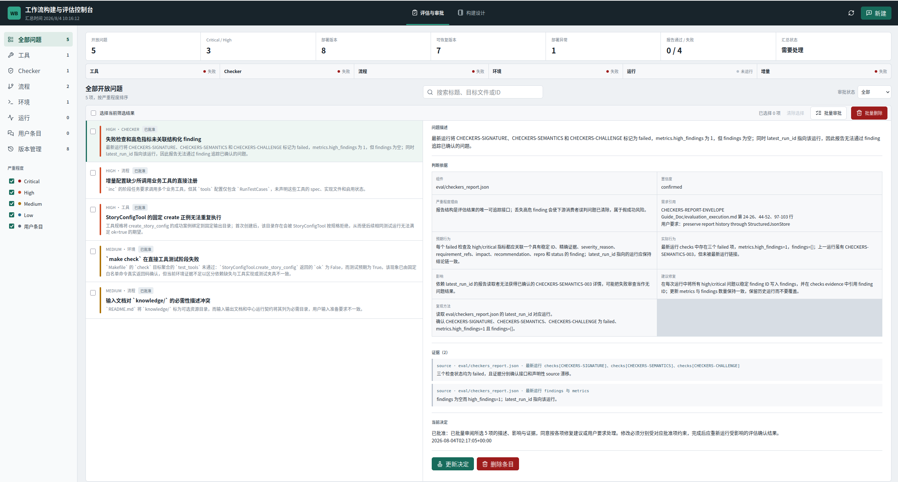
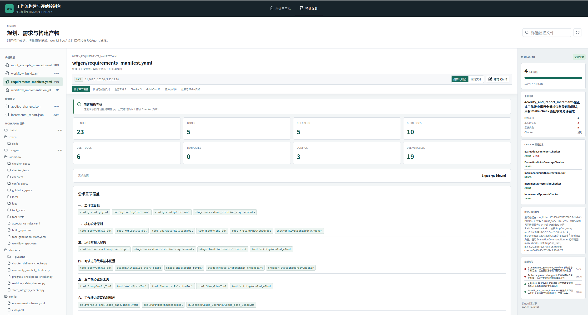
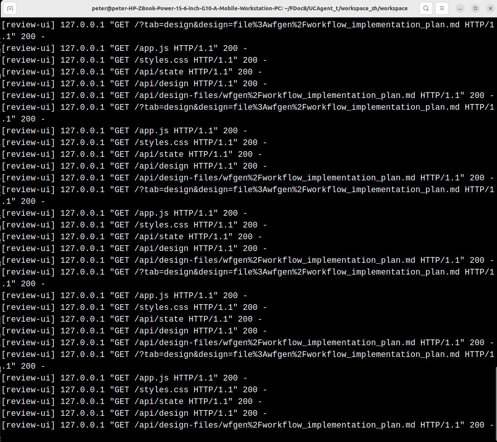

# Workflow Builder and Evaluation Console

The console provides a unified interface in the browser to view evaluation reports, review approval requests, add suggestions, inspect design files, monitor UCAgent progress, and manage incremental deployment history. It serves as the native management interface and does not replace the Evaluation Agent or the Incremental Agent.

## Startup

```bash
cd ~/work/UCAgent/examples/workflow_builder
make WS=~/work/ucagent_tasks/docx/workspace eval-ui
```

The default address is `http://127.0.0.1:8765`. If the port is already in use by another program, first verify if the console is already running:

```bash

# Linux

ss -ltnp | grep ':8765'

# macOS

lsof -nP -iTCP:8765 -sTCP:LISTEN
```

Use a different port if you need to view another workspace in parallel:

```bash
make WS=~/work/ucagent_tasks/docx/workspace EVAL_UI_PORT=8766 eval-ui
```

Do not blindly restart the same port. After completing approvals, press `Ctrl+C` in the terminal where the console was started; the port will be released once the service process exits.

## Evaluation and Approval Interface

This page displays findings, user suggestions, evidence, and approval status. Filters allow viewing by unapproved, approved, approved, pending, and rejected. Single-item approvals provide default reasons that users can adopt or supplement; batch approvals are suitable only for fixing entries with identical boundaries.



Deleting items is an explicit management action. Deleting an evaluation entry differs semantically from deleting version records: version records are by default used for recovery and audit, and are only removed from the index and corresponding historical files when explicitly deleted by the user.

## Design Interface

The design page parses files by format:

- `wfgen/input_example_manifest.yaml`
- `wfgen/workflow_build.yaml`
- `wfgen/requirements_manifest.yaml`
- `wfgen/workflow_implementation_plan.md`
- `eval/incremental_report.json`
- `eval/applied_changes.json`

Fixed-format files use a structured view; editable fields must pass length, type, reference, and calculation field validation before writing back. Files without a stable format display full text and should not be forced parsed by guessing incorrect fields.



The left side displays the workflow file tree, the center shows the wider core content, basic document information is fixed at the top, current document navigation is located below the basic information, and the main text area scrolls independently. The right side displays the UCAgent current stage and runtime status.

## Backend and Security Boundaries



The console backend calls structured storage via controlled APIs and does not allow the browser to arbitrarily concatenate file paths. The workspace must be a directory explicitly passed in the startup command; all write operations validate paths, versions, and formats. The console listens by default only on `127.0.0.1`; remote access should be done via a trusted tunnel rather than exposing it directly to the public internet.

## Next Steps After Approval

Console approvals only update structured approval data and do not automatically start the Incremental Agent. After completing approvals, you may exit or keep the console running; execute `make WS=... run_inc` in another terminal. After the incremental process finishes, refresh the page to view reports, deployment files, and historical versions, then run a new evaluation to close the loop.

## Page and Backend Status Mapping

| Page Action | Backend Status Change | Action That Will Not Occur Automatically |
| --- | --- | --- |
| Approve finding | Add/update approval | Do not start inc, do not modify workflow |
| Create suggestion | Write user suggestions | Do not auto-approve |
| Save structured design | Write to specified wfgen file after validation | Do not re-run build phase |
| Recover history | Atomically replace formal file and record | Do not automatically close old finding |
| Delete history | Delete specified record and unreferenced backups | Do not delete other runs |

Users should refresh and verify revision, status, and time after actions. If the browser shows success but JSON has not updated, this is a backend issue that cannot be masked by frontend prompts.

## Structured Editing Limitations

The editor only exposes fields allowed by the schema. Calculated values such as minimum counts, hashes, run IDs, and audit times cannot be entered arbitrarily. During save, the server compares the revision read at that time; if the backend Agent has already updated the file, the user must reload and merge changes rather than overwrite the new version.

The Markdown implementation plan is primarily for reading stage structure and issue records and is not intended as a casual text editor. Files without fixed formats display full text but do not provide a save button to prevent the UI from becoming an arbitrary file tool that bypasses incremental approvals.

## Version Management Operations

Before recovering, view the original path, run ID, backup hash, and creation time. Recovery first backs up the current formal version, so recovery can be undone. Deletion operations are irreversible; only delete versions confirmed to no longer be needed and not referenced by other records; when dealing with large numbers of records, first filter by run, file, and status.

## Console Error Evidence

When encountering blank pages or operation failures, retain the browser request path, HTTP status, backend traceback, workspace, and revision. Port conflicts, illegal paths returning 400, revision conflicts returning 409, and server-side exceptions returning 500 represent different issues. Do not simply take a screenshot of a "button not responding," and do not kill the port-occupying process without confirming the PID.
