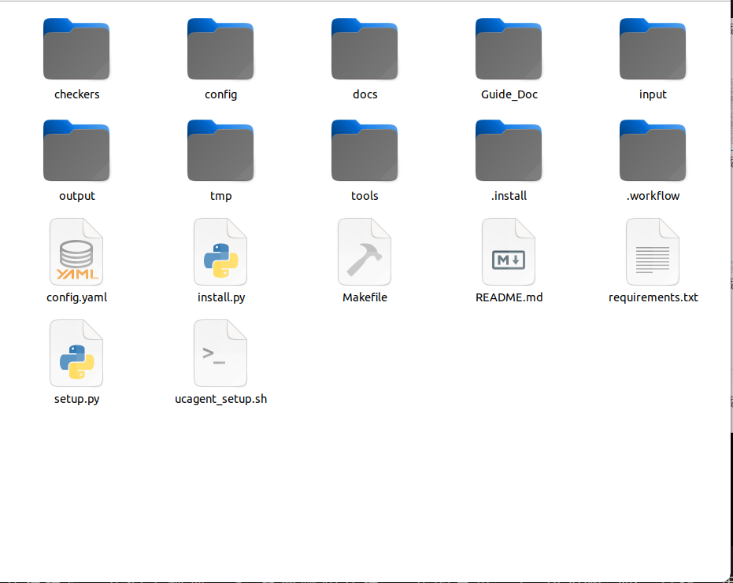

# Output and Workspace Structure

The `workspace/` directory under the business root saves design, final workflow, evaluation, incremental history, and UCAgent state. Each directory serves a different purpose and has distinct cleanup and version management strategies.

## Primary Directories

| Path | Content | Modifiable by Hand |
| --- | --- | --- |
| `input/` | Snapshot of input for this build | Usually not modified during runtime |
| `wfgen/` | requirements, build design, example manifest, implementation plan | Written during build phase; console only exposes specific structure fields |
| `Guide_Doc/` | Public stage guide copy for master workflow | Not modified as a business artifact |
| `workflow/` | Final generated independent business workflow | Modified during build or controlled incremental deployment |
| `eval/` | Component evaluation, approval, incremental, and deployment reports | Modified via structured tools or console |
| `res/` | Source of user expertise and suggestions | Maintained by user |
| `tmp/` | Temporary files, evaluation cases, incremental candidates, and historical versions | Can be cleaned according to rules |
| `.ucagent/` | Current UCAgent history and runtime state | Should not be manually rewritten |

## Key Files in wfgen

- `requirements_manifest.yaml`: Normalized user requirements and deliverables.
- `workflow_implementation_plan.md`: Cross-stage design, tools, Checker, documentation, and "issues and handling".
- `input_example_manifest.yaml`: File mapping and sources for example targets.
- `workflow_build.yaml`: Central workflow spec, files, tools, Checker, GuideDoc, and environment design.

Subsequent stages must read and update the marked areas of the plan for the current phase without overwriting preceding content. Central design changes must be synchronized across the manifest and final artifacts; modifying only one file is insufficient.

## workflow Deliverables

Typical outputs include `config.yaml`, `config/inc.yaml`, `tools/`, `checkers/`, `Guide_Doc/`, `docs/`, `input/example/`, `setup.py`, `requirements.txt`, `ucagent_setup.sh`, and `Makefile`.

The `output/` directory within the generated workflow contains data that is only produced when the business goal is executed in the future; it cannot be substituted with pre-built results during the build phase.

## eval and tmp

The `eval/` directory stores structured records that need long-term reading, approval, and aggregation. The `tmp/` directory stores reproducible process data, but `tmp/change_history/` and the currently valid `tmp/inc_runs/` must not be deleted until version management is complete. Cleanup commands must retain files referenced by historical indexes.

Browser validation profiles, locks, and caches generated are restricted to `tmp/ui_validation/`. When the browser exits, locks may vanish instantly; the cleaner must tolerate this race condition and should not misinterpret warnings as business failures.

## File Permissions

UCAgent history may temporarily alter snapshot permissions, while the Makefile restores the writable state of the workspace. Formal incremental deployments do not rely on the original files being writable; instead, they use backups and atomic replacement. Users should still avoid simultaneously editing the same files with other editors during workflow execution.

## Public and Internal Files

Public files of the generated workflow are intended for end users, including README, docs, config, Makefile, setup, requirements, tools, and business Checkers. The `.workflow/` directory stores specs, internal Checkers, tests, and acceptance criteria; developers may inspect them, but ordinary users are not required to manually edit them.

`reference_files` and `output_files` represent stage contracts and must be listed with specific filenames. References must exist before the stage begins, while outputs are produced or updated by the current stage. Directory structure displays should be placed in documentation or manifests; directories cannot be used to impersonate file references.

## Key JSON Ownership

| File | Writer | User Action |
| --- | --- | --- |
| `eval/*_report.json` | Evaluation structured tool | Read, approve findings |
| `eval/user_suggestions.json` | CLI/Console | Create, retract, delete |
| `eval/approvals.json` | Approval API | Approve, reject, suspend |
| `eval/incremental_report.json` | Incremental workflow | Read repair status |
| `eval/applied_changes.json` | Deployer | Read and version operations |

Manual editing may break revisions, fingerprints, and audit trails. Standard clean operations must preserve `input`, `eval`, `res`, the current inc run, and change history. When checking outputs, YAML/JSON must be parsed, Python imports executed, and Make targets run; a complete file tree does not guarantee valid content.
