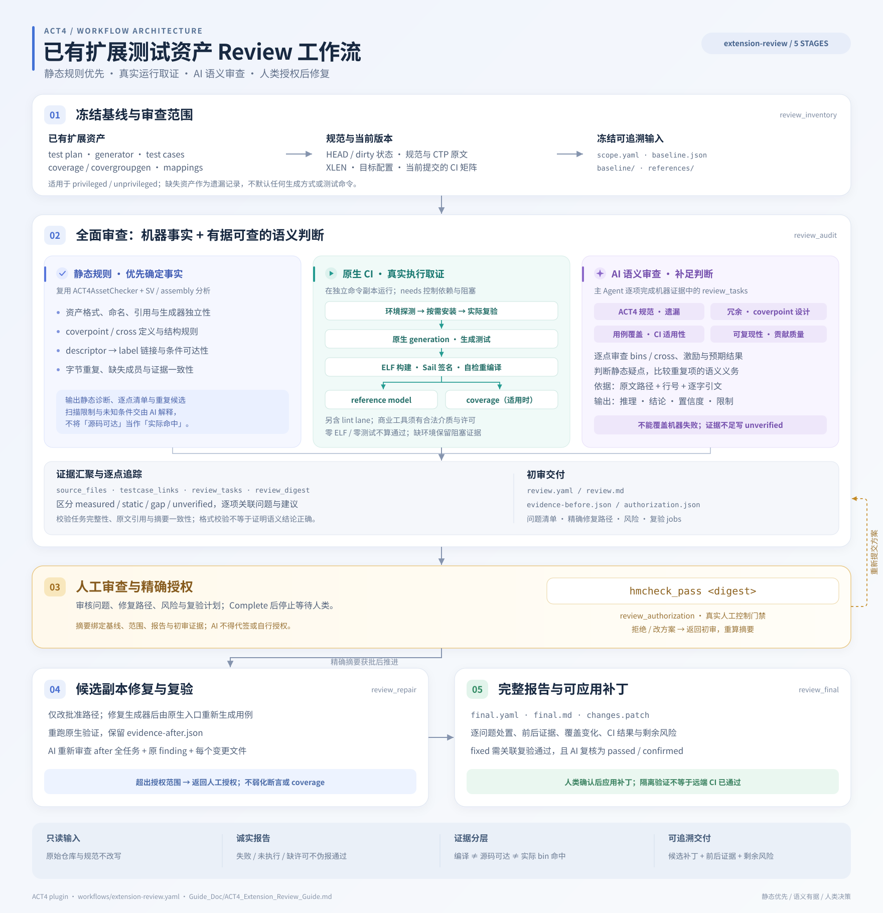

# ACT4 插件开发

插件实现位于 `src/act4_privileged_suite/`，不修改 UCAgent 核心的默认 workflow、
依赖或 checker 导出。`ucagent-plugin.toml` 支持源码加载，`pyproject.toml` 的
`ucagent.plugins` entry point 支持安装态发现；两者指向相同 provider。

## 资源和注册

- `plugin.py` 声明两个工作流、9 类 checker、依赖和 Guide_Doc。
- `workflows/privileged-suite-generation.yaml` 保留 ITGen 七阶段任务及其验收规则，
  使用插件 registry 的 checker 短名。
- `checkers/` 包含资产一致性、CTP/manual 来源、审查、switch、manifest 和最终报告校验。
- `Guide_Doc/` 包含运行指南、checker 说明和阶段填写模板，仅在选择本工作流后复制。
- 各阶段 `reference_files` 列出当前模板及所用 gate 的说明，保留原有 ACT4 原生输入。
- `tests/` 保留 ITGen 的 ACT4 checker 回归，并增加插件描述、阶段生命周期及配置测试。

这些文件迁移自 ITGen 的 `itgen/lang/zh/config/act4_priv_suite_generate.yaml`、
`itgen/checker/act4_*.py` 与相应指南及测试。原有 `work_itgen_<Suite>` 构建目录名继续使用。
checker 使用包内导入，所有 Checker 构造函数调用核心基类初始化，不依赖
`sys.path` 注入、ITGen checkout 或顶层模块别名。
生成工作流为 7 个阶段、25 个 gate。插件特有适配为
checker 短名注册、manual 路径配置和静态规范引用；生成器独立性校验另外拒绝
`act4_privileged_suite` 私有导入/路径及 `ACT4_MANUAL_ROOT`，允许 ACT4 原生输入。
UCAgent 版本下限采用实际测试的 `26.9.2.dev25`。



`workflows/extension-review.yaml` 提供 5 阶段已有资产审查，新增 `ACT4ReviewChecker` 管理
冻结基线、审查契约、真实命令证据、人工授权范围、候选差异与最终补丁；复用
`ACT4AssetChecker` 和现有 SV/assembly 分析，不使用仅允许新 suite 的 manifest 门禁。
初审允许资产检查或 CI 失败，门禁要求报告完整、真实并保留限制。修复在候选副本进行；
输入 checkout 通过文件工具写入白名单保护，并在每次 Check 检查内容、模式、HEAD 及子模块。
工作流只将 Guide_Doc 配置为 `un_write_dirs`，避免核心初始化的 chmod 改动输入模式；
`write_dirs` 只允许输出目录。外部 shell/MCP 仍须遵守只读输入约定，边界不是 OS 沙箱。

授权采用真正的 `need_human_check`，摘要绑定 baseline、scope、review 和初审证据。
`Check` 不签发授权；`Complete` 后的 stage completion callback 才记录控制器状态。
修复检查同时确认该阶段已完成、未跳过及匹配的摘要；恢复会话从 stage_data 读取授权，
不从 agent 可编写的 `authorization.json` 或 `approved` 字段推断许可。
规范示例见独立运行指南，避免在生成工作流文档中复制另一套契约。

原生命令在独立本地 Git clone 中运行，包含冻结的 dirty 源码及初始化子模块，无共享
hardlinks；生成文件不反写 baseline/candidate。每项命令记录 argv、cwd、退出码、日志和
产物摘要。后续 Check 使用绑定源码/矩阵的缓存，只有显式 `run_commands: true` 才重跑。
矩阵通过 `needs` 排序并传播前置失败；每个 target 声明 environment lane，工具探测失败时
运行声明的安装命令并复验。安装只使用输出下的 tools 目录，Questa/VCS 缺介质/许可证时
保留实测日志与恢复动作。build 依赖 generation，执行依赖同 target 的非空 ELF 构建产物，
模型结果按原生格式核对通过数等于输入 ELF 数；零测试、空产物和 signature-only 结果均失败。
日志、产物和候选内容变化会使证据失效。静态结果与 measured coverage 分开，通用门禁
只能核验 coverage 产物来源，具体 bins/义务等价仍需 AI 与人类结合原生产物审查。

review 在保留现有资产检查的基础上启用完整声明资产的格式解析、generator 独立性及现有
cross default-bin/bitwalk 结构检查，
复用 assembly 条件分析建立源码/本轮生成用例的 descriptor-label 对应；条件未知、确定不可达
或解析异常的链接不能标为 static。measured 仅接受成功 coverage lane 的正式产物。
规范输入通过 `scope.reference_files` 单独冻结并核对原件；这些设置仅在 review 中启用，
不更改共享 checker 的实现、默认参数或生成工作流的门禁。

主 Agent 必须完成 `semantic_review`：机器证据列出八类主题、逐 coverpoint/cross、静态诊断、
条件疑点和字节重复候选；每项给出推理、结论、置信度及可验证的原文引用。门禁校验任务完整性、
输入摘要、行号/引文、关联 finding 和结论一致性，不宣称能机械证明推理正确。
修复后以 after 证据复核全部任务、原 finding 和变更文件，未解决的判断进入最终风险。
完整运行契约及示例集中在 `Guide_Doc/ACT4_Extension_Review_Guide.md`。

本工作流不主动启用核心 `check_pass_refinement` 独立 LLM 复核：核心当前在建议生成异常时
会将阶段标为 approved（`ucagent/stage/vmanager.py` 的 `gen_pass_suggestion`），不宜将它
作为强制语义门禁。采用主 Agent 的结构化审查，不增加第二套模型 API 配置，也不把 schema
校验当成独立模型已审查的证明。真正的人工摘要授权继续独立生效。

manual 路径由工作流的 `template_overwrite.ACT4_MANUAL_ROOT` 提供，加载 YAML 时解析
`ACT4_MANUAL_ROOT` 环境变量，再由 UCAgent 模板系统统一渲染进提示和 checker 参数。
工作流的 context factory 在初始化前验证输出是工作区内非空相对目录，解析符号链接
后两个可写根仍位于工作区内，且输出、ACT4 副本、manual 两两不重叠；不修改最终配置。
新增配置应继续走 UCAgent 的最终配置，不在 checker 中重复读取环境变量。

## 源码与安装态

在仓库根目录执行 Python 会优先导入当前 checkout，不一定使用环境中已安装的核心。
初次构建前若缺少生成的 `ucagent/_version.py`，源码版本为 `0.9.1+source.code`，会被
插件最低版本检查拒绝，即使 `pip show UCAgent` 显示一个兼容版本。

开发当前核心与插件时，先在仓库根目录执行一次 `python3 -m pip install -e .`，再安装
插件开发依赖。该步骤由构建系统生成核心版本，不要手写 `_version.py`、修改版本门槛
或在测试中伪造通过。检查 `python3 -c 'from ucagent.version import __version__; print(__version__)'`
后再执行下面的源码校验。

只验证已安装核心时，应在仓库外运行 `ucagent --validate-plugin`，以绝对路径加载
本插件；测试同样使用绝对路径，并加 `--import-mode=importlib`，避免仓库根目录
进入导入路径。记录实际使用的核心版本，不把安装态回归说成当前核心源码回归。

## 验证与打包

在插件目录执行：

```bash
python3 -m pip install -e '.[dev]'
make validate
make test
make package
```

也可在 UCAgent 根目录直接加载源码：

```bash
python3 ucagent.py --validate-plugin ./plugins/ACT4
PYTHONPATH=plugins/ACT4/src python3 -m pytest -q plugins/ACT4/tests
```

`make test` 使用临时工作区和合成资产，检查成功与失败边界，不联网生成真实 suite。
阶段启动测试使用 UCAgent blank backend，验证 Skill 开启/关闭时均能装配完整工作流，
并验证 manual 路径覆盖、Guide_Doc 复制与目录策略。
路径测试覆盖输出越界、符号链接越界、输出与 ACT4 重叠及外部只读 manual；manifest
测试覆盖已有 suite generator、重复基线路径与缺失/错误的对象身份字段；最终报告
测试区分 YAML 布尔值与数值，避免 `1`/`0` 冒充 readiness。
`test_documentation_contracts.py` 将指南中的完整清单、最终报告和参考运行记录交给真实
checker 校验，并检查运行文档与生成报告的标题间距，防止示例和实际契约漂移。
插件契约测试还覆盖配置搜索路径、全部 checker 的名称冲突、依赖缺失、命令版本探测
失败和工作流专属依赖的按需激活。原有测试分别覆盖 CTP/manual 来源、资产集合与语义、
generator API/拆分/独立性、VM scope、testcase 可达性、ELF/签名、审查、switch、manifest
和最终报告；测试不等价于真实套件的编译、参考模型执行或 coverage 命中。
正式 ACT4 生成和模拟执行需按 README 准备真实依赖并另行运行。

`test_act4_review_checker.py` 覆盖真实 Complete 的等待/拒绝/摘要匹配、审批完成回调、
已批准/未完成审批的重启恢复、两种 Skill 设置，以及初审失败仍可交付报告的语义。
合成 CI 命令用于验证非零退出、缺工具、超时、缺产物及陈旧产物不得冒充成功；另测
源码/基线/报告/日志/产物漂移、越权路径、新 coverage 资产、完整追踪和最终处置。
同时覆盖缺失/初始化子模块、dirty 子模块输入、越界路径与符号链接，以及布尔/数值等
不能冒充文本说明或证据列表的格式边界。
环境和依赖测试覆盖已安装时跳过安装、安装/版本复验失败、缺商业许可、依赖循环/未知 ID、
缺 ELF 自动先构建、无效 ELF 阻塞执行，以及原生结果为空/失败/数量不符和安装证据漂移。
review 专属回归覆盖失败/超时诊断保留、截断和省略标记、诊断篡改及越界、未跟踪/忽略资产
进入原生 lint 索引、说明修改复用证据但使授权失效，以及精简报告中的 ELF/模型计数。
显式重新执行仍运行完整矩阵，诊断片段不能代替 coverage 证据或覆盖 ELF 输入。
语义审查回归还覆盖格式错误与逐点/重复/条件任务发现、缺失/重复任务、伪造引用与行号、
规范快照漂移、陈旧 digest、无依据的通过/修复声明和 after 复核；完整指南示例也执行这些门禁。
另测注释中的 descriptor 不得形成链接、真实行号、空/二进制输入及静态分析不可用时的诚实报告。
补丁测试使用 `git apply --check` 验证新增、删除、模式、CRLF、无末尾换行和含空格路径。
这些测试不宣称真实 extension 或远端 CI 已通过。

`setup.py` 构建时临时带入根目录 LICENSE/NOTICE，构建结束后清理副本；
sdist 带入它们以支持脱离仓库重建 wheel。发布前检查 wheel 的 entry point、所有
checker 模块、workflow、Guide_Doc 和 `.dist-info/licenses/`，并在仓库外测试安装态加载。
无需为本插件增加核心依赖或仓库根目录 CI。
