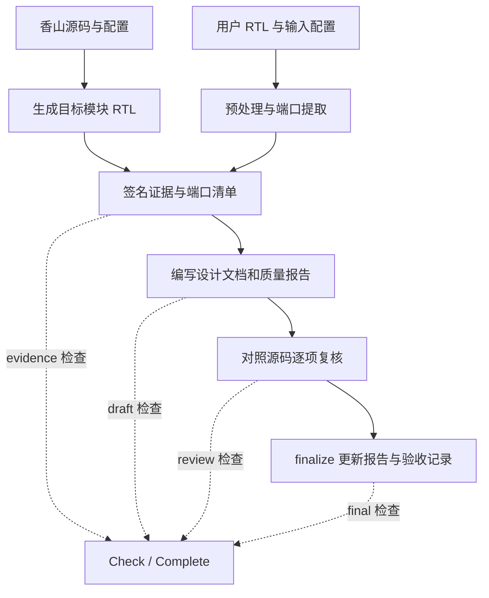

# RTL2Spec 插件原理与设计

本文面向维护或扩展 RTL2Spec 的开发者，介绍当前实现的数据流、工作流和 checker 设计。安装与运行见 [README](../README.md)，代码目录、测试命令和打包方法见[开发与验证](development.md)。

## 设计目标与职责分工

RTL2Spec 为指定源码版本和配置下的模块生成设计文档。实现由三部分协作：工具提取可确定的事实并保存证据，AI 根据源码组织行为说明和验证计划，checker 在阶段完成前核验当前文件。UCAgent 提供阶段调度、工具调用和工作区管理。

例如，端口名称、方向和位宽由工具提取；某个接口在什么条件下接受事务，由 AI 阅读实现后描述；checker 可以检查该描述的字段、证据位置以及关联的测试计划是否完整，却不能仅凭这些记录判断其语义是否正确。

这一区分决定了插件的验收范围：结构完整、证据真实且与当前文件一致，不等于 RTL 符合外部需求。若输入 RTL 自身有缺陷，文档仍可能准确描述有缺陷的实现；识别设计意图与实际行为的偏差，需要额外需求、人工审阅或动态、形式化验证。

## 插件接入与配置传递

[plugin.py](../src/rtl2spec/plugin.py) 的 `get_plugin()` 声明两个工作流、工具工厂、checker 和随包资源。工具与 checker 通过插件注册，不需要加入 UCAgent 的内置导出列表。Bash、Git、Curl、Make 等命令依赖挂在香山工作流上，加载通用工作流不会要求安装香山工具链。

工作流 YAML 指定阶段任务、参考文件、输出和 checker 参数。`template_context_factory` 在启动阶段检查输出目录必须为空或不存在，避免资源复制、工具暴露或历史阶段恢复之后才发现旧产物冲突。生成过程中继续检查该条件，以保护运行期间新出现的文件。

配置经过以下路径传递：

| 配置 | 来源与用途 |
| --- | --- |
| `{DUT}`、`{OUT}` | UCAgent 解析的模块名、输出目录；工具工厂从 `PluginContext` 获取工作区和输出位置，阶段与 checker 使用渲染后的参数 |
| `{XS_CONFIG}` | YAML 加载时从 `XIANGSHAN_CONFIG` 读取，默认 `DefaultConfig`；传给工具和 checker 的 `config`，并最终用于香山生成器的 `--config` |
| `{GENERIC_CONFIG}` | YAML 加载时从 `RTL2SPEC_CONFIG` 读取，默认 `Generic`；标识通用工作流的文档配置，并参与证据身份校验 |
| `inputs/{DUT}/rtl2spec.json` | 通用工作流的实际输入选项：文件顺序、include 搜索目录、对象宏及整数参数覆盖 |

`XS_CONFIG` 是内部模板变量，用户设置的是 `XIANGSHAN_CONFIG`。环境变量在 YAML 加载时解析，`{XS_CONFIG}` 在模板渲染时替换；后续操作使用已经传入的 `config`，不能重新读取环境变量改变本次配置。通用工作流中的配置名称也不能代替 `rtl2spec.json` 中的输入选项。

两条工作流都不依赖 Skill。必需的任务和格式要求由阶段提示、`Guide_Doc`、工具参数和模板提供，关闭 Skill 时仍应能完成相同验收。

## 四阶段工作流

工作流定义分别位于 [xiangshan-design-document.yaml](../src/rtl2spec/workflows/xiangshan-design-document.yaml) 和 [generic-design-document.yaml](../src/rtl2spec/workflows/generic-design-document.yaml)。两者获取输入证据的方法不同，后续文档和验收契约相同。下表工具操作以香山名称表示，通用操作加 `generic_` 前缀。

| 阶段 / checker phase | 工作与主要产物 | 阶段验收内容 |
| --- | --- | --- |
| 核验输入 / `evidence` | `preflight`、`evidence`，按需登记相关源码，`ports` 生成端口表骨架 | 签名、模块与配置、当前源码身份、RTL 和端口清单一致 |
| 编写文档 / `draft` | AI 编写设计文档与质量报告，`metadata` 同步事实字段 | 重新检查证据，再检查文档结构、精确端口、字段、引用和追溯关系 |
| 源码复核 / `review` | AI 对照实现修订草稿；`review` 生成问题，AI 填写 `semantic_review.json` | 包含草稿检查，并检查每个行为的复核项、源码范围和当前基线 |
| 最终验收 / `final` | `finalize` 更新报告，生成 `validation.json` | 包含复核检查，并验证最终验收记录及其绑定的文件摘要 |

阶段只提供当前任务需要的参考文件。草稿和复核阶段使用的文件在前一阶段生成，因此 checker 的 `on_init()` 会将已经存在的证据、设计文档及相关源码加入当前阶段参考列表。

工具的 `validate` 用于草稿诊断，`lint` 用于复核诊断。正常收尾调用 `finalize`，记录阶段日志，再调用 `Complete`；无需为同一份未变化的内容连续调用所有诊断操作。`finalize` 执行的是 `review` 级检查，通过后才生成最终记录；随后 `Complete` 执行 `final` 级检查，避免让尚未生成的验收记录成为生成它自身的前提。

## 两种输入如何转化为证据

### 香山：固定源码和配置后生成 RTL

[evidence.py](../src/rtl2spec/evidence.py) 用 Git 提交和递归子模块状态确定源码身份，要求工作树干净且子模块与记录一致。[runtime.py](../src/rtl2spec/runtime.py) 在调用生成脚本前后比较源码状态，防止生成过程中源码发生变化。

[generate_rtl.sh](../src/rtl2spec/scripts/generate_rtl.sh) 调用香山 `top.TopMain`，按选定配置生成 RTL，再获取目标模块文件。当前实现从顶层生成结果中提取模块，不直接构造任意 Chisel 类的独立生成器。缓存标识纳入源码提交、配置、工具版本、生成选项、宿主平台和脚本摘要；使用缓存还需要校验对应签名记录及 RTL 内容。

若生成命令失败但目标模块 RTL 已产生，记录使用 `generation_status=partial`，草稿验收返回警告；final 还必须存在处于 `Open` 或 `Deferred` 的 `OPEN-GENERATION-PARTIAL`，并在质量报告中说明失败范围和受限结论。文档结论仅能依据已有模块证据，不能被描述为完整生成成功。实际命令、选项和工具版本与 RTL 摘要一同保存到 manifest。

### 通用 RTL：捕获输入并建立预处理视图

[generic_evidence.py](../src/rtl2spec/generic_evidence.py) 对输入目录内全部普通文件记录路径、大小和 SHA-256，计算 `source_baseline`；输入树中的软链接会被拒绝。未提供显式配置时寻找唯一顶层源文件，提供配置时按 `files` 顺序处理输入。

[verilog.py](../src/rtl2spec/verilog.py) 处理受支持的条件编译、include 和对象宏，并保留每行对应的原始文件位置。[sv_frontend.py](../src/rtl2spec/sv_frontend.py) 调用 pyslang 解析与展开选定顶层，支持 ANSI/非 ANSI 声明、package/typedef、packed struct/enum、多维 packed/unpacked 数组及 HDL 常量表达式；无法确定端口事实时返回错误，不猜测位宽。

证据同时保存原始目标源文件、预处理结果和 `source_map.json`。整数参数覆盖用于端口事实求值，并记录在 manifest 的 `compilation` 中；预处理结果不是完成参数展开后的网表。预处理仍限定支持的指令与对象宏；pyslang 对选定编译单元进行语法和展开检查，但不会综合、仿真或证明模块行为。

两条路径最终都产生 `manifest.json`、模块 RTL 和 `ports.csv`。每次检查重新核验源状态、哈希和端口事实；登记的相关源码另有独立路径、摘要和 `E-REL-*` 标识，不能用顶层 RTL 的哈希代替。

两条路径的端口提取范围不同。香山针对 firtool 已生成的扁平 ANSI 端口读取名称、方向和数值位宽；通用路径通过 pyslang 解析类型、绑定参数并求值宽度，还记录符号性、规范类型、packed/unpacked 维度和声明位置。这里的“展开”用于解析模块实例、参数和类型，不产生可执行仿真程序或综合结果。通用路径拒绝 interface/ref、动态尺寸和非 integral 端口。

附录 A 必须逐一映射所有实际端口，名称、方向和形状与当前 `ports.csv` 一致，源码位置包含真实声明。形状中的宽度是单个元素的 integral 位宽（包含所有 packed 维度），unpacked 维度另列，例如 `I/9[0:3]` 表示 4 个 9 位输入元素。通用证据保留类型详情，但端口映射检查不会证明协议说明、逻辑分组或采样语义正确。

## Checker 设计

### 阶段适配与共享验证入口

[checkers.py](../src/rtl2spec/checkers.py) 提供 `RTL2SpecArtifactsChecker` 与 `RTL2SpecGenericArtifactsChecker`。通用类复用前者的初始化和阶段计时逻辑，在 `do_check()` 中选择通用证据验证。它们都调用 [validation.py](../src/rtl2spec/validation.py) 的 `validate()`，由 `phase` 决定检查深度。

构造函数先调用 `super().__init__()`，只验证和保存静态参数。`on_init()` 在工作区、阶段可用后添加参考文件并注册一次完成回调；回调将 UCAgent 的实际阶段时间写入 `logs/stages.jsonl`。`do_check()` 每次读取当前文件，不生成 RTL、不改写文档、不自动更新复核或验收记录。

初始化时发现损坏的 manifest 或越界路径，只跳过无法读取的参考文件，由当前 Check 返回结构化诊断。修复或恢复有效证据后，可以在同一 Checker 实例上重新 Check/Complete；初始化时的读取失败不会成为永久失败状态。路径和签名仍由实时校验检查，不能通过修复 JSON 外观来绕过证据完整性要求。

这些 checker 没有批次进度。`Check` 和 `Complete` 使用相同的当前阶段产物检查；阶段推进和完成回调由 UCAgent 管理，工具调用成功本身不会替代阶段验收。

### 文档解析与确定性规则

[documents.py](../src/rtl2spec/documents.py) 使用 `markdown-it-py` 解析标题、表格和代码块，区分正文与代码围栏、引用中的示例。章节结构和规范表头来自[文档模板](../src/rtl2spec/Guide_Doc/chip_design_document_template_zh.md)，本地化字段名和状态标签来自 [artifact-templates.json](../src/rtl2spec/Guide_Doc/artifact-templates.json)。维护时应修改这些契约来源，避免在 Python 中另抄一份中文标题列表。

[contracts.py](../src/rtl2spec/contracts.py) 实现共享文档规则，精确端口比对由 `validation.py` 补充：

| 检查领域 | 可以确定的问题 | 保留的合理表达空间 |
| --- | --- | --- |
| 行为字段 | 每个 `P-*` 缺少必需字段、字段为空、缺少 `E-*` 或 `OPEN-*` 依据 | 不适用可以说明原因；证据缺口可以登记开放项 |
| 写作占位符 | 正文和报告遗留 `TODO`、`TBD` 或已知模板占位符 | 不把正常 HDL 下标等任意方括号内容当成占位符 |
| 规范表格 | 缺失或改序的表头、列数错误、空单元格、非法类型或状态 | 允许补充说明表；不要求给不存在的参数或状态制造条目 |
| 标识符 | 重复定义、格式错误、引用未定义的实体 | 区分定义与重复引用；说明表不自动成为定义表 |
| 跨表追溯 | Testplan 与 FC/CK、CASE、COV 的关系或行号矛盾 | 允许多对多关系，不强制一项行为只有一个检查 |
| 源码位置 | 未登记或越界的路径、无效或全空行范围、端口位置不含实际声明 | 支持原始源文件和允许的 RTL 视图，不判断自然语言是否被该行证明 |
| 接口映射 | 逻辑接口未定义、实际端口遗漏或重复、名称或方向/位宽错误 | 多个实际端口可以归属同一个逻辑接口 |
| 签核状态 | 必需签核项缺失、文档与报告矛盾、没有执行证据却宣称验证通过 | 文档审阅通过与硬件验证通过分开；有理由的不适用和已解决的文档开放项有效 |

完整字段和状态约束以 [Guide_Doc/generation-guide.md 的确定性验收规则](../src/rtl2spec/Guide_Doc/generation-guide.md#确定性验收规则)为准。源码引用的存在性与范围检查不能证明引用确实支撑结论；Mermaid 检查也只覆盖 Markdown 围栏结构，不执行渲染或完整 Mermaid 语法验证。

质量报告须以唯一的一级标题开始，六个固定二级区块依次出现且各有内容。文字说明或有非空数据单元格的表格均可；空表头、全空数据行、注释、子标题和围栏示例不能独立满足内容要求。这项检查保证报告结构与内容存在，不自动确认人工填写的事实统计数量或复核结论正确。

`validate()` 返回 `ok`、`phase` 和有界警告。失败时提供 `SPEC_ARTIFACT_INVALID`、首个错误及文件、`observed` 中最多 12 项诊断、错误总数和 `next_action`；具体规则可带 `rule` 与行号。新增检查应指出可执行的修复动作，避免仅返回“检查失败”或整份文档。

语义复核记录还保存每个 P-* 的结构化 `facts`。复核基线同时保存每个 P-* 的依赖指纹，因此设计文档变化后只重置受影响行为，未变化行为的复核答案继续有效。

## 源码复核与最终验收

[review.py](../src/rtl2spec/review.py) 将语义复核组织成逐行为记录。`prepare_review()` 提取当前 `P-*`，为每项建立结构化事实及接受边界、存储与背压、旁路、配置、复位恢复、环境假设及验证计划七类问题。AI 填写事实、结论和证据，checker 检查事实是否出现在引用 RTL 范围中，并检查七项是否完整、状态是否有效、源码范围是否真实，以及 CK/COV 是否属于该行为的测试计划。

每个复核项至少引用一个允许的源文件范围，每段为 1 至 100 行且不能全空，并须与对应 P-* 正文引用的至少一个 E-* 范围在同一文件内相交。`asserted` 和 `no_deterministic_fact` 都遵守此要求；OPEN-* 说明判定缺口，不能替代实际源码引用。`open` 状态须引用文档中仍为 `Open` 或 `Deferred` 的开放项。完整 JSON 格式与填写方式见 [Guide_Doc/source-review-guide.md](../src/rtl2spec/Guide_Doc/source-review-guide.md)。

结构化事实检查由 pyslang 语法树提取目标模块内的赋值，再按 HDL token 比较 `lhs/rhs`、赋值运算符、过程类型、事件以及从外到内的全部 if/else 条件。引用范围必须覆盖完整赋值，并与正文 E-* 范围相交。它支持连续赋值和受限的 always/always_ff/always_comb/always_latch；普通 always 必须有事件，always_ff 要求单一边沿事件。case、循环、generate、函数体内赋值、额外延迟和多重事件控制不产生确定性事实。函数调用 RHS 只核对调用表达式，不展开函数体。

该检查能发现事实字段与赋值语法的直接矛盾，不进行表达式等价证明、完整数据流分析或跨周期性质证明，也不保证枚举了所有赋值。对于复杂行为，`no_deterministic_fact` 要求空 facts、具体原因和一个仍为 Open/Deferred 的 OPEN-*，并继续完成全部七类复核。因此“已有匹配事实”不能推出整个 P-* 的自然语言叙述已被机器证明。

SHA-256 标识文件内容，HMAC-SHA256 签名标识本工作区工具生成的记录。签名密钥位于 `.ucagent/.rtl2spec_receipt_key`，由工具创建，普通工作流文件写入禁止修改该路径。这是工作区内的完整性机制，不是第三方认证，也不能阻止拥有宿主文件和密钥访问权的人重签记录。

| 记录 | 绑定内容 | 检查意义 |
| --- | --- | --- |
| `manifest.json` | 源码身份、配置、RTL 和端口事实，以及相关源码；通用路径还记录预处理选项与映射摘要 | 证据来自工具记录，并且仍与当前输入一致 |
| `semantic_review.json` 的 `baseline` | 模块、配置、设计文档摘要、manifest 摘要、允许引用的源文件摘要和每个 P-* 的正文、关联行为、CK/COV/CASE/E 及共享文档依赖指纹 | 复核针对当前设计与证据；再次调用 `review` 只重置指纹发生变化的行为 |
| `validation.json` | 版本、检查结果、设计文档、质量报告、完整复核文件及 `evidence/` 下文件的摘要 | 最终验收对应当前交付文件；`logs/` 和验收记录自身不参与文件摘要集合 |

复核答案在填写期间可编辑，签名保护的是 `baseline`；最终验收才绑定包含答案在内的完整复核文件。签名本身不证明 AI 的结论正确。

设计文档或 manifest 变化会使原复核基线失效，必须重新 `review`；工具保留未变化行为的答案。共享接口、配置、环境假设和开放项表变化会重置全部行为，避免保留依赖旧公共前提的答案。只修改质量报告或复核答案时，需要通过当前复核检查后重新 `finalize`。源文件或实际输入配置变化则需要选择空输出目录重新获取证据。日志继续追加不会使验收记录失效。

`finalize()` 先比较检查前后的文件摘要，再更新质量报告中的自动验收区块，确认当前摘要与预期一致后写入签名记录。JSON 使用临时文件加替换的方式发布；报告和 JSON 并非跨文件事务，中断或检测到文件变化时需重新验收，不能把遗留报告区块单独当作成功凭据。

## 工具执行与工作区边界

[tools.py](../src/rtl2spec/tools.py) 的 `RTL2SpecCommand` 使用 Pydantic schema 限定操作与参数，将操作映射到固定参数列表启动 `python -P -m rtl2spec.runtime`。子进程使用当前加载的插件包和当前工作区，避免工作区内的同名模块改变实际执行代码。

每个操作声明其可能写入的位置，在执行前检查工作区边界、软链接和 UCAgent 的 `write_dirs` / `un_write_dirs`。香山构建额外允许工具缓存及指定生成路径；两条工作流的文档、证据和日志均使用选定的 `{OUT}`。扩展操作时，必须同时更新参数 schema、运行分派和写入范围，不能只新增子进程分支。

工具包装层提供进度消息、子进程组超时终止和截断输出。`actions.jsonl` 只记录操作、模块、配置、时间、结果及退出码，不保存原始子进程输出。运行计时用于定位耗时，不作为语义复核或硬件验证通过的证据。

## 扩展与验证原则

新增 checker 规则前，先确认判断所需的信息已经存在，并且能从当前输入和产物中确定。对自然语言质量、设计意图或未经执行的时序性质，应保留源码复核或验证任务，不用关键词命中替代证明。每条拒绝规则还要有合理输入可以通过的边界测试，防止强制模块拥有本不存在的机制。

按修改范围选择实现和回归位置：

| 修改内容 | 实现入口 | 主要回归测试 |
| --- | --- | --- |
| 通用输入或端口解析 | `verilog.py`、`sv_frontend.py`、`generic_evidence.py` | `test_compilation_inputs.py`、`test_sv_frontend.py`、`test_generic_workflow.py` |
| 模板、字段和追溯规则 | 模板与本地化资源、`documents.py`、`contracts.py`、`validation.py` | `test_document_structure.py`、`test_document_contracts.py`、`test_deterministic_contract.py` |
| 赋值事实、复核和验收失效条件 | `sv_frontend.py`、`review.py` | `test_sv_frontend.py`、`test_review_acceptance.py`、`test_incremental_review.py` |
| 工作流、工具和输出路径 | 工作流 YAML、`plugin.py`、`tools.py`、`checkers.py` | `test_runtime.py`、`test_output_lifecycle.py`、`test_ucagent_plugin.py` |

涉及文档契约时，同步阶段任务、运行指南、模板、本地化资源、解析器和完整样例；不要让正文教学与 checker 接受的格式不同。涉及工作流时，验证香山与通用两条路径，以及 Skill 开启、关闭和独立输出目录。测试、真实模块复核与打包的具体操作见[开发与验证](development.md#开发与验证)。
