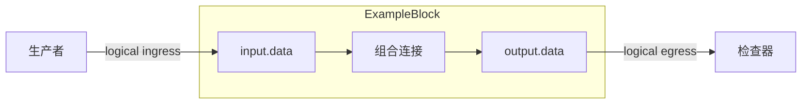

# 设计文档写作

香山与通用工作流使用同一文档契约。输入准备分别见 Guide_Doc/xiangshan-input-guide.md 和 Guide_Doc/generic-generation-guide.md；本阶段只负责从当前证据生成设计文档与质量报告。

## 必须交付

- `{OUT}/{DUT}_design_document_zh.md`：按 Guide_Doc/chip_design_document_template_zh.md 的固定标题顺序写作，P-* 和 CASE-* 只在指定位置重复。
- `{OUT}/{DUT}_document_quality_review.md`：记录输入证据、实际复核发现、使用的源文件与开放项。最终检查结果由 finalize 自动写入，不预先声明工具通过。

`{OUT}` 是当前阶段给出的输出目录。示例使用 `outputs`，实际使用时替换为本次目录。只使用当前 manifest 对应的配置和源码；源文件存在不代表已编译、仿真或证明。

## 写作与验收约束

1. 正文从职责、边界、事务与资源解释 DUT；用逻辑接口名和 P-/E-/CK-/OPEN-* 引用。逻辑 `clock`、`reset` 不自动代表同名 RTL 端口。
2. 将工具生成的 `{OUT}/evidence/ports.md` 表格复制到附录 A，补全 TODO 逻辑分组与协议；每个精确端口必须唯一出现，方向/位宽须与 ports.csv 完全一致。不得用通配符、逻辑别名或端口组代替精确映射。无端口模块保留表头并说明没有端口。
3. 每个 P-* 写明激励、处理、输出/状态、时延/顺序、边界/恢复和配置裁剪。没有某项能力时说明不适用的源码依据。
4. 对有缓冲的路径分别描述入口接受、缓冲出队、目标接受、响应进入缓冲和响应被原请求方消费。未命中目标不必然阻止入口接受；以实际 ready/valid 和容量条件为准。
5. 核查空/满状态、同周期入出队和旁路；核查路由控制是随请求锁存还是实时输入。明确哪些性质由 RTL 保证，哪些依赖输入稳定、区域互斥、公平性或合法响应等环境假设。
6. Testplan 每行关联 FC、CK、P-*、激励、可观察结果和关闭条件。Coverage 的采样事件须与分箱相容：完成分箱按握手采样，等待、饥饿或空选择分箱按其有效等待条件采样，不能要求这些分箱发生完成握手。仅在对应检查通过时计入覆盖。
7. 相关源码结论引用 manifest 中的 E-REL-*，在附录 C 定义相应源路径、行范围和该文件自己的摘要；顶层 RTL 摘要不能代替相关源码摘要。
8. 未运行的综合、仿真、回归、断言编译、formal 和 coverage 保持 Unrun/Open。不能把结构检查或复核记录称为功能签核。
9. 保留每个 Markdown 标题前后空行；删除模板 HTML 说明、方括号占位符和 TODO/TBD。仅保留工具生成的 metadata、related-source 和 acceptance 标记。Mermaid 保存为闭合源码块，不生成图片。
10. 写完执行 metadata 或 generic_metadata。需要草稿诊断时用 validate 或 generic_validate；下一阶段按 Guide_Doc/source-review-guide.md 对照源码复核。

## 确定性验收规则

以下规则从草稿阶段开始适用于两种工作流。可判定的缺失或矛盾必须修复；工具不判断自然语言结论是否真实，也不要求为不存在的功能制造行为或测试。

- 每个 P-* 保留模板规定的七个加粗字段，各出现一次且有内容。无适用工作时写原因，例如“不适用：组合路径没有存储”；单独的 N/A、无、TODO/TBD 不能代替行为说明。证据字段引用 E-* 或明确的 OPEN-* 缺口。
- 使用模板中的表头、列顺序和完整单元格。普通文字可以自由组织，也可增加说明表；没有条目的开放项、参数、状态等表可保留表头并在附近解释。不能把说明表当成规范表的替代品。
- FG/FC 在“功能分组”定义；CK 在 Testplan 定义（每行一个，包括 Cover 检查）；P/CASE 在对应标题定义；COV、OPEN、E、IO、PARAM、STATE、CHANGE 在各自规范表定义。定义唯一，其他位置可以重复引用。OPEN 的状态为 Open、Closed 或 Deferred；复核的 open 项只能引用 Open/Deferred 条目。
- 一个 CK 可关联多个 FC/P/CASE/COV，多个端口可共享一个逻辑接口。附录 D 的 CK 行与 Testplan 中的 FC、CASE、COV 集合一致；FC 行的 FG 与功能分组一致，P 与关联检查的行为集合一致。Testplan 行号从 1 开始，可写 `1,3-5`。场景表列出的 FC/CK 不能与计划矛盾。每个 P 至少进入一个检查，或引用说明规划缺口的 OPEN-*；不强制每个行为都具有恢复场景、formal 属性或独立覆盖项。
- 逻辑接口在“数据与控制通路”表中唯一命名，附录 A 引用该名字并保留精确端口。源位置使用行号从 1 开始的 `工作区相对路径:起行-止行`，或 Markdown 链接（链接目标相对当前文档，形式为 `相对路径#L3-L5`）；单行可省略止行。位置必须存在于当前输入证据中。端口位置须包含 ports 骨架定位的声明；允许引用等价的原始输入、捕获 RTL 或预处理视图。
- 不保留模板占位符或 TODO/TBD。真实 RTL 下标（如 `data[7:0]`）、代码示例和合理的不适用说明不会因为包含括号或 N/A 而被拒绝。
- 本工作流没有运行仿真、formal、综合或覆盖统计。Coverage 状态使用 Planned、Unrun、Open、Blocked 或 NotApplicable；属性/CK 实现状态使用 Planned、Implemented、Unrun、Blocked 或 NotApplicable，签核使用 OPEN、Blocked 或 NotApplicable。NotApplicable 必须有相邻的适用性说明；Implemented 仅表示已写实现，不表示已编译或通过。正式属性类型为 Assume、Assert 或 Cover。
- 设计文档保留全部签核行。Formal / assertion 和 Regression / coverage 使用 Unrun、Open、Blocked、Planned 或有说明的 NotApplicable。I/O mapping、Testplan 等文档检查可以 Pass；文档状态可为 Draft、Review、Frozen，但 Frozen 不代表硬件验证完成。质量报告若重复记录状态，使用 `项目 | 状态 | 依据`（英文可用 `Item | Status | Evidence`）表，并与设计文档一致。Proved、Covered、验证 Pass/Closed 等声明不能由自述文字或文件名证明。

源码语义复核仍需检查接受条件、背压、复位、配置和环境假设是否被正确解释；上述规则不证明 RTL 无 Bug。

## 完整设计文档示例

下面是单纯组合转发的教学示例。输入 RTL 如下；摘要与配置值仅用于展示布局，实际值必须由当前证据和 metadata 提供。不可将本例的行为或摘要复制为 DUT 事实。

```verilog
module ExampleBlock (
  input clock,
  input reset,
  input [7:0] io_data,
  output [7:0] io_result
);
assign io_result = io_data;
endmodule
```

````markdown

# ExampleBlock 设计与功能检测点文档

> 模板结构版本：v6.0.0

## 文档摘要


**模块职责**

ExampleBlock 将输入数据组合转发到结果端口，不包含状态、握手或恢复事务。

**输入与生产者**

- `input.data`：由测试激励提供，用于传递数据。
- `control.clock`、`control.reset`：由测试控制提供；此实现保留这两个输入但不使用它们。

**输出与消费者**

- `output.data`：由检查器接收，与当前输入数据比较。

**关键概念**

- **组合转发**：输入值直接连接到输出值。
- **直连路径**：输入值直接连接到输出值。

**关键延迟与容量**

- 典型时延：组合路径，零拍。
- 吞吐与容量：无握手、队列或时钟采样吞吐定义；输出连续跟随输入。

**验证范围**

覆盖组合转发、全零/全一边界；未执行形式化和覆盖率工具。

**开放项**

OPEN-FORMAL-01：未运行形式化工具。

## 设计概览

### 职责与边界

DUT 只负责组合转发；输入和输出均为逻辑数据接口，边界外的复位、时钟和验证环境不参与该路径。P-FORWARD、E-RTL-01。

### 事务模型


1. **产生**：测试激励稳定 input.data。
2. **接受**：模块无 ready/valid，输入值改变即进入组合路径。
3. **处理**：input.data 直接经过组合连接。
4. **完成**：检查器采样 output.data。
5. **取消与恢复**：无 flush、replay、cancel、error 或状态资源，故无存活或取消事务。

### 数据与控制通路


| 逻辑接口 | 生产者 / 消费者 | 方向 | 事务阶段 | 有效与背压约束 |
| --- | --- | --- | --- | --- |
| `input.data` | 测试激励 / DUT | 输入 | 连续观察 | 无握手；组合值稳定 |
| `output.data` | DUT / 检查器 | 输出 | 组合输出 | 无握手；组合值稳定 |
| `control.clock` | 测试控制 / DUT | 控制 | 不适用 | 未使用，无采样边沿 |
| `control.reset` | 测试控制 / DUT | 控制 | 不适用 | 无状态 |

input.data 通过组合路径到达 output.data；没有控制、错误或取消路径。P-FORWARD。

### 关键资源与冲突

| 资源 | 类型 / 容量 | 写入 / 产生 | 读取 / 消费 | 冲突 / 优先级 | 观测点 |
| --- | --- | --- | --- | --- | --- |
| 无 | `none` | 不适用 | 不适用 | 不适用 | `input.data` / `output.data` |

### 时序与状态

组合路径无寄存器和显式状态机；复位与时钟未参与数据路径，状态机不适用。E-RTL-01。



## 功能行为


### P-FORWARD：组合转发

当前输入值连续传递到输出。该路径没有请求接收或事务完成握手。

**激励条件**：生产者改变 input.data，并在检查器采样前保持稳定。

**处理过程**：连续赋值直接连接输入与输出，不锁存数据。

**输出与状态结果**：组合传播稳定后 output.data 等于 input.data；没有内部状态。

**时延与顺序**：零个寄存器周期；仿真需等待组合传播稳定，不在驱动发生的同一调度事件中比较。

**边界与恢复**：全零与全一都直接转发；改变 control.reset 不清零或屏蔽输出。无恢复、取消或背压状态。

**配置裁剪**：无可覆盖参数和条件编译分支，当前数据宽度固定为 8 位。

**证据**：E-RTL-01。完整位置见附录 C。

## 验证策略与 Testplan

### 验证策略

用已知输入值验证组合等值关系；覆盖全零、全一和代表性的中间值。复位切换时仍检查等值关系，不制造不存在的恢复事务。

**优先级原则**

- `P0`：组合等值检查及输入有效性约束。
- `P1`：全零/全一边界及复位不影响路径的检查。
- `P2`：补充随机已知值，提高数据取值覆盖。

### 验证架构与采样点

| 组件 | 责任 | 输入 / 输出 | 采样点或工件 |
| --- | --- | --- | --- |
| `stimulus` | 产生合法和边界值 | `input.data` | 输入值 |
| `monitor` | 采集组合输出 | `output.data` | 输出值 |
| `checker` | 比较输入和输出 | 输入 / 输出 | 等值检查 |
| `formal harness` | 不适用 | N/A | 未执行 |

### 功能分组

`<FG-API>`

- FC-INPUT-CONTRACT：采样前输入为稳定的已知 8 位数据。

`<FG-CORE>`

- FC-BEHAVIOR：组合输出始终与稳定输入一致。

`<FG-RECOVERY>`

- FC-RECOVERY：确认复位未参与数据路径，没有取消或恢复事务。

### Testplan


| 优先级 | FC | CK | Style | 关联行为 | 检查机制 | 激励 / 前置条件 | 可观察结果 | Coverage / 场景 | 关闭标准 |
| --- | --- | --- | --- | --- | --- | --- | --- | --- | --- |
| P0 | `FC-INPUT-CONTRACT` | `CK-API-INPUT` | Assume | `P-FORWARD` | Assertion | 输入为已知 8 位值 | output.data | `COV-NORMAL` / `CASE-NORMAL` | 测试通过 |
| P0 | `FC-BEHAVIOR` | `CK-EVENT-RESULT` | Seq | `P-FORWARD` | Scoreboard | 输入变化 | 输出等于输入 | `COV-NORMAL` / `CASE-NORMAL` | 测试通过 |
| P1 | `FC-RECOVERY` | `CK-RECOVERY` | Seq | `P-FORWARD` | Scoreboard | 保持非零输入并切换复位 | 输出仍等于输入 | `COV-RECOVERY` / `CASE-RECOVERY` | 两种复位电平下等值检查通过 |
| P1 | `FC-BEHAVIOR` | `CK-COVER-BOUNDARY` | Cover | `P-FORWARD` | Coverage | 驱动全零和全一数据 | 稳定输出与输入一致 | `COV-BOUNDARY` / `CASE-BOUNDARY` | 两个边界分箱在等值检查通过后命中 |

### Coverage Summary

| Coverage ID | 目标行为 | 观察事件 | 重要取值 / 分箱 | 依赖 / 交叉 | 非法 / 忽略条件 | 有效性保护 | 关闭标准 | 状态 |
| --- | --- | --- | --- | --- | --- | --- | --- | --- |
| `COV-NORMAL` | 正常组合路径 | 组合稳定后的等值检查 | 0x55、0xaa | 输入取值 | 未知输入不采样 | 等值检查通过 | 两个代表值均命中 | Planned |
| `COV-BOUNDARY` | 全零/全一边界 | 组合稳定后的等值检查 | 0x00、0xff | 输入 x 输出 | 未知输入不采样 | 等值检查通过 | 两个边界值均命中 | Planned |
| `COV-RECOVERY` | 复位不影响转发 | 复位切换后组合稳定 | reset=0、reset=1 | 复位电平 x 非零输入 | 未知输入不采样 | 等值检查通过 | 两种复位电平均命中 | Planned |

## 形式化属性契约

### 契约边界与执行条件

| 项目 | 约束或定义 | 依据 / 状态 |
| --- | --- | --- |
| 时钟与复位 | 时钟和复位输入均未用于数据路径 | `E-RTL-01` |
| X 态与未知值 | 仅采样已知输入 | `OPEN-FORMAL-01` |
| 公平性与等待界限 | 不适用，无仲裁 | `E-RTL-01` |
| Harness 边界 | 组合输入到输出 | `E-RTL-01` |

### 属性实现状态

| CK | 类型 | 契约 | 当前实现 | 属性状态 | 签核状态 |
| --- | --- | --- | --- | --- | --- |
| `CK-API-INPUT` | Assume | 输入为已知值 | 未实现 | Planned | OPEN |
| `CK-EVENT-RESULT` | Assert | 输出等于输入 | 未实现 | Planned | OPEN |
| `CK-RECOVERY` | Assert | 复位任意电平下输出等于输入 | 未实现 | Planned | OPEN |
| `CK-COVER-BOUNDARY` | Cover | 边界值可达 | 未实现 | Planned | OPEN |

### Assume

CK-API-INPUT：比较时输入不含 X/Z。仿真驱动需给组合逻辑稳定的时间；形式化检查使用组合约束，无公平性假设。

### Assert

CK-EVENT-RESULT：已知输入条件下输出等于当前输入。CK-RECOVERY：复位保持任意电平时该关系仍成立，不依赖复位历史。属性尚未实现或运行。

### Cover

CK-COVER-BOUNDARY：在组合等值关系成立时分别到达全零和全一输入。此处仅定义目标，尚无覆盖结果。

## Sign-off 与开放项

### 开放项

| ID | 缺口或问题 | 影响 | 关闭动作与所需证据 | 状态 |
| --- | --- | --- | --- | --- |
| `OPEN-FORMAL-01` | 未运行形式化工具 | Formal / assertion | 编译并运行属性，保存工件 | Open |

### 签核状态

| 项目 | 状态 | 依据 |
| --- | --- | --- |
| I/O mapping | Pass | `E-RTL-01` |
| Testplan | Review | `FC-BEHAVIOR` |
| Formal / assertion | Unrun | `OPEN-FORMAL-01` |
| Regression / coverage | Unrun | `OPEN-FORMAL-01` |
| 当前文档状态 | Draft | `OPEN-FORMAL-01` |

## 附录 A：I/O 定义与接口约束


| IO-ID | 正文逻辑接口 | 源字段 / 端口分组 | 定义位置 | 方向 / 位宽 | 配置状态 | 精确 RTL I/O | 协议 / 对端 | 证据 |
| --- | --- | --- | --- | --- | --- | --- | --- | --- |
| `IO-CLOCK` | `control.clock` | 控制 | `outputs/evidence/ExampleBlock.sv:2` | `I/1` | Generated | `clock` | 未使用，无采样边沿要求 | `E-RTL-01` |
| `IO-RESET` | `control.reset` | 控制 | `outputs/evidence/ExampleBlock.sv:3` | `I/1` | Generated | `reset` | 未使用，无有效极性要求 | `E-RTL-01` |
| `IO-INPUT-01` | `input.data` | 数据 | `outputs/evidence/ExampleBlock.sv:4` | `I/8` | Generated | `io_data` | 连续输入，无握手 | `E-RTL-01` |
| `IO-OUTPUT-01` | `output.data` | 数据 | `outputs/evidence/ExampleBlock.sv:5` | `O/8` | Generated | `io_result` | 连续输出，无背压 | `E-RTL-01` |

端口表覆盖当前 RTL 的全部四个端口，没有额外状态或错误接口。

## 附录 B：参数、编码、状态与复位

### 参数与配置

| 参数 ID | 参数 / 派生常量 | 配置值 | 约束或裁剪 | 证据 |
| --- | --- | --- | --- | --- |
| `PARAM-01` | 数据宽度 | `8` | 声明常量，不是可覆盖参数 | `E-RTL-01` |

### 编码、状态与复位

| 状态/编码 ID | 名称或编码 | 进入条件 | 退出条件 | reset 值 / 复位行为 | 证据 |
| --- | --- | --- | --- | --- | --- |
| `STATE-01` | `无状态` | `输入有效` | `输入有效` | `未使用` | `E-RTL-01` |

没有寄存器、编码字段或可配置裁剪；复位电平不改变输出关系。

## 附录 C：范围、文档控制、证据与版本变更

### 范围与文档控制

| 项目 | 内容 |
| --- | --- |
| 使用模板版本 | v6.0.0 |
| DUT / 顶层模块 | `ExampleBlock` |
| Elaborated RTL 顶层 | `ExampleBlock` |
| 文档状态 | Draft |
| RTL/source 基线 | `fixture-commit` |
| 适用配置 | `DefaultConfig` |
| RTL 生成状态 | `success` |
| RTL 证据 | `outputs/evidence/manifest.json；4 ports` |
| Mermaid 图形源码 | `1` |
| 生成日期 | `2026-09-23` |

| 范围或条件 | 裁定 | 理由 / 证据 |
| --- | --- | --- |
| DUT 边界 | `ExampleBlock 组合路径` | `无内部状态` |
| 相关模块源码 | `无` | `无相关源码` |
| 未覆盖验证 | `形式化和覆盖率` | `N/A` |
| 特性门控 | `not applicable` | `无内部状态` |

### 证据与版本变更


| Evidence ID | 类型 | 来源位置 | Commit / 配置 | 支持内容 |
| --- | --- | --- | --- | --- |
| `E-RTL-01` | RTL/ports | `outputs/evidence/ExampleBlock.sv:1` | `fixture/DefaultConfig` | `组合转发` |

| 版本变更 ID | 变更类型 | 本次变更 | 影响范围 | 依据 |
| --- | --- | --- | --- | --- |
| `CHANGE-01` | Initial | `初始文档` | `全部章节` | `E-RTL-01 / OPEN-FORMAL-01` |

## 附录 D：CK 追溯矩阵

### 功能组与 FC

| FC | 所属 FG | 验证目标 | 关联行为 | Testplan 行 |
| --- | --- | --- | --- | --- |
| `FC-INPUT-CONTRACT` | `FG-API` | 已知且稳定的输入 | `P-FORWARD` | 1 |
| `FC-BEHAVIOR` | `FG-CORE` | 组合等值 | `P-FORWARD` | 2,4 |
| `FC-RECOVERY` | `FG-RECOVERY` | 复位不影响等值 | `P-FORWARD` | 3 |

### CK 追溯

| CK | FC | 检查目标 | Style | 属性状态 | Test Case | Coverage | 签核状态 |
| --- | --- | --- | --- | --- | --- | --- | --- |
| `CK-API-INPUT` | `FC-INPUT-CONTRACT` | 数据一致 | Assume | Planned | `CASE-NORMAL` | `COV-NORMAL` | OPEN |
| `CK-EVENT-RESULT` | `FC-BEHAVIOR` | 数据一致 | Assert/Seq | Planned | `CASE-NORMAL` | `COV-NORMAL` | OPEN |
| `CK-RECOVERY` | `FC-RECOVERY` | 数据一致 | Assert/Seq | Planned | `CASE-RECOVERY` | `COV-RECOVERY` | OPEN |
| `CK-COVER-BOUNDARY` | `FC-BEHAVIOR` | 全零和全一可达 | Cover | Planned | `CASE-BOUNDARY` | `COV-BOUNDARY` | OPEN |

## 附录 E：场景视角 Test Case


### CASE-NORMAL：转发数据

| 参与者 | 前置条件 | 输入 | 预期输出 | 关联 FC / CK |
| --- | --- | --- | --- | --- |
| 生产者、DUT、检查器 | 组合路径稳定 | `input.data` | `output.data` 等于输入 | `FC-BEHAVIOR`, `CK-EVENT-RESULT` |

**参与者与前置条件**：生产者驱动已知数据；检查器等待组合传播稳定后采样。

1. 产生合法 input.data。
2. 组合路径稳定。
3. 观察 output.data。

**验收标准**：output.data 等于 input.data；引用 P-FORWARD、CK-EVENT-RESULT、COV-NORMAL。

### CASE-BOUNDARY：取值边界

| 参与者 | 前置条件 | 输入 | 预期输出 | 关联 FC / CK |
| --- | --- | --- | --- | --- |
| 生产者、DUT、检查器 | 输入可取全零和全一 | `0x00`, `0xff` | 输出保持等值 | `FC-BEHAVIOR`, `CK-COVER-BOUNDARY` |

**参与者与前置条件**：输入取全零和全一。

1. 施加边界值。
2. 观察输出一致。

**验收标准**：输出与输入一致；引用 P-FORWARD、CK-COVER-BOUNDARY、COV-BOUNDARY。

### CASE-RECOVERY：恢复适用性

| 参与者 | 前置条件 | 输入 | 预期输出 | 关联 FC / CK |
| --- | --- | --- | --- | --- |
| 生产者、DUT、检查器 | 输入稳定为非零值 | 切换 control.reset | 输出保持等于输入 | `FC-RECOVERY`, `CK-RECOVERY` |

**参与者与前置条件**：该组合模块没有恢复资源；本场景只检查复位不影响组合路径。

1. 保持 input.data 为 0x55。
2. 分别驱动 control.reset 为 0 和 1，等待组合传播稳定。
3. 两次均比较 output.data 与 input.data。

**验收标准**：两种电平均保持等值；引用 P-FORWARD、CK-RECOVERY、COV-RECOVERY。


### CASE-EXTRA：其他场景

| 参与者 | 前置条件 | 输入 | 预期输出 | 关联 FC / CK |
| --- | --- | --- | --- | --- |
| N/A | 无额外场景 | N/A | N/A | N/A |

无额外场景。

````
